<p align="center">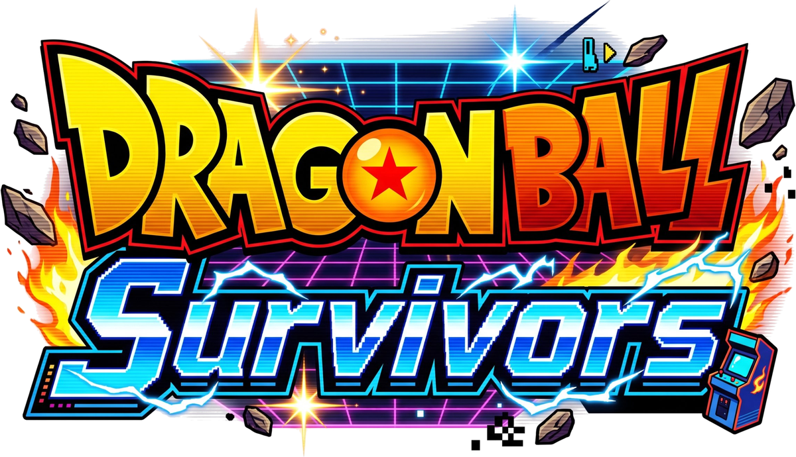</p>

# Dragon Ball: Survivors

> 🇮🇹 Versione italiana: [README.md](README.md)

A *Vampire Survivors*-style survivor-like inspired by Dragon Ball: you move, the weapons fire on their own, you collect experience, level up, transform and survive until the final boss. It runs in the browser, on PC and phone, as **a single HTML file** (Canvas 2D and plain JavaScript, no dependencies).

> ⚠️ Unofficial, non-profit fan project. Not affiliated with Toei Animation, Shueisha, Bandai Namco or the heirs of Akira Toriyama. See [DISCLAIMER.md](DISCLAIMER.md).

<p align="center">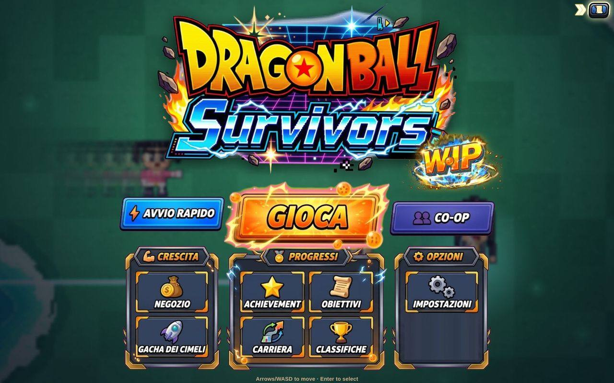<br><sub>Menu</sub></p>

## Contents

1. [How to play](#how-to-play)
2. [Controls](#controls)
3. [Game modes](#game-modes)
4. [In a run](#in-a-run)
5. [Characters, weapons and transformations](#characters-weapons-and-transformations)
6. [Trinkets and Gacha](#trinkets-and-gacha)
7. [Stages, enemies and bosses](#stages-enemies-and-bosses)
8. [Permanent progression](#permanent-progression)
9. [Online and co-op](#online-and-co-op)
10. [Screens and options](#screens-and-options)
11. [Graphics and character sprites](#graphics-and-character-sprites)
12. [Build and development](#build-and-development)
13. [Project layout](#project-layout)
14. [License and credits](#license-and-credits)

---

## How to play

1. From the menu pick **Play** (or **Quick start**), then the stage, the character, the **companion** and how many weapons to bring (1 to 5).
2. You move; **the weapons attack on their own**. With `Tab` you choose who to hit (closest, most or least Health, the boss).
3. Enemies drop **experience gems**: collect them to level up and pick a card (weapon, upgrade, etc.).
4. At the right levels you **transform** (Super Saiyan, Ultra Instinct…): each form gives bonuses for the rest of the run.
5. Survive **30 minutes**, then defeat the stage's **final boss**. You get 30 seconds to collect the loot before the victory screen.
6. If you die you still keep the zenny you earned. **Zenny** buys permanent upgrades in the Shop, characters and Gacha tickets.

<table><tr><td width="50%">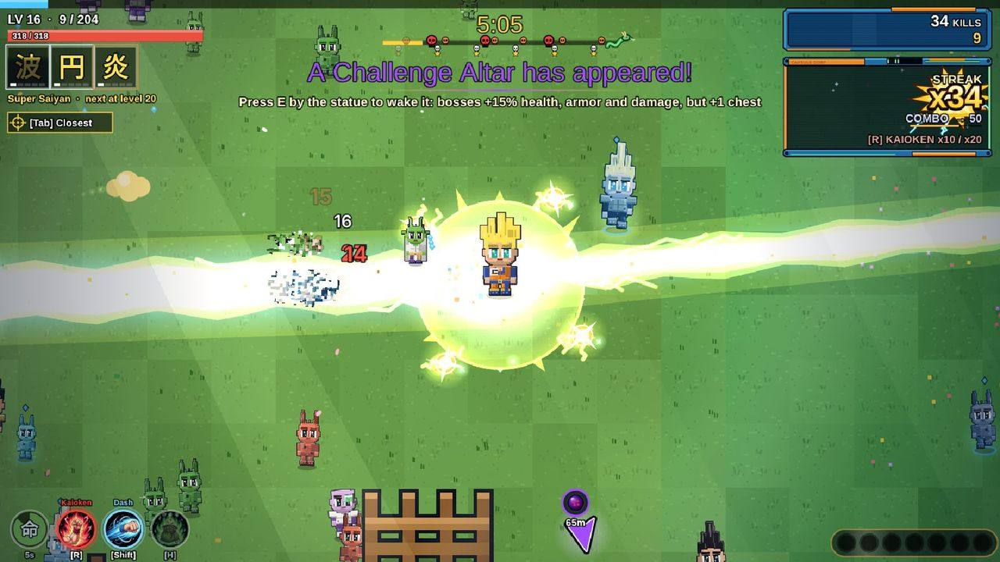<br><sub>A run: automatic weapons, combos and kill Streaks</sub></td><td width="50%">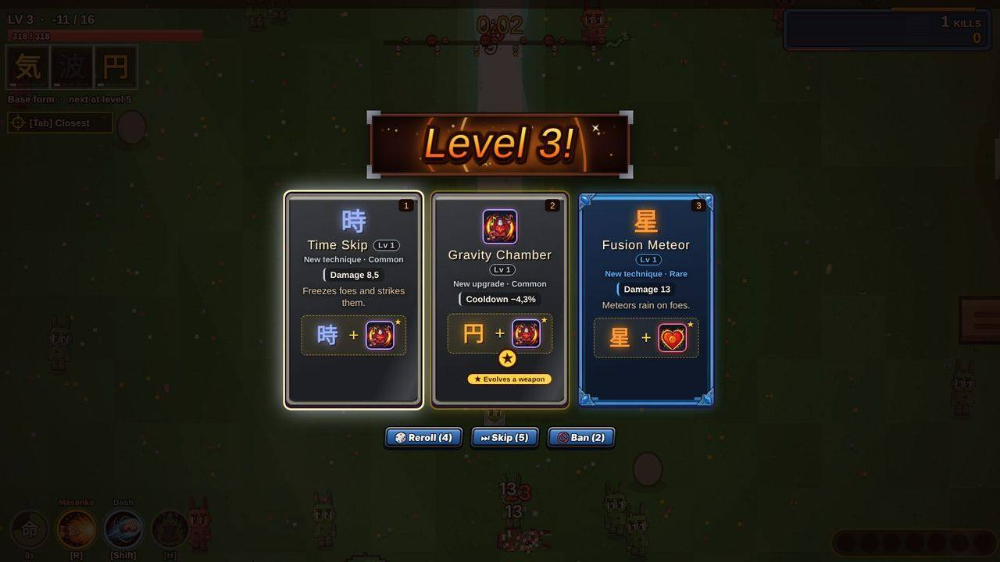<br><sub>Level-up: three cards, with Reroll, Skip and Ban</sub></td></tr></table>

## Controls

### Keyboard and mouse

| Action | Keys |
|---|---|
| Move | `W` `A` `S` `D` / arrow keys |
| Character ability (Kaioken, Berserk, beams, clones, time stop…) | `R` or `X` |
| Dash (damages what it crosses, brief invulnerability) | `Shift` |
| Senzu Bean (heals 50% and gives a stat bonus, from the bag) | `H` |
| Companion ability | `Q` |
| Interact (altars, totems, chests, Swap Machine, Hyperbolic Time Chamber…) | `E` or `F` |
| Change weapon target | `Tab` |
| Pause (map, stats, event log, settings) | `Esc` or `P` |
| Pick a card in choice windows | `1`–`9` (`0` = the tenth) |
| Press the highlighted button / leave the Hyperbolic Time Chamber | `Space` |
| Confirm / back in menus | `Enter` or `Space` / `Esc` or `⌫` |
| Camera zoom | mouse wheel (50–150%, in steps of 10%) |
| FPS counter and diagnostics | `F2` or `` ` `` |

The **Kamehameha** is charged by holding the ability key. Every key can be rebound in **Settings → Controls**.

### Gamepad

| Action | Button |
|---|---|
| Move / menus | D-pad |
| Confirm / interact | A |
| Back | B |
| Companion ability | X |
| Character ability | Y |
| Senzu Bean | LB |
| Dash | RB |
| Change target | left stick click |
| Pause | Start |
| Diagnostics | Select |

### Phone and tablet

On-screen virtual joystick and large buttons with the icons for **ability**, **Dash**, **Senzu Bean**, **companion** and **Interact** (`E`). The interface shrinks to leave more of the field visible, and the pause map can be dragged with a finger.


<p align="center">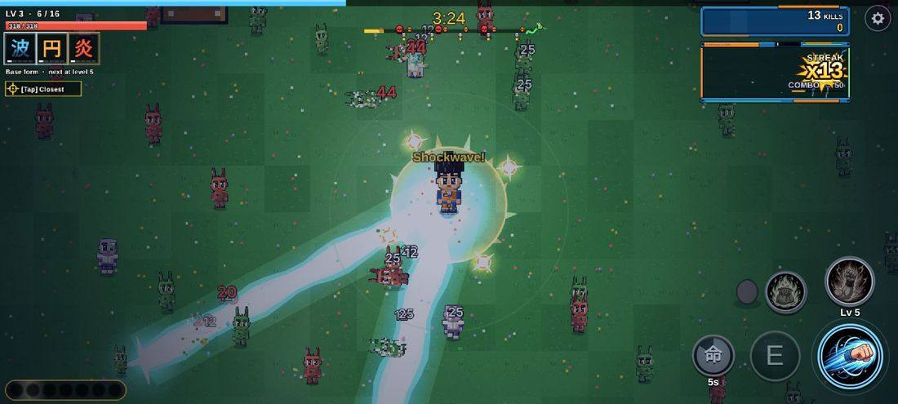<br><sub>On phone: touch buttons</sub></p>

---

## Game modes

| Mode | How it works |
|---|---|
| **Classic** | A 30-minute run per stage that ends with the final boss. A single difficulty: the challenge grows with time (more enemies from minute 3, stronger every 5 minutes, minibosses and elites). |
| **x2** | Unlocks by reaching a stage's final boss: the run lasts half as long, experience is reduced and enemies are tougher. No zenny multiplier. |
| **Endless** | Unlocks by winning the stage ("Continue"): weapons climb to Lv 100, cooldown can drop to 0.2 s, Zeno-sama's shop shows up every 5 minutes and every 50 levels you get 100 coins while enemies keep getting stronger. From the pause menu you set priorities and auto-pick for upgrades. |
| **Quick start** | Starts right away with the last character and stage used. |
| **Weekly challenge** | Same stage, character and seed for everyone for a week: the leaderboard's first place comes back at you as a ghost. |
| **Co-op** | Up to 4 players in the same world (BETA). See [Online and co-op](#online-and-co-op). |

---

## In a run

### Combat
- **Automatic attack**: every weapon behaves differently (projectiles, beams, orbits, fire zones, chain lightning, meteors…). Hits feel heavy: arcade damage numbers (red for crits), combos, a kill **Streak** with a bar and tiers (50, 100, 200, 500).
- **Weaknesses**: every boss has one. Some enemy attacks can be destroyed.
- **Ki Clash**, **Last breath**, allies that come to help, boss and transformation cutscenes (the camera tightens and everything stops until the aura bursts).
- **Level-up**: besides the cards you can use **Reroll**, **Skip** and **Ban** (Shop tools) and automatic level-up with your priorities (Settings).

<table><tr><td width="50%">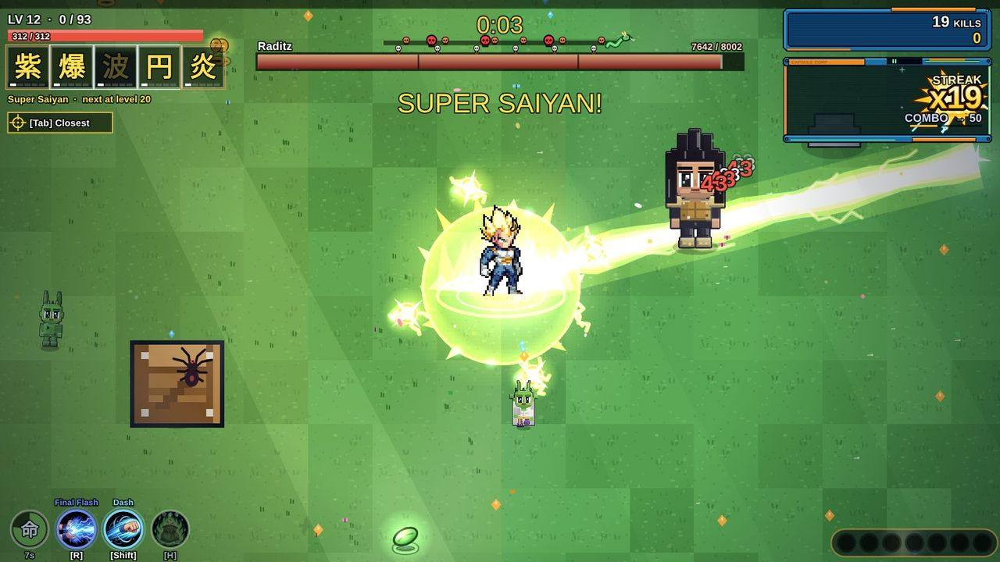<br><sub>A boss with its bar and weakness</sub></td><td width="50%">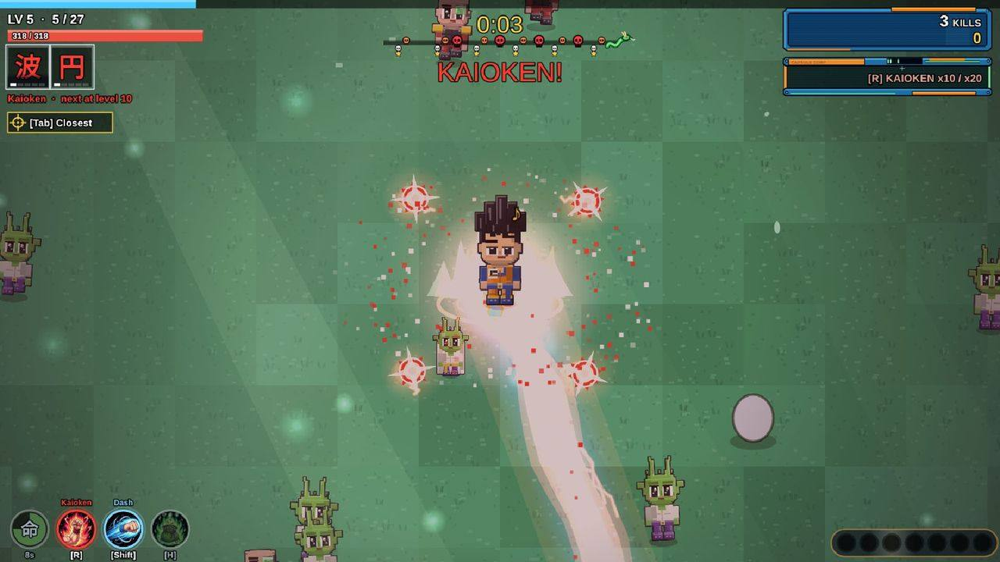<br><sub>Transformation: the camera tightens as the aura bursts</sub></td></tr></table>

### What you find on the map
Every run has a different, living map (weather, day/night, animated sea and lava, creatures, breakable objects).

| Element | What it does |
|---|---|
| **Chests** | One per boss and a supply chest every 5 minutes, in five rarities, with upgrades and trinkets. |
| **Zenny and items** | Coins, zenny bags, hearts, magnet, temporary power-ups, experience, Luck. Loot spots show up more often with extra loot. |
| **Dragon Balls** | Collect 7 to summon **Shenron** (4 wishes offered among second life, power, luck, tickets, immortality, transformation, legend). The 3 **Super Balls** guarded by the Tamagami call **Porunga**. |
| **Altars and springs** | Power Altar, healing Spring, Sacrifice Altar, Experience Fountain, Coin Stash, Challenge Altars (stronger bosses in exchange for more chests). Used with `E`. |
| **Totems** | 8 powers: Fortune, Risk, Vitality, Fury, Wealth, Guardian, Storm, Spirit. |
| **Hyperbolic Time Chamber** | Buy the next form in advance (with at least 70% of the required level) and face a Master who mimics your weapons. |
| **Swap Machine** | Shows up in about 12% of runs: put up to 3 trinkets in, it works for ~10 seconds **while you play** (progress bar above it) and gives back different trinkets of the same rarity, with equal or better perfection. |
| **Tunnel** | One shows up every 15 minutes: a one-way tunnel with a boss at the end and 3 chests. |
| **Zeno Portal** | Zeno-sama's shop. |
| **Surprise visits** | A character arrives with a 60-second mission; Training Circle, Capsule Corp, a golden Saibaman that runs off with the loot. |
| **Traps and healing zones** | Rare, but dangerous or precious. |
| **Themed events** | Each stage has an event in which enemies transform (announced in 6 languages). |
| **Hordes, elites, minibosses** | Themed hordes (the first at 2 minutes, then one every 5) led by an elite, a miniboss every 5 minutes, enemies that rank up. |

The pause map (large, zoomable) shows where the pickups are; arrows at the screen edges point to important items.

<table><tr><td width="50%">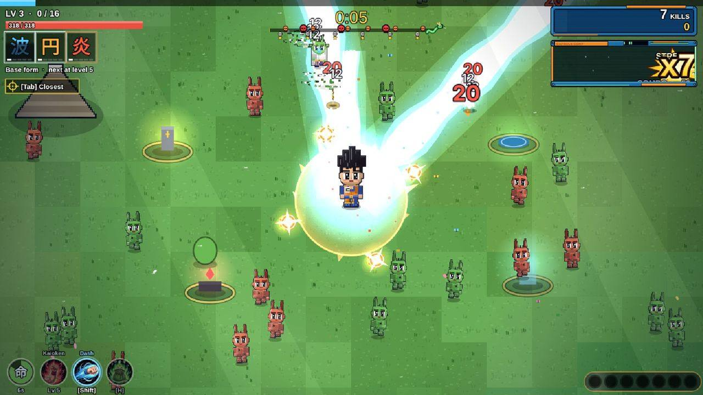<br><sub>Altars and springs on the map</sub></td><td width="50%">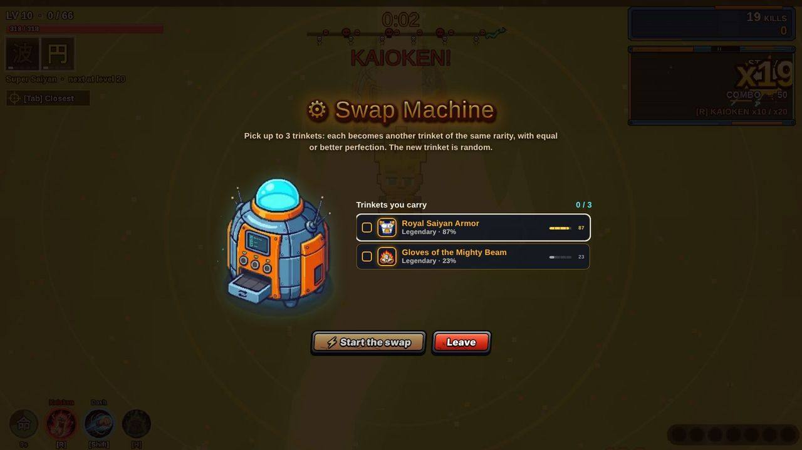<br><sub>Swap Machine</sub></td></tr></table>

<table><tr><td width="50%">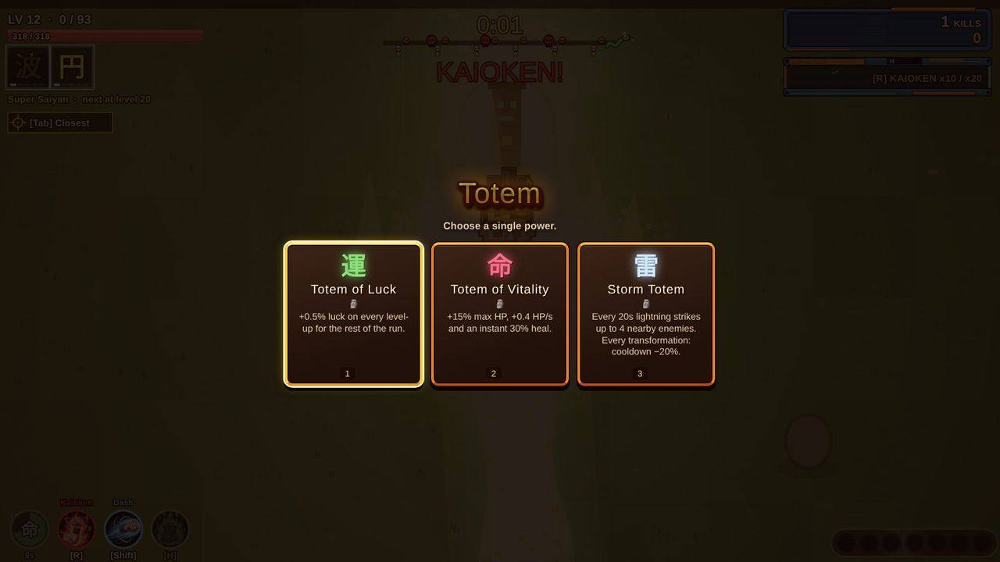<br><sub>Totem: choose a single power</sub></td><td width="50%">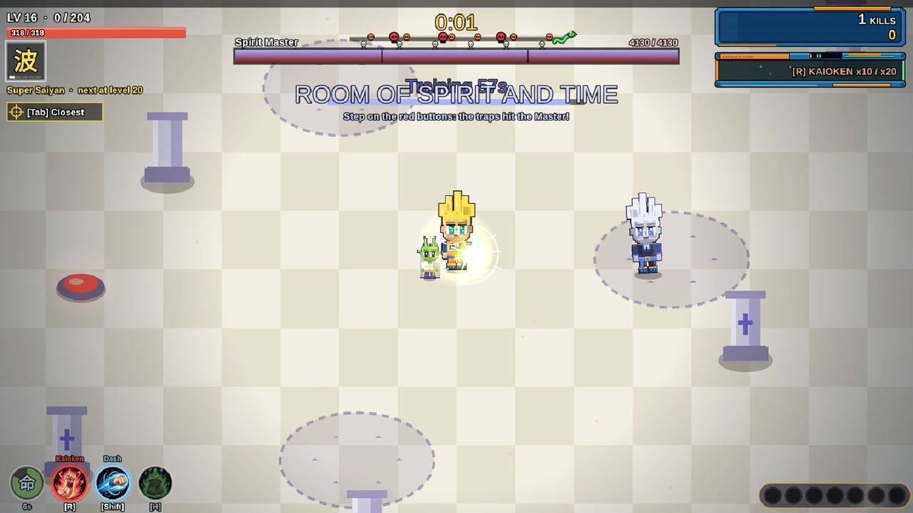<br><sub>Hyperbolic Time Chamber</sub></td></tr></table>

<table><tr><td width="50%">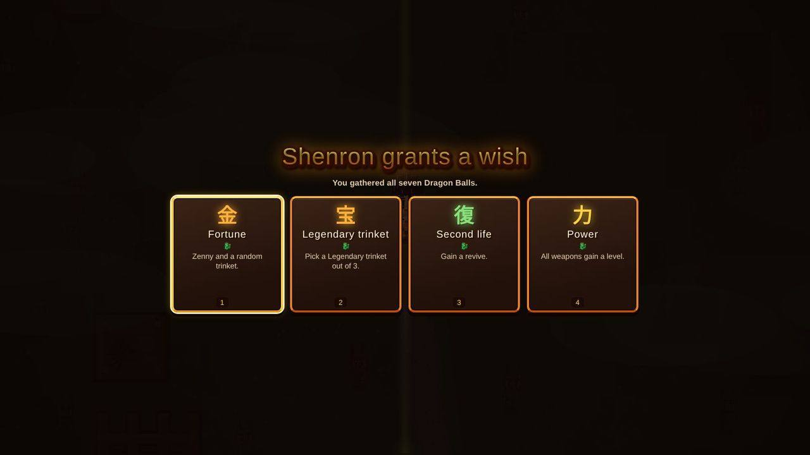<br><sub>Shenron grants a wish</sub></td><td width="50%">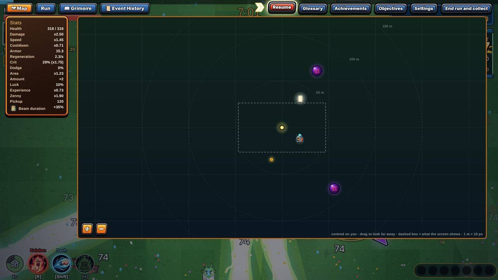<br><sub>Pause: map, stats and settings</sub></td></tr></table>

### Companions
They collect distant experience, have an ability (`Q`) and release a shockwave when you are surrounded.

| Companion | Race | Ability | cooldown |
|---|---|---|---|
| **Dende** | Namekian | **Healing** — Restore 30% of your HP. | 30 s |
| **Mini Shenron** | Dragon | **Magic Gather** — Pulls in XP gems within 400 px and grants an XP bonus equal to 5% of a level. | 40 s |
| **Mini Droid** | Android | **Energy Shield** — You are invulnerable for 1.5 seconds. | 40 s |
| **Bubbles** | Earth Animal | **Lucky Banana** — Three zenny coins on the ground and +2.5% luck for 50 seconds. | 36 s |
| **Mini Buu** | Majin | **Candy Beam** — Stuns enemies within 210 px for 1 second (0.4 on bosses). | 28 s |
| **Saibaman** | Saiyan (plant) | **Self-Destruct** — Explodes for area damage (160 px radius). | 22 s |

**Totems** (8 powers, you pick one):

| Totem | Effect |
|---|---|
| **Totem of Luck** | +0.5% luck on every level-up for the rest of the run. |
| **Totem of Risk** | XP x2, but you take 50% more damage for 3 minutes. |
| **Totem of Vitality** | +15% max HP, +0.4 HP/s and an instant 30% heal. |
| **Totem of Fury** | +12% damage, but cooldowns are 8% slower. |
| **Totem of Wealth** | +35% zenny and +25% pickup range for 150 seconds. |
| **Guardian Totem** | A barrier blocks one hit, then recharges every 25s. |
| **Storm Totem** | Every 20s lightning strikes up to 4 nearby enemies. Every transformation: cooldown −20%. |
| **Spirit Totem** | Every 20s a pulse heals 6% (up to 12% with transformations) and stuns nearby enemies. Every transformation: cooldown −20%. |

---

## Characters, weapons and transformations

### 58 playable characters
Each has starting weapons, stats, a **transformation line** (up to 8 forms, at levels 5, 10, 20, 30, 50, 70, 90 and 120, with painted auras) and a **unique ability** with an upgraded version in the final form.

<p align="center">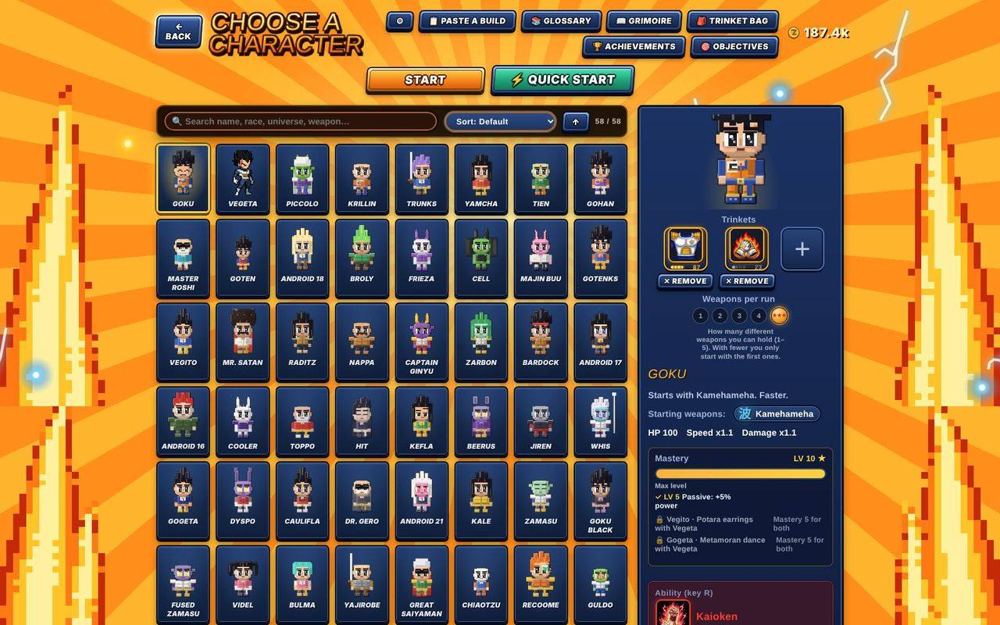<br><sub>Character select</sub></p>

<details>
<summary><b>All 58 characters</b></summary>

| | Name | Starts with | Ability | Health · Speed · Damage |
|---|---|---|---|---|
|  | **Goku** | Kamehameha | 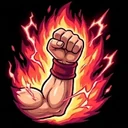 **Kaioken** — Kaioken x10 / x20: damage ×1.5 / ×2, but you lose 8 / 16 HP per second, +1.5 for every transformation reached. Press again to switch or stop. | 100 · ×1.1 · ×1.1 |
|  | **Vegeta** | Galick Gun, Big Bang Attack | 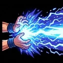 **Final Flash** — A powerful beam toward the nearest enemy: hits everything in line. | 95 · ×1 · ×1.2 |
|  | **Piccolo** | Hellzone Grenade | 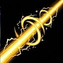 **Special Beam Cannon** — Charges for about 1 second, then fires an ultra-thin spiral beam that pierces every enemy in line: very high damage and a stun. | 125 · ×0.95 · ×1.1 |
|  | **Krillin** | Destructo Disc | 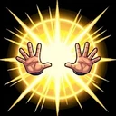 **Solar Flare** — Blinds and stuns nearby enemies for 1.7 seconds. | 105 · ×1 · ×1.3 |
|  | **Trunks** | Sword | 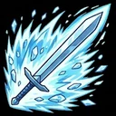 **Furious Slash** — A ki blast around you: area damage that pushes enemies back. | 100 · ×1.05 · ×1.1 |
|  | **Yamcha** | Homing Orbs | 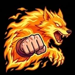 **Wolf Fang Fist** — A forward dash, invulnerable, that hits whoever you pass through. | 95 · ×1.05 · ×1 |
|  | **Tien** | Solar Flare, Ki Blast | 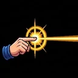 **Dodon Ray** — A powerful beam toward the nearest enemy: hits everything in line. | 100 · ×1 · ×0.97 |
|  | **Gohan** | Ki Blast | 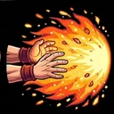 **Masenko** — A powerful beam toward the nearest enemy: hits everything in line. | 100 · ×1 · ×1 |
|  | **Master Roshi** | Kamehameha | 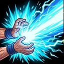 **Master's Kamehameha** — A powerful beam toward the nearest enemy: hits everything in line. | 90 · ×0.95 · ×1 |
|  | **Goten** | Homing Orbs | 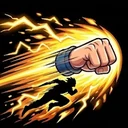 **Lightning Dash** — A forward dash, invulnerable, that hits whoever you pass through. | 95 · ×1.15 · ×1 |
|  | **Android 18** | Ki Blast | 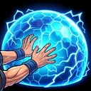 **Energy Barrier** — Barrier: invulnerable for 1.5 seconds. | 105 · ×1 · ×1 |
|  | **Broly** | Aura | 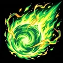 **Gigantic Meteor** — Hurls a green ki meteor at the nearest enemy: it rolls slowly forward as it grows, then explodes for huge damage. | 140 · ×0.9 · ×1.25 |
|  | **Frieza** | Piercing Beam | 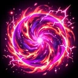 **Death Nova** — A ki blast around you: area damage that pushes enemies back. | 88 · ×1 · ×1.2 |
|  | **Cell** | Ki Blast | 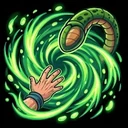 **Absorption** — Absorb energy from nearby enemies: damage and heal up to 12% HP. | 105 · ×1 · ×1.05 |
|  | **Majin Buu** | Aura, Spirit Bomb | 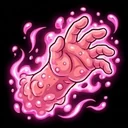 **Elastic Regeneration** — Regenerates 15% of your HP over 6 seconds. | 165 · ×0.85 · ×0.95 |
|  | **Gotenks** | Homing Orbs, Ki Blast | 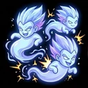 **Super Ghost Kamikaze** — Summons 3 ghosts that fly at the nearest enemy and copy your active weapons: they attack every 10 seconds (down to every 4 seconds as you level up) and explode when they expire. | 80 · ×1.15 · ×1.05 |
|  | **Vegito** | Ki Blast, Kamehameha | 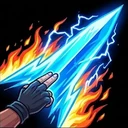 **Spirit Blade** — A powerful beam toward the nearest enemy: hits everything in line. | 95 · ×1.05 · ×1 |
|  | **Mr. Satan** | Dynamite Kick |  **Lucky Strike** — Coins, a small heal and a bit of luck for 30 seconds. | 90 · ×0.95 · ×0.95 |
|  | **Raditz** | Double Sunday | 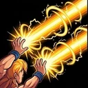 **Double Sunday** — A powerful beam toward the nearest enemy: hits everything in line. | 100 · ×1 · ×1.1 |
|  | **Nappa** | Break Cannon | 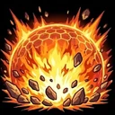 **Saiyan Blast** — A ki blast around you: area damage that pushes enemies back. | 130 · ×0.9 · ×1.15 |
|  | **Captain Ginyu** | Ginyu Boomerang | 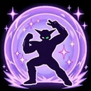 **Ginyu Pose** — Barrier: invulnerable for 1.5 seconds. | 105 · ×1 · ×1.05 |
|  | **Zarbon** | Elegant Dance | 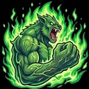 **Monster Zarbon** — Power-up for 8 seconds: damage +25%, speed +15%. | 95 · ×1.1 · ×1.05 |
|  | **Bardock** | Rebel Javelin | 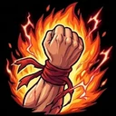 **Saiyan Revolt** — Power-up for 8 seconds: damage +30%. | 100 · ×1.05 · ×1.15 |
|  | **Android 17** | Destructo Disc | 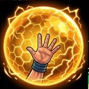 **Perfect Barrier** — Barrier: invulnerable for 1.5 seconds. | 105 · ×1.05 · ×1 |
|  | **Android 16** | Hellzone Grenade |  **Eye Cannon** — A powerful beam toward the nearest enemy: hits everything in line. | 150 · ×0.85 · ×1.15 |
|  | **Cooler** | Piercing Beam | 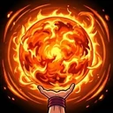 **Cooler Supernova** — A ki blast around you: area damage that pushes enemies back. | 92 · ×1 · ×1.2 |
|  | **Toppo** | Sphere of Destruction | 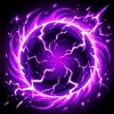 **Sphere of Justice** — Hurls a dark sphere at the nearest enemy: it grows, pulls nearby enemies in and then explodes for huge damage. | 135 · ×0.95 · ×1.25 |
|  | **Hit** | Time Skip | 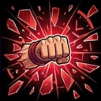 **Time Skip** — Stops time: enemies on screen are frozen for 1.8 seconds. | 90 · ×1.15 · ×1.1 |
|  | **Kefla** | Fusion Meteor | 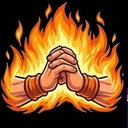 **Furious Fusion** — Power-up for 8 seconds: damage +30%, speed +10%. | 100 · ×1.1 · ×1.15 |
|  | **Beerus** | Aura, Sphere of Destruction | 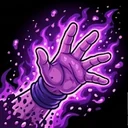 **Hakai** — Erases part of nearby enemies' HP (little on bosses). | 100 · ×1 · ×1.1 |
|  | **Jiren** | Power Impact, Aura | 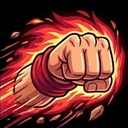 **Unstoppable Fist** — A forward dash, invulnerable, that hits whoever you pass through. | 125 · ×1 · ×1.3 |
|  | **Whis** | Angelic Bolt | 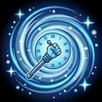 **Rewind** — Rewinds time: recover the HP you lost in the last 6 seconds. | 85 · ×1.2 · ×1 |
|  | **Gogeta** | Big Bang Kamehameha, Ki Blast | 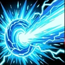 **Big Bang Kamehameha** — A powerful beam toward the nearest enemy: hits everything in line. | 100 · ×1.05 · ×1.2 |
|  | **Dyspo** | Dynamite Kick | 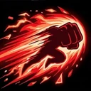 **Supreme Speed** — A forward dash, invulnerable, that hits whoever you pass through. | 80 · ×1.28 · ×1 |
|  | **Caulifla** | Ki Blast | 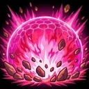 **Saiyan Wave** — A ki blast around you: area damage that pushes enemies back. | 95 · ×1.1 · ×1.15 |
|  | **Dr. Gero** | Double Sunday |  **Infinite Energy** — Regenerates 13% of your HP over 6 seconds. | 100 · ×0.88 · ×1.1 |
|  | **Android 21** | Ki Blast, Ginyu Boomerang |  **Insatiable Hunger** — Absorb energy from nearby enemies: damage and heal up to 12% HP. | 105 · ×1.05 · ×1.05 |
|  | **Kale** | Big Bang Kamehameha | 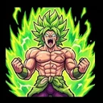 **Uncontrolled Fury** — Power-up for 8 seconds: damage +50% (you take +30% damage). | 125 · ×0.95 · ×1.25 |
|  | **Zamasu** | Sword, Angelic Bolt | 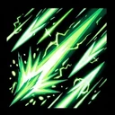 **Blade of Judgment** — A powerful beam toward the nearest enemy: hits everything in line. | 100 · ×1 · ×1.05 |
|  | **Goku Black** | Sword, Ki Blast | 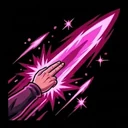 **Ki Blade Dash** — A forward dash, invulnerable, that hits whoever you pass through. | 95 · ×1.1 · ×1.2 |
|  | **Fused Zamasu** | Angelic Bolt, Fusion Meteor |  **Divine Judgment** — Erases part of nearby enemies' HP (little on bosses). | 130 · ×1 · ×1.25 |
|  | **Videl** | Dynamite Kick, Ki Blast |  **Flying Kick** — A forward dash, invulnerable, that hits whoever you pass through. | 95 · ×1.1 · ×1.05 |
|  | **Bulma** | Ki Blast |  **Genius Invention** — Coins, a small heal and a bit of luck for 30 seconds. | 80 · ×1 · ×0.9 |
|  | **Yajirobe** | Sword |  **Senzu Stash** — Regenerates 20% of your HP over 6 seconds. | 130 · ×0.9 · ×1.15 |
|  | **Great Saiyaman** | Ki Blast |  **Heroic Pose** — +35% critical chance for 8 seconds. | 100 · ×1.05 · ×1.15 |
|  | **Chiaotzu** | Piercing Beam |  **Dodon Ray** — A powerful beam toward the nearest enemy: hits everything in line. | 85 · ×1.08 · ×0.95 |
|  | **Recoome** | Break Cannon |  **Recoome Kick** — A forward dash, invulnerable, that hits whoever you pass through. | 125 · ×0.9 · ×1.3 |
|  | **Guldo** | Time Skip |  **Time Freeze** — Stops time: enemies on screen are frozen for 1.8 seconds. | 80 · ×0.95 · ×0.95 |
|  | **Turles** | Fusion Meteor, Ki Blast |  **Fruit of the Tree** — Absorb energy from nearby enemies: damage and heal up to 12% HP. | 100 · ×1.05 · ×1.2 |
|  | **Nail** | Rebel Javelin |  **Warrior Spirit** — Power-up for 8 seconds: damage +40% (you take +20% damage). | 110 · ×1.05 · ×1.15 |
|  | **King Kai** | Aura |  **King Kai Training** — Power-up for 8 seconds: damage +30%, speed +12%. | 115 · ×0.9 · ×1 |
|  | **Pan** | Homing Orbs, Elegant Dance |  **Saiyan Blood** — Power-up for 8 seconds: damage +20%, speed +20%. | 85 · ×1.15 · ×0.95 |
|  | **Dabura** | Sword, Hellzone Grenade |  **Demon Wave** — A ki blast around you: area damage that pushes enemies back. | 115 · ×0.95 · ×1.2 |
|  | **Mr. Popo** | Angelic Bolt |  **Genie's Shield** — Barrier: invulnerable for 1.5 seconds. | 120 · ×0.9 · ×1 |
|  | **Uub** | Kamehameha, Homing Orbs |  **Pure Beam** — A powerful beam toward the nearest enemy: hits everything in line. | 100 · ×1.1 · ×1.2 |
|  | **Frost** | Piercing Beam, Angelic Bolt |  **Death Beam** — A ki blast around you: area damage that pushes enemies back. | 105 · ×1.05 · ×1.15 |
|  | **King Piccolo** | Sphere of Destruction |  **Demon Regeneration** — Regenerates 18% of your HP over 6 seconds. | 140 · ×0.85 · ×1.3 |
|  | **Zeno-sama** | Sphere of Destruction, Spirit Bomb |  **Erase** — Erases part of nearby enemies' HP (little on bosses). | 360 · ×1.4 · ×1.65 |

</details>

You have **4 from the start** (Goku, Vegeta, Piccolo, Krillin); the others unlock with a condition (win stages, reach a level, defeat a number of enemies or bosses) **or by buying them** with zenny. The **Achievements** screen tells you what to do for each unlock.

**Character fusions**: Vegito and Gogeta (Potara / Metamoran), Gotenks, Kefla and Fused Zamasu are played for one run with both parents at **Mastery 5**.

<table><tr><td width="50%"><br><sub>Character ability: Kaioken</sub></td><td width="50%"><br><sub>Legendary chest</sub></td></tr></table>

### Abilities
Kaioken (x10/x20), Berserk, Final Flash, Special Beam Cannon, Solar Flare, Furious Slash, Dodon Ray, Wolf Fang Fist, clones, Justice Sphere, Super Ghost Kamikaze, barriers, absorption, time stop, erasure, rewind, jackpot and more. When you use an ability its icon rises above the hero; if it lasts for a while you see a ring that empties. Every ability has **dedicated icons** on buttons, cards and tooltips.

### 24 weapons
<details>
<summary><b>The 24 weapons and their evolutions</b></summary>

| | Weapon | Evolution | Second evolution |
|---|---|---|---|
|  | **Ki Blast**<br>Fires at the nearest enemy. | **Ki Supernova**<br>Six piercing blasts. | **Ki Cataclysm**<br>Eight fast piercing blasts. |
|  | **Kamehameha**<br>Long-range energy wave. | **Divine Kamehameha**<br>One gigantic, electrified beam. | **Ultra Kamehameha**<br>Even wider beam, with a blast behind you too. |
|  | **Destructo Disc**<br>Discs orbiting around you. | **Supreme Kienzan**<br>Six huge discs. | **Cataclysm Kienzan**<br>Eight giant discs. |
|  | **Spirit Bomb**<br>A huge sphere falls on enemies. | **Supreme Spirit Bomb**<br>Three devastating spheres. | **Divine Spirit Bomb**<br>Five electric spheres. |
|  | **Aura**<br>An aura burns nearby foes. | **Divine Aura**<br>Huge aura that slows enemies. | **God Aura**<br>Immense aura that burns all. |
|  | **Solar Flare**<br>Blinds nearby enemies. | **Supreme Solar Flare**<br>Long stun and heavy damage. | **Absolute Solar Flare**<br>Total blindness and huge damage. |
|  | **Sword**<br>Arc slash against nearby foes. | **Supreme Blade**<br>360-degree slash. | **God Blade**<br>Faster 360-degree slash. |
|  | **Homing Orbs**<br>Orbs that chase enemies. | **Divine Orbs**<br>Six fast, powerful orbs. | **Spheres of Fate**<br>Eight chasing spheres. |
|  | **Piercing Beam**<br>Pierces the toughest enemy. | **Death Beam**<br>Three deadly beams. | **Emperor's Beam**<br>Five deadly beams. |
|  | **Rebel Javelin**<br>Piercing ki spears. | **Last Saiyan Spear**<br>More spears, deeper pierce. | **Spear of Revolt**<br>One more spear, more damage. |
|  | **Double Sunday**<br>Explosive shots on many targets. | **Supreme Double Sunday**<br>More shots, bigger blasts. | **Cataclysm Sunday**<br>One extra shot, wider blasts. |
|  | **Break Cannon**<br>Shell that explodes on impact. | **Max Break Cannon**<br>Much larger explosions. | **Apocalypse Cannon**<br>Twin shells, huge area. |
|  | **Elegant Dance**<br>Spiral of shots around you. | **Supreme Elegant Dance**<br>More arms, piercing. | **Prince's Dance**<br>One extra arm, faster. |
|  | **Ginyu Boomerang**<br>Flies out and back, hitting twice. | **Special Boomerang**<br>More boomerangs, longer range. | **Ginyu Force**<br>One extra boomerang, wider. |
|  | **Hellzone Grenade**<br>Dozens of ki spheres surround an enemy and strike all at once: very slow attack, devastating burst. | **Supreme Hellzone Grenade**<br>Surrounds 2 enemies at once, more spheres and more damage. | **Divine Hellzone Grenade**<br>Surrounds 3 enemies, even more spheres and a wider blast. |
|  | **Time Skip**<br>Freezes foes and strikes them. | **Perfect Time Skip**<br>More hits, longer freeze. | **Shattered Time**<br>Two extra hits, wider. |
|  | **Power Impact**<br>Shockwave that knocks back. | **Supreme Impact**<br>Larger radius, double wave. | **Absolute Impact**<br>Wider, stronger waves. |
|  | **Sphere of Destruction**<br>Sphere that follows and burns foes. | **Supreme Hakai**<br>Pulls enemies in. | **Divine Hakai**<br>One extra sphere, bigger. |
|  | **Angelic Bolt**<br>Lightning that jumps between foes. | **Heaven's Bolt**<br>More jumps, more damage. | **Angelic Storm**<br>Two extra jumps, wider reach. |
|  | **Fusion Meteor**<br>Meteors rain on foes. | **Meteor Shower**<br>More meteors, bigger blasts. | **Comet Cataclysm**<br>One extra meteor, wider. |
|  | **Big Bang Kamehameha**<br>A beam sweeps all around you. | **Twin Big Bang**<br>Two opposing beams. | **Triple Big Bang**<br>Three rotating beams. |
|  | **Galick Gun**<br>Charges and fires a wide purple wave where enemies are thickest: it pushes them back. | **Supreme Galick Gun**<br>A wider, longer wave with a harder push. | **Final Galick Gun**<br>The wave explodes at the end of its run. |
|  | **Big Bang Attack**<br>Charges a ki sphere and hurls it: it explodes on contact. | **Final Big Bang**<br>Two spheres, wider blasts. | **Galactic Big Bang**<br>One more sphere, huge blasts. |
|  | **Dynamite Kick**<br>Close blast that knocks back. | **Super Dynamite Kick**<br>Double blast. | **Champion Kick**<br>Wider, stronger blasts. |

</details>

<details>
<summary><b>The 12 double evolutions</b></summary>

| | Evolution | Fusion of |
|---|---|---|
|  | **Ki Storm** | Ki Blast + Homing Orbs |
|  | **Final Kamehameha** | Kamehameha + Break Cannon |
|  | **Kienzan Blade** | Destructo Disc + Sword |
|  | **Universal Spirit Bomb** | Spirit Bomb + Fusion Meteor |
|  | **Explosive Aura** | Aura + Power Impact |
|  | **Divine Judgment** | Sphere of Destruction + Angelic Bolt |
|  | **Hellzone Lances** | Hellzone Grenade + Rebel Javelin |
|  | **Big Bang Kick** | Big Bang Kamehameha + Dynamite Kick |
|  | **Time Flash** | Solar Flare + Time Skip |
|  | **Ginyu Sunday** | Double Sunday + Ginyu Boomerang |
|  | **Emperor's Dance** | Elegant Dance + Piercing Beam |
|  | **Final Explosion** | Big Bang Attack + Galick Gun |

</details>

- Every weapon goes up to **Lv 5**, **evolves** (chest or Grimoire condition) and has 5 more levels.
- Weapons unlock into the pool by winning a stage with a character who starts with that weapon. The Shop's **Weapon Blacklist** lets you ban some.
- Effects are **painted animations** (evolutions included) with 8-bit sounds.

### 11 passive upgrades
<details>
<summary><b>The 11 passive upgrades</b></summary>

| Name | Effect |
|---|---|
| **Zenkai** | +10% damage. |
| **Vigor** | +20 max HP. |
| **Swift Flight** | +6% speed. |
| **Scouter** | +10% pickup range; also needed to evolve some weapons. |
| **Gravity Chamber** | -5% cooldown. |
| **Battle Armor** | Armor +1: reduces every hit taken. |
| **Senzu Beans** | +0.5 HP/s. |
| **Meditation** | +8% experience. |
| **Amount** | +1 amount: every weapon fires one more projectile (beams charge 15% longer). |
| **Luck** | +2% luck: better rewards, loot and cards. |
| **Area** | +6% area: every weapon reaches farther. |

</details>

Some are also needed for evolutions.

### Senzu Beans and Dash
The **Senzu bag** (up to 3) heals 50% Health and raises a stat for the run. The **Dash** damages what it crosses and grants invulnerability; it has a cooldown of a few seconds.

---

## Trinkets and Gacha

**173 trinkets** in 5 rarities (Common, Rare, Epic, Legendary, Mythic), each with stats and a special effect. Every copy has a **Perfection from 0 to 100** (at 100 the aura is Ultra Instinct) and can have extra stats.

- **Gacha**: 1- or 10-pull tickets with animation (auto-open, adjustable speed), Super Balls.
- **Bag**: collects your trinkets, with sorting, filters by rarity and stat (including the ones that matter), selling and the Shop's extra slots.
- **Reroll**: rerolls Perfection (200 zenny per roll, −2% every 10 rolls down to −50%), with stat locking and **auto reroll** up to a target.
- **Fusion**: three trinkets of the same type give the highest rarity with the best perfection of each stat; three of the same rarity raise it by one tier.
- **In a run**: trinkets are found in chests; after the final boss you pick 2 to bring to the Bag. The **Swap Machine** regenerates them.


<table><tr><td width="50%"><br><sub>Trinket bag</sub></td><td width="50%"><br><sub>Trinket reroll</sub></td></tr></table>

<details>
<summary><b>All 173 trinkets</b></summary>

<details>
<summary><b>Common (7)</b></summary>

| | Name | Effect |
|---|---|---|
|  | **Broken Scouter** | +5% crit chance. |
|  | **Senzu Pouch** | +0.6 HP per second. |
|  | **Training Headband** | +8% experience. |
|  | **Gravity Boots** | +8% speed, +3% damage. |
|  | **Dragon Radar** | +49% pickup range, +25% extra loot. |
|  | **Master Roshi's Shell** | +0.7 armor, +0.3 HP per second. |
|  | **Heavy Training Gi** | +8% HP. |

</details>

<details>
<summary><b>Rare (9)</b></summary>

| | Name | Effect |
|---|---|---|
|  | **Wind Boots** | Faster dash: -35% cooldown and +30% damage. |
|  | **Potara Earring** | +7% damage, +12% HP. |
|  | **Namekian Cape** | +12% dodge. |
|  | **Power Pole** | +12% area, +4% damage. |
|  | **Speedy Cloud** | +15% speed, -8% cooldown. |
|  | **Hoi-Poi Capsule** | 1.2% extra loot from enemies. |
|  | **Training Weights** | +6% damage, +8% HP. |
|  | **Capsule Corp. Card** | +10% experience, +30% extra loot. |
|  | **Tournament Medal** | +15% zenny, +25% pickup range. |

</details>

<details>
<summary><b>Epic (7)</b></summary>

| | Name | Effect |
|---|---|---|
|  | **Kaioh's Heart** | Each kill heals 0.4 HP. |
|  | **Angel Halo** | Revive once with 50% HP. |
|  | **Spirit Room Clock** | -10% cooldown, +4% damage. |
|  | **Four-Star Ball** | Every 4s a shockwave hits nearby foes. |
|  | **Divine Crystal** | +6% crit chance. Crits explode for 40% of the damage. |
|  | **Jackie Chun's Mask** | +6% crit chance, +10% dodge. |
|  | **Turtle Scroll** | +14% area, +4% crit chance. |

</details>

<details>
<summary><b>Legendary (150)</b></summary>

| | Name | Effect |
|---|---|---|
|  | **Royal Saiyan Armor** | +3 armor, +30% HP. |
|  | **Ring of Time** | Every 10s enemies slow for 4s. |
|  | **Dragon Heart** | +12% damage, +8% experience, +25% zenny. |
|  | **Kaioh Mirror** | A barrier blocks one hit every 7.5s. |
|  | **Saiyan Fury** | +4% damage. +20% damage below 35% HP. |
|  | **Champion's Belt** | +8% damage, +2 armor. |
|  | **Ring of the Warrior** | +11% damage, +15% speed. |
|  | **Boots of the Sage** | +8% damage, +21% experience. |
|  | **Badge of Fury** | +11% damage, +30% zenny. |
|  | **Crystal of the Sniper** | +8% damage, +10% crit chance. |
|  | **Pendant of the Iron Fist** | +11% damage, +13% dodge. |
|  | **Tunic of the Wave** | +8% damage, +21% area. |
|  | **Necklace of the Giant** | +11% damage, +70% pickup range. |
|  | **Bracer of Life** | +8% damage, +32% HP. |
|  | **Crystal of the Champion** | +11% damage, +50% extra loot. |
|  | **Earring of the Guardian** | +8% damage, +2.8 armor. |
|  | **Sandals of Saiyan Pride** | +11% damage, +0.8 HP per second. |
|  | **Brooch of Time** | +8% damage, -14% cooldown. |
|  | **Circlet of the Wind** | +21% speed, +15% experience. |
|  | **Sandals of the Merchant** | +15% speed, +42% zenny. |
|  | **Amulet of Lightning** | +21% speed, +7% crit chance. |
|  | **Medallion of the Shadow** | +15% speed, +18% dodge. |
|  | **Bandana of the Sprint** | +21% speed, +15% area. |
|  | **Capsule of the Magnet** | +15% speed, +98% pickup range. |
|  | **Tunic of the Cloud** | +21% speed, +23% HP. |
|  | **Shield of the Predator** | +15% speed, +70% extra loot. |
|  | **Medallion of the Hawk** | +21% speed, +2 armor. |
|  | **Vial of Rebirth** | +15% speed, +1.1 HP per second. |
|  | **Emblem of Thunder** | +21% speed, -10% cooldown. |
|  | **Helm of Fortune** | +15% experience, +42% zenny. |
|  | **Bandana of Study** | +21% experience, +7% crit chance. |
|  | **Staff of the Mist** | +15% experience, +18% dodge. |
|  | **Tunic of Meditation** | +21% experience, +15% area. |
|  | **Crown of the Collector** | +15% experience, +98% pickup range. |
|  | **Medallion of the Master** | +21% experience, +23% HP. |
|  | **Ring of Loot** | +15% experience, +70% extra loot. |
|  | **Emblem of Training** | +21% experience, +2 armor. |
|  | **Scroll of the Senzu** | +15% experience, +1.1 HP per second. |
|  | **Crown of Wisdom** | +21% experience, -10% cooldown. |
|  | **Gem of the Keen Eye** | +30% zenny, +10% crit chance. |
|  | **Sandals of the Treasure** | +42% zenny, +13% dodge. |
|  | **Horn of the Storm** | +30% zenny, +21% area. |
|  | **Gloves of Zenny** | +42% zenny, +70% pickup range. |
|  | **Sash of Vigor** | +30% zenny, +32% HP. |
|  | **Staff of the Banker** | +42% zenny, +50% extra loot. |
|  | **Badge of Stone** | +30% zenny, +2.8 armor. |
|  | **Horn of Capsule Corp.** | +42% zenny, +0.8 HP per second. |
|  | **Circlet of the Spirit** | +30% zenny, -14% cooldown. |
|  | **Vial of Precision** | +10% crit chance, +13% dodge. |
|  | **Amulet of the Blast** | +7% crit chance, +21% area. |
|  | **Helm of the Hunter** | +10% crit chance, +70% pickup range. |
|  | **Talisman of the Turtle** | +7% crit chance, +32% HP. |
|  | **Gem of the Assassin** | +10% crit chance, +50% extra loot. |
|  | **Seal of Steel** | +7% crit chance, +2.8 armor. |
|  | **Watch of the Killing Blow** | +10% crit chance, +0.8 HP per second. |
|  | **Pauldron of the Clock** | +7% crit chance, -14% cooldown. |
|  | **Belt of the Ghost** | +18% dodge, +15% area. |
|  | **Necklace of the Radar** | +13% dodge, +98% pickup range. |
|  | **Scroll of the Dance** | +18% dodge, +23% HP. |
|  | **Bandana of Plunder** | +13% dodge, +70% extra loot. |
|  | **Circlet of the Ninja** | +18% dodge, +2 armor. |
|  | **Mask of the Flower** | +13% dodge, +1.1 HP per second. |
|  | **Amulet of Illusion** | +18% dodge, -10% cooldown. |
|  | **Bracer of Attraction** | +15% area, +98% pickup range. |
|  | **Sash of the Vortex** | +21% area, +23% HP. |
|  | **Earring of the Pirate** | +15% area, +70% extra loot. |
|  | **Orb of the Cataclysm** | +21% area, +2 armor. |
|  | **Brooch of Healing** | +15% area, +1.1 HP per second. |
|  | **Pauldron of the Dome** | +21% area, -10% cooldown. |
|  | **Sandals of the Hero** | +70% pickup range, +32% HP. |
|  | **Amulet of the Call** | +98% pickup range, +50% extra loot. |
|  | **Medallion of the Fortress** | +70% pickup range, +2.8 armor. |
|  | **Bandana of the Explorer** | +98% pickup range, +0.8 HP per second. |
|  | **Capsule of Tempo** | +70% pickup range, -14% cooldown. |
|  | **Seal of Endurance** | +32% HP, +50% extra loot. |
|  | **Wristband of the Wall** | +23% HP, +2.8 armor. |
|  | **Card of the Colossus** | +32% HP, +0.8 HP per second. |
|  | **Belt of Focus** | +23% HP, -14% cooldown. |
|  | **Necklace of the Hunt** | +70% extra loot, +2 armor. |
|  | **Helm of the Phoenix** | +50% extra loot, +1.1 HP per second. |
|  | **Crystal of the Thief** | +70% extra loot, -10% cooldown. |
|  | **Gem of the Spring** | +2 armor, +1.1 HP per second. |
|  | **Tunic of the Carapace** | +2.8 armor, -10% cooldown. |
|  | **Horn of the Kata** | +0.8 HP per second, -14% cooldown. |
|  | **Medallion of the Tournament** | +8% damage, +14% speed, +12% experience. |
|  | **Cape of the Dash** | +8% damage, +14% speed, +40% extra loot. |
|  | **Capsule of the Echo** | +8% damage, +14% experience, +12% area. |
|  | **Seal of the Warrior** | +8% damage, +27% zenny, +6% crit chance. |
|  | **Shield of Gold** | +8% damage, +27% zenny, +0.6 HP per second. |
|  | **Pendant of the Bastion** | +8% damage, +6% crit chance, +1.6 armor. |
|  | **Ring of Fury** | +8% damage, +11% dodge, +1.6 armor. |
|  | **Necklace of the Wave** | +8% damage, +14% area, +0.6 HP per second. |
|  | **Gloves of Plenty** | +8% damage, +20% HP, +40% extra loot. |
|  | **Brooch of the Iron Fist** | +8% damage, +1.8 armor, +0.6 HP per second. |
|  | **Emblem of the Dojo** | +15% speed, +14% experience, +56% pickup range. |
|  | **Seal of the Mirage** | +15% speed, +27% zenny, +10% dodge. |
|  | **Crown of the Wind** | +15% speed, +27% zenny, -8% cooldown. |
|  | **Pauldron of the Gaze** | +15% speed, +6% crit chance, +0.6 HP per second. |
|  | **Belt of Breath** | +15% speed, +11% dodge, +0.6 HP per second. |
|  | **Earring of Lightning** | +15% speed, +14% area, -8% cooldown. |
|  | **Helm of Health** | +15% speed, +20% HP, +1.6 armor. |
|  | **Bandana of Calm** | +15% speed, +1.8 armor, -8% cooldown. |
|  | **Gem of the Sage** | +15% experience, +27% zenny, +40% extra loot. |
|  | **Tunic of the Sniper** | +15% experience, +6% crit chance, +18% HP. |
|  | **Horn of Life** | +15% experience, +11% dodge, +18% HP. |
|  | **Medallion of Study** | +15% experience, +14% area, +40% extra loot. |
|  | **Ring of the Dragon** | +15% experience, +63% pickup range, +0.6 HP per second. |
|  | **Earring of Rebirth** | +15% experience, +45% extra loot, +0.6 HP per second. |
|  | **Badge of the Merchant** | +30% zenny, +6% crit chance, +56% pickup range. |
|  | **Brooch of the Shadow** | +30% zenny, +11% dodge, +56% pickup range. |
|  | **Pendant of Vigor** | +30% zenny, +14% area, +18% HP. |
|  | **Vial of Fortune** | +30% zenny, +63% pickup range, +1.6 armor. |
|  | **Watch of the Predator** | +30% zenny, +45% extra loot, +1.6 armor. |
|  | **Medallion of the Magnet** | +7% crit chance, +11% dodge, +56% pickup range. |
|  | **Talisman of the Keen Eye** | +7% crit chance, +14% area, +18% HP. |
|  | **Emblem of the Collector** | +7% crit chance, +63% pickup range, +1.6 armor. |
|  | **Orb of the Guardian** | +7% crit chance, +45% extra loot, +1.6 armor. |
|  | **Wristband of the Mist** | +13% dodge, +14% area, +18% HP. |
|  | **Card of the Radar** | +13% dodge, +63% pickup range, +1.6 armor. |
|  | **Belt of Stone** | +13% dodge, +45% extra loot, +1.6 armor. |
|  | **Necklace of the Storm** | +15% area, +63% pickup range, +40% extra loot. |
|  | **Capsule of the Turtle** | +15% area, +20% HP, -8% cooldown. |
|  | **Bandana of Loot** | +70% pickup range, +20% HP, +40% extra loot. |
|  | **Circlet of Attraction** | +70% pickup range, +1.8 armor, +0.6 HP per second. |
|  | **Bracer of the Ki Rain** | +2 amount, +8% damage. |
|  | **Cape of a Thousand Blows** | +2 amount, +7% crit chance. |
|  | **Emblem of the Barrage** | +2 amount, -10% cooldown. |
|  | **Mask of the Swarm** | +2 amount, +15% area. |
|  | **Horn of the Ki Storm** | +2 amount, +15% speed. |
|  | **Medallion of the Hundred Fists** | +2 amount, +23% HP. |
|  | **Talisman of the Multitude** | +2 amount, +15% experience. |
|  | **Staff of the Ki Rain** | +2 amount, +2 armor. |
|  | **Tunic of a Thousand Blows** | +2 amount, +6% damage, -8% cooldown. |
|  | **Watch of the Barrage** | +2 amount, +12% area, +6% crit chance. |
|  | **Red Ribbon Badge** | +34% elite spawn rate. |
|  | **Frieza Force Scouter** | +24% elite spawn rate, +7% crit chance. |
|  | **Ginyu Force Emblem** | +24% elite spawn rate, +8% damage. |
|  | **Saiyan Blood** | +24% elite spawn rate, +15% experience. |
|  | **Hunter's Bounty** | +17% elite spawn rate, +30% zenny, +40% extra loot. |
|  | **Gem of the Eternal Beam** | +30% beam duration. |
|  | **Gloves of the Mighty Beam** | +21% beam duration, +11% damage. |
|  | **Boots of the Swift Beam** | +21% beam duration, +21% speed. |
|  | **Lens of the Wide Beam** | +21% beam duration, +21% area. |
|  | **Crystal of the Steady Flow** | +21% beam duration, -14% cooldown. |
|  | **Eye of the Deadly Beam** | +21% beam duration, +10% crit chance. |
|  | **Scroll of the Beam Master** | +21% beam duration, +21% experience. |
|  | **Medallion of the Vital Beam** | +21% beam duration, +32% HP. |
|  | **Bracer of the Steadfast Beam** | +21% beam duration, +2.8 armor. |
|  | **Vial of the Healing Beam** | +21% beam duration, +1.1 HP per second. |
|  | **Crown of the Multiplied Beam** | +2 amount, +15% beam duration. |

</details>

<details>
<summary><b>Mythic (0)</b></summary>

| | Name | Effect |
|---|---|---|

</details>

</details>

---

## Stages, enemies and bosses

<p align="center"><br><sub>Stage select</sub></p>

| | Stage | Unlock | Bosses |
|---|---|---|---|
|  | **1. Roshi's Island** | — | Mercenary Tao, Tien, Jackie Chun, King Piccolo |
|  | **2. Snake Way** | win stage 1 | Janemba (Fat Form) |
|  | **3. Saiyan Plains** | win stage 2 | Raditz, Nappa, Vegeta, Great Ape |
|  | **4. Planet Vegeta** | win stage 3 | Nappa, Bardock, Turles, Great Ape |
|  | **5. Planet Namek** | win stage 4 | Ginyu, Dodoria, Zarbon, Cooler, Frieza |
|  | **6. Android Ruins** | win stage 5 | Dr. Gero, Android 13, Android 14, Android 15, Android 16, Android 17, Android 18 |
|  | **7. Cell Games Arena** | win stage 6 | Android 16, Cell Max, Cell |
|  | **8. Hell** | win stage 7 | Dabura, Frieza (First Form), Cell (Imperfect Form), Omega Shenron |
|  | **9. Buu's Dimension** | win stage 8 | Dabura, Super Buu, Kid Buu, Majin Buu |
|  | **10. Realm of the Gods** | win stage 9 | Supreme Kai, Grand Supreme Kai, Champa, Beerus |
|  | **11. Tournament of Power** | win stage 10 | Dyspo, Bergamo, Basil, Lavender, Ribrianne, Cabba, Caulifla, Kale, Frost, Hit, Toppo, Jiren |

Stages follow Dragon Ball's canonical order (Dragon Ball → Z → Super). Each map has its own music, painted obstacles, weather and themed event; **Snake Way** is made of reachable islands, the **Tournament of Power** is fought in a closed circular arena.

- **Enemies**: over 140 variants with different AI (chasers, shooters, kamikazes, shielded, dodgers…), with **ranks** that make them stronger and recolor them as the minutes pass.
- **Bosses**: around a hundred bosses and minibosses (Raditz, Nappa and Vegeta, Frieza and Cooler, Cell, Janemba, Omega Shenron, Jiren…). They transform, have signature moves, a weakness and a power-up during the run. The **Guide/Glossary** describes every enemy and boss.
- **Enemy album**: discovering 10, 25 and 50 gives rewards.

---

## Permanent progression

- **Shop**: permanent upgrades with rising cost (Greed, Study, Vitality, Regeneration, Damage, Agility, Magnetism, Saiyan Armor, Rhythm, Luck, Area, Critical Eye, Beam Duration, Second Life, Broly's Scream!, Dragon Ball Scanner, Amount, Extra Trinket, Weapon Blacklist, Reroll, Skip, Ban).
- **Achievements and Objectives**: hundreds of goals with zenny and ticket rewards (kills, bosses, trinket collection, perfection, fusions, pulls…), plus **daily quests**.
- **Mastery**: each character levels up to Lv 10 by playing it; at **Lv 5** you get a passive, and character fusions unlock with the parents at Mastery 5.
- **Pacts**: 7 voluntary curses (iron, fury, horde, wind, crystal, fasting, oblivion) for tougher runs and higher pay.
- **Grimoire**: recipes for every evolution, requirements and progress per weapon, with a kill diary.
- **Career**: play time, runs, wins, enemies and bosses defeated, favorite weapon and character, enemies per saga.
- **Build codes**: copy your build's code at the end of a run and paste a friend's to view it.
- **End-of-run card** to share, in-game patch notes (📜).


<table><tr><td width="50%"><br><sub>Shop</sub></td><td width="50%"><br><sub>Objectives and daily quests</sub></td></tr></table>

<table><tr><td width="50%"><br><sub>Achievements and unlocks</sub></td><td width="50%"><br><sub>Grimoire</sub></td></tr></table>

<table><tr><td width="50%"><br><sub>Enemy glossary</sub></td><td width="50%"><br><sub>Pacts and curses</sub></td></tr></table>

<details>
<summary><b>All Shop upgrades</b></summary>

| | Name | Effect | Max level |
|---|---|---|---|
|  | **Greed** | +15% zenny per level. | 6 |
|  | **Study** | +10% experience per level. | 6 |
|  | **Vitality** | +20 max HP per level. | 6 |
|  | **Regeneration** | +0.5 HP/s per level. | 6 |
|  | **Damage** | +6% damage per level. | 6 |
|  | **Agility** | +4% speed per level. | 6 |
|  | **Magnetism** | +5% pickup range per level. | 6 |
|  | **Saiyan Armor** | +2 armor per level. | 6 |
|  | **Tempo** | -5% cooldown per level. | 6 |
|  | **Luck** | +2.5% luck per level: better chest rewards, loot and trinkets. | 6 |
|  | **Area** | +4% area per level: every weapon reaches farther. | 6 |
|  | **Keen Eye** | +4% crit chance per level. | 6 |
|  | **Beam Duration** | +5% beam duration per level: Kamehameha, Big Bang and Galick Gun stay longer at full reach. | 6 |
|  | **Second Life** | +1 revive (50% HP) per run. | 2 |
|  | **Broly's Roar!** | +5% enemy spawn rate per level: more enemies, more experience and loot, but more danger. | 5 |
|  | **Dragon Ball Scanner** | +5% Dragon Ball spawn rate per level, Super ones and enemy drops too. | 2 |
|  | **Amount** | +1 amount: every weapon fires one more projectile (beams charge 15% longer). | 2 |
|  | **Extra Trinket** | +1 trinket slot: carry up to 3 trinkets at once. | 2 |
|  | **Weapon Blacklist** | +1 banned weapon: banned weapons never show up among the upgrades, so the others come up more often. Pick which ones from this card. | 10 |
|  | **Reroll** | +1 reroll per run: on a level-up, redraws all 3 upgrade cards. | 5 |
|  | **Skip** | +1 skip per run: on a level-up, skip the choice and take nothing. | 5 |
|  | **Ban** | +1 ban per run: on a level-up, ban a weapon or upgrade (your choice) for the rest of the run. | 5 |

</details>

---

## Online and co-op

- **Account and cloud** (optional): sign up with email and password (with code-based recovery) or with Google; the save syncs across devices, with conflict handling.
- **Leaderboards** per stage and metric, the **Weekly challenge** with the first place's ghost, weekly **community events**.
- **Co-op (BETA)**: rooms with a code, friends, invites, player search, chat and leaderboard. Up to **4 players** in the same run; one player's card choice doesn't stop the others.
- Server-side checks and anti-cheat protections for the leaderboards.

Without an account the game works perfectly well **offline**: the save lives in the browser (encoded).

---

## Screens and options

**Main menu**: Play · Quick start · Co-op · Growth (Shop, Gacha, Bag) · Progress (Unlocks, Achievements, Career, Leaderboards) · Options · Grimoire · Guide/Glossary · Patch notes · Account.

**Options**: language (**Italian, English, Spanish, French, German, Portuguese**), graphics (dynamic resolution, effect opacity and reduction, death animations, fullscreen, zoom), audio (music, effects, quieter evolved weapons), gameplay (auto level-up, priorities, Kamehameha, tickets), rebindable controls for keyboard and gamepad.

**Technology**: all the graphics are pixel art, partly generated by code and partly painted (characters, auras, weapons, maps, icons); sound effects are synthesized in 8-bit style, music is MP3 (one per map, plus the boss themes). The game adjusts its own resolution to stay smooth in the busiest moments.

---

## Graphics and character sprites

> **Sprite notice.** The characters in this game **do not** use official Dragon Ball sprites and are not a faithful reproduction of the original artwork. This is a necessity, not a style choice.

**How they are made.**
- **Almost every character is generated by code** (`src/js/sprites.js`): small "blocky" pixel art built from parameters (skin tone, outfit, armor, boots, hair style, accessories). The **transformation lines** change hair, colors and **aura**; weapon poses (Kamehameha, Spirit Bomb…) are drawn by code (`src/js/pose.js`). So they are *inspired by* the characters, simplified, and recognizable only by their main traits.
- **Goku is the exception**: his forms (base, Kaioken, Super Saiyan, God, Blue, Ultra Instinct) use **fan-made** pixel-art sprites by third-party artists, listed in [CREDITS.md](CREDITS.md). His walk cycles were derived from videos and images generated with an AI (Gemini) starting from the still sprites and recolored with the same palette.
- **Auras, weapon effects, terrain and obstacles** are illustrations generated with AI tools, then cleaned up, cropped and animated by scripts (`tools/`).

**Why the originals are hard to recreate.**
- **Rights**: the designs belong to Toei Animation, Shueisha and Bandai Namco. Official game sprites cannot be used, and redrawing them faithfully would mean reproducing protected works: the game stays a *fan-made, non-commercial* tribute.
- **Amount of work**: 58 characters, up to 8 forms each, every one with walk, attack, weapon poses and aura, facing several directions. Drawing them by hand and keeping them consistent is a job for a whole team of artists.
- **AI limits**: image generators do not keep the same character from one frame to the next, do not respect a pixel grid or a restricted palette, and get proportions and hands wrong. They work for auras and effects, not for animating a character frame by frame.
- **Style consistency**: sprites from different sources have incompatible sizes, palettes and levels of detail; the game normalizes them, but a complete, uniform set by a single author does not exist.

If you are a rights holder or the author of a sprite and want to request a change or removal, open an issue: it will be handled promptly. See also [DISCLAIMER.md](DISCLAIMER.md) and [CREDITS.md](CREDITS.md).

---

## Build and development

You need **Python 3** (for the bundler) and, optionally, **Node.js** (syntax checks and tests).

```bash
python3 build.py --check    # builds dist/dragon-ball-survivors.html and checks the syntax with node
```

Open `dist/dragon-ball-survivors.html` in a modern browser: it is self-contained and also works offline. If `esbuild` is installed the page is minified.

- **Music and effects**: files in `assets/audio/` (see [assets/README.md](assets/README.md)); if missing, synthesized audio is used.
- **Publishing**: the `.github/workflows/deploy.yml` workflow builds the game and publishes it to GitHub Pages on every push to `main`.
- The game notices new versions on its own (`dist/version.json`) and offers to reload.

## Project layout

```
build.py              bundler: merges src/ and the assets into a single HTML
src/index.html        page
src/css/              styles (style, skin, gacha, mobile, loader)
src/js/
  util.js data.js     utilities and data (weapons, characters, stages, enemies, bosses, trinkets, companions, shop…)
  i18n*.js            translations (it, en, es, fr, de, pt)
  game.js             game logic (no DOM) and MapDirector (events, totems, rooms, Swap Machine)
  weapons*.js wfx.js  weapon behavior and painted animations
  world.js mapx.js …  maps, terrain, obstacles, islands, sea, lava, themed events
  sprites*.js pose.js procedural and painted sprites, weapon poses
  renderer.js         drawing (canvas, HUD, effects)
  ui*.js app.js       screens, input, main loop
  gacha.js ui_gacha.js ui_trin.js   Gacha, Bag, Reroll, Fusion, Swap Machine
  save.js cloud.js    save, sync and leaderboards
  audio.js            synthesized 8-bit effects and music
assets/
  ui/                 logo, bar atlases, menu art, card frames
  icons/              icons: shop, weapons, trinkets, abilities, HUD
  sprites/            sprite sheets and sources (see assets/sprites/README.md)
  audio/              music (music/menu, stages, bosses) and sound effects (sfx/)
tools/                scripts that generate atlases and sprite sheets from the sources
tests/                simulations and Puppeteer tests (python3 tools/run_tests.py)
docs/                 logo and screenshots
```

```bash
python3 tools/run_tests.py   # runs the test suite
node tests/check_i18n.js     # checks the translations in every language
```

> Balance has also been checked with a deliberately weak bot: a real player's experience may be easier. Reports and suggestions are welcome in the issues.

## License and credits

The **code** is under the [MIT](LICENSE) license. Dragon Ball names, characters and trademarks are **not covered** by this license and belong to their respective owners ([DISCLAIMER.md](DISCLAIMER.md)). Graphics and music credits in [CREDITS.md](CREDITS.md).
