<p align="center">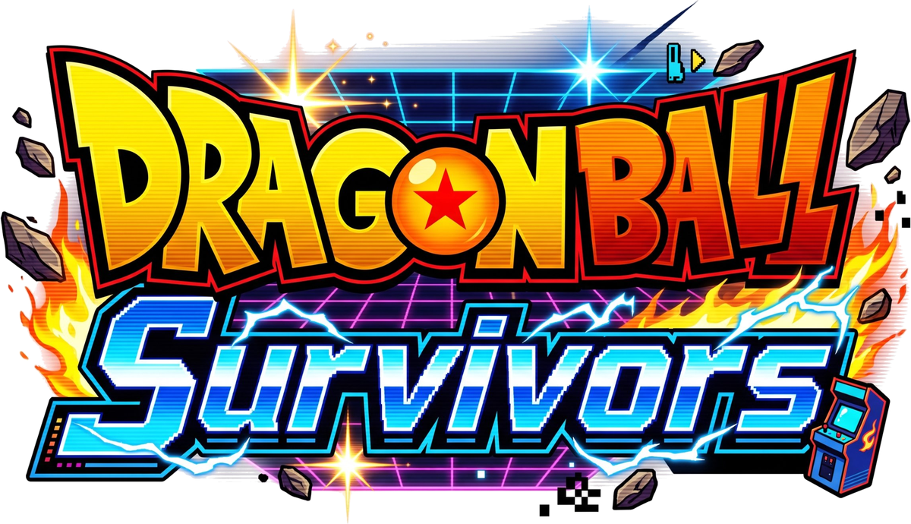</p>

# Dragon Ball: Survivors

> 🇮🇹 Versione italiana: [README.md](README.md)

A *Vampire Survivors*-style game inspired by Dragon Ball: you move, your weapons fire on their own, you collect experience, level up, transform and survive until the final boss. Everything lives in **a single HTML file** (Canvas 2D + vanilla JavaScript, zero dependencies, no external assets: graphics are generated by code and sound effects are synthesised).

> ⚠️ Unofficial, non-commercial fan project. Not affiliated with Toei Animation, Shueisha, Bandai Namco or the Akira Toriyama estate. See [DISCLAIMER.md](DISCLAIMER.md).

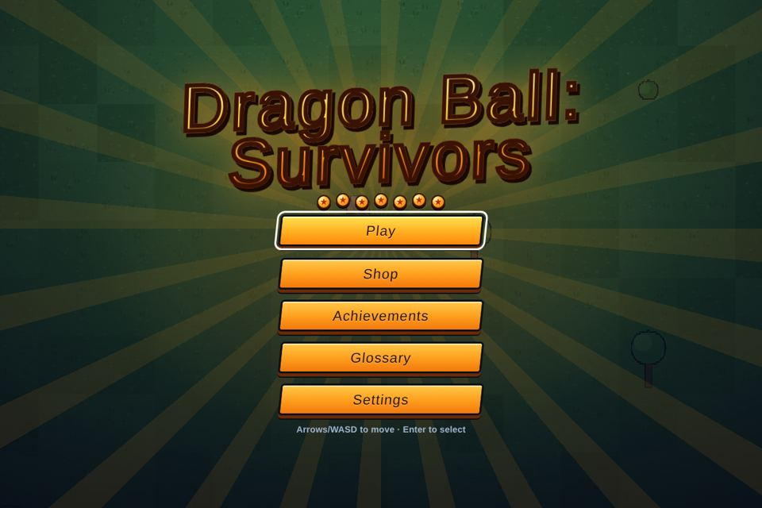

## Contents

1. [How to play](#how-to-play) · 2. [Controls](#controls) · 3. [What's new](#whats-new) · 4. [Game mechanics](#game-mechanics) · 5. [Build](#build-and-development) · 6. [Project layout](#project-layout) · 7. [Tests](#tests) · 8. [License](#license)

---

## How to play

1. From the menu pick **Play**, then stage, difficulty, character and **companion**.
2. Move with keyboard or gamepad: **weapons attack automatically** nearby enemies.
3. Enemies drop **experience gems**: collect them to level up and pick an upgrade card.
4. Reach the required levels to **transform** (Super Saiyan, Ultra Instinct…): each form grants permanent bonuses for the run.
5. Survive until the stage timer ends and **defeat the final boss** to win. If you die you still keep the zenny you earned.
6. **Zenny** is spent in the **Shop** (permanent upgrades) and to **unlock characters**.

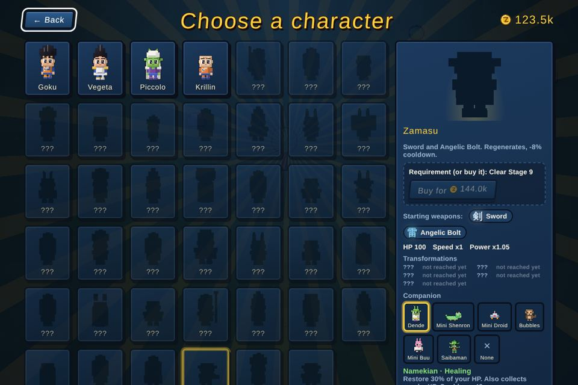

## Controls

| Action | Keyboard | Gamepad |
|---|---|---|
| Move | `WASD` / arrows | D-pad |
| Confirm / Cancel | `Enter`, `Space` / `Esc`, `Backspace` | A / B |
| Pause | `Esc` or `P` | Start |
| Interact (altars, totems, time chamber) | `E` or `F` | A |
| Companion ability | `Q` (or tap the bottom-left button) | X |
| **Senzu bean** (from the bag) | `H` · on-screen button | LB |
| **Dash** (damages what it crosses + invulnerability, 4 s cooldown) | `Shift` · on-screen button | RB |
| **Character ability** (Kaioken, Berserk, beams, clones…) | `R` or `X` · on-screen button | Y |
| Debug (FPS…) | `F2` or `` ` `` | Select |

All keys can be rebound in **Settings → Controls**.

---

## What's new

### 🆕 October 21, 2026 update (trinket roll bar)

New shop upgrades (**Amount**: +1 projectile per weapon, max 2; **Dragon Ball Scanner**: +5% spawn rate per level, max 2; **Broly's Roar!**: +5% enemy spawn rate per level, max 5, from 666), Saiyan Armor +2 per level, **128 new trinkets** (2-3 stat combinations, at every rarity; 10 with Amount at Legendary/Mythic only, up to +5 with a 100 roll) and the 0 to 100 roll bar on every trinket. Patch notes entry `2026-10-21`; the trinkets are regenerated with `tools/gen_trinkets.py`.

### 🆕 October 20, 2026 update, part 6 (Cooler, extra trinkets, Master, password and Google)

Details in the game's **patch notes** (entry `2026-10-20f`): Cooler as a late Planet Namek boss with three forms, extra trinket slots visible (up to 3), the Master of the Room of Spirit and Time copies your weapons, forgotten password with a 6-digit code, a "Continue with Google" button and a fix for the Tamagami sprite. Supabase setup: [`docs/SUPABASE.md`](docs/SUPABASE.md). Gemini prompts for the missing sprites: [`docs/PROMPT_GEMINI_SPRITES.md`](docs/PROMPT_GEMINI_SPRITES.md).

### 🆕 October 20, 2026 update, part 5 (spiders, shadows, damage numbers, Dyspo)

Details with numbers are in the game's **patch notes** (📜 in the menu: entry `2026-10-20e`, `src/js/patches.js`).

- **Natural barrel spiders** (`ObjLife.crawl`, `ObjLife.dangle`, `ObjLife.spider`): behaviour is a pure function of time (no state). A 6.5 s cycle: it turns, walks to a random spot (legs follow the distance covered, soft start and stop), then stops and does 2 random things among rearing up its head and front legs, grooming, looking around, twitching a leg. The hanging spider (14 s) lets itself down, sways, climbs back in jerks and rests. New drawing: abdomen, head, eight jointed legs with an alternating gait.
- **Shadows instead of gulls** (`Ambient.birdShadow`, `Ambient.flockShadows`, `Ambient.ground`): no more flocks in the sky or single birds drawn; what is left is the shadow on the ground (alpha 0.10, ~20-30 px), in a V formation, anchored to the world, sliding at 36-50 px/s. The gulls perched on crates, barrels and gravestones (Roshi's Island, Saiyan Plains, Cell Games Arena) are gone too.
- **Arcade damage numbers** (`Renderer.dmgSpr`, `DMG_T = 1.1`, `Game.floatText` classes 0 = damage, 6 = critical): Anton lettering (Google Fonts, falling back to Impact/Arial Black), slanted, white-to-yellow gradient, dark outline, 3-D edge and pixel edges; **red critical hits**, bigger and with a shake; they stay 1.1 s (before 0.8 s). At most 46 damage numbers at once.
- **Dyspo redone** (purple like Beerus, rabbit ears `ears:'rabbit'`, red/grey suit, white gloves and boots) as a character and as a boss; **Beerus** more purple.
- **Sprite guide for weapons and abilities:** [`docs/SPRITES_ABILITA.md`](docs/SPRITES_ABILITA.md) (what to do first, formats and sizes).
- **🧪 Test added:** `v56` (continuity and variety of the spider behaviour, no perched gulls, shadows in view ~40% of the time and faint, duration and class of damage numbers, red criticals, number sprites cached with crisp edges); `shot_v56.js` and `shot_dyspo.js` for screenshots.

### 🆕 October 20, 2026 update, part 4 (bosses, enemies and characters)

The full numbers are in the game's **patch notes** (📜 in the menu: entry `2026-10-20d`, `src/js/patches.js`).

- **Boss transformations** (`Game.bossTransform`, `TRANS_K = 1.2`, `TRANS_HEAL = 0.5`): +50% of the (new) maximum health and +20% maximum health, damage, speed (`spdK`) and armor on every form. **Frieza** (Namek) and **Cell** (Cell Games Arena) go through all their forms (`p2`, `p2at = 0.6`, `morph`), with +2.5% speed per form.
- **Final boss death** (`Game.startVictory/updateVictory`, `VIC_T = 4.2`): 4.2 s of slow motion with growing explosions, a white blast and «VICTORY!» before the stage-complete menu.
- **Boss signature moves** (`BOSSES[id].sig`, `startBossMove/updateBossMove/updateHeld/updateRain`): Dodoria **body hurl** (3 s warning, path as wide as his body), Dr. Gero and Android 19 **hold** draining 5/15/25/35% health over 3 s, Super Buu **rain of ki** (50/55/60/70 balls, 2% health each).
- **Android Ruins** (`STAGES[2].abs`, `bossPlan`, `ANDROID_SEQ`, `ANDROID_K`): a canonical android every 5 minutes in real time (13, 14, 15, 16, 17, 18; Endless: 19 and 21, then the list starts over +35% health); the first android at the end of the run is the final boss. New bosses `c13/c13s/c14/c15/c18/c19/c21/c21m` (temporary procedural sprites) and canonical moves in `bossAttack` (`bd.lb` renames a move, `bd.ext` lists the special moves, `e.bar` = barrier −88% damage). Red Endless note: `STAGES[2].endNote`. **Cell** is no longer in the Ruins.
- **Realm of the Gods**: bosses `shin`, `daikai`, `champa` in place of Zarbon, Cooler and Janemba; Beerus stays the final boss.
- **Room of Spirit and Time** (`Game.sparCopy`, `SPAR_COPY_P`, `SPAR_COPY_MUL`): the Master copies the player's unique ability or a weapon on one attack in two, with 40% less damage.
- **Piccolo / Toppo / Gotenks**: Special Beam Cannon (`sbc`), dark Sphere of Justice (`sphere`), Kamikaze Ghosts that copy the weapons (`ghosts`, `GHOST_KIND`); **Hellzone Grenade** weapon (`HellzoneWeapon`, 2 evolutions); Kaioken → **Aura** (to Jiren); Gotenks SSJ → SSJ Blue.
- **Playable Zeno-sama** (`CHARS.zeno`, `LINES.zeno`, `ABIL.zeno`): Vampire Survivors' Queen Sigma numbers, a bit higher, not for sale, unlocked by clearing every stage on Extreme and unlocking every weapon (`runCtx.allX/allW`); his sprite is the picture of his shop registered as a sheet (`Sprites.zenoSheet`).
- **Difficulty**: the stepped enemy reinforcement (Normal/Hard/Extreme) now happens every 10 minutes instead of 1:30 (`ESC_EVERY`; Easy stays 60 s). **Enemy health bars sit above the head.**
- **🧪 Test added:** `v55` (transformations, Frieza/Cell, final boss death, Piccolo/Toppo/Gotenks, Dodoria/Gero/Buu, android schedule, new boss moves, Realm of the Gods, Zeno-sama, Room of Spirit and Time); `shot_v55b/c/d.js` and `shot_zeno.js` take the screenshots.

### 🆕 October 20, 2026 update, part 3 (trinket Perfection, companions, 4-trinket chests)

The full before/after numbers are in the game's **patch notes** (📜 in the menu: entry `2026-10-20c`, `src/js/patches.js`).

- **Companion** (`Game.updatePet`, `petFindGem`, `petRelease`, `PET_*` constants): fetches XP gems within 340 px of you but outside your pick-up range, carries up to 3 above its head (`gem.held`, drawn in `Renderer.drawPet`) and hands them over when it is back; **shockwave** (≥ 5 enemies within 165 px over at least 3 quadrants, 210 px, 12 + 1.1/level, 5 s cooldown).
- **Trinket Perfection 0–100%** (`PF_SPREAD`, `pfK`, `rollPf`, `hasPf`, `trinMods(t,r,pf)` in `data.js`): stats −12% … +12% around the rarity value (50% = nominal); rarity ranges never overlap (worst Mythic > best Legendary); effect-only trinkets have none. In a run `Game.tPf`/`trP(id)`; offers (chest, boss pick, Zeno's shop) carry their `pf`; the gacha stores `bag[].p` (a better duplicate ⇒ updates `p`, `res.up`), old saves start at 50 (`Save.normalize`).
- **Ultra Instinct aura** at 100% (`Game.perfAura`, `Renderer.drawPlayer`; pulsing frame in `style`/`gacha.css`); **consistent Mythics**: only trinkets with stats (`rarOf`).
- **UI**: `UI.perfBar` (bag, character screen, chest, Zeno's shop, pause, tooltips); bag sort «Perfection»; **trinket swap** with % difference, Better/Worse/Equal verdict and zenny you get; **HUD slots** 30 px with a Perfection bar and dashed empty slots; setting **«Skip lower trinkets»** (`trinScore`/`autoRefuse`: rarity, then Perfection).
- **Boss chest: 4 trinkets** (`TRIN_PICK`, `pickCount`; before 4 + up to 6 with Luck).
- **🧪 Added test:** `v54` (Perfection and ranges, 4-trinket chest, Mythics, skip-lower, companion carrying XP, shockwave, gacha/migration, swap window, aura, bag sort).

### 🆕 October 20, 2026 update, part 2 (weapon slots, TAB, Tamagami, a harsher world)

The full before/after numbers are in the game's **patch notes** (📜 in the menu: entry `2026-10-20b`, `src/js/patches.js`).

- **1–5 weapons per run** (`settings.weapons`, `Game.maxW`): 5 Dragon Balls under the character screen (`UI.weaponCount`); level-ups offer no new weapon while the slots are full.
- **TAB = target** (`Game.cycleTarget`/`pickTarget`, `target` action): closest → most HP → least HP → boss; `nearest()` follows the mode. An illustrated panel in the left HUD (`TgtArt`, `assets/tgt.webp` from `tools/gen_tgt.py`).
- **Super Dragon Balls: 3** (`SB_TOTAL`), each with a **Tamagami** (`wakeTamagami`, bosses `tama1/2/3` + Fury form): the statue wakes up at 340 px and the ball stays locked until it falls; indicator at the bottom right (`drawSuperBall`, `Renderer`).
- **Tamagami art** (`assets/sprites/tama1/2/3.png`, Fury `tama1f/2f/3f.png`, statues `tamas1/2/3.png`): 9-frame sheets (0 idle, 1-4 walk, 5 wind-up, 6 strike, 7 special, 8 hit) imported from the sources in `assets/src/tama/` with `tools/import_tama.py` (magenta background removal, frame-by-frame cutting, per-row scale, feet anchor). `Sprites.BOSS_SHEET` maps the boss id to its sheet, `Sprites.BOSS_SHEET_F` to the Fury sheet (`e.pf`); `drawEnemy` picks the frame (`e.lp` = last attack pattern, `TAMA_WEAPON` = weapon patterns, `e.pwUntil` = power-up pose). Without the PNGs the procedural sprites remain.
- **World**: no walking on water (`blockWater`), lava −10% max HP/s (`updateLava`), enemies 50% farther above the screen (`TOP_K`), enemy speed by difficulty (`stageSpd`), enemy stats on the stage card (`UI.stageStats`).
- **Maxed level-ups**: 3 bags of zenny + «⚡ Auto-choose» (`Game.autoZ`, `settings.zAuto`); **Senzu** heals 50% and raises a random stat (`eatSenzu`); the red arrow is attracted; ground Hoi-Poi capsules removed.
- **Abilities**: usable in the Room of Spirit and Time; character passives ×1.5 → ×6.45 (Lv 100, `passK`); cooldowns −35% (`ABIL_CD_K`).
- **Balance**: Easy Health ×0.72; Zenkai +10%, Swift Flight +6%, Gravity Chamber −5%, Meditation +8%; Storm / Spirit totems 20 s (−20% per transformation; heal up to 12%), Risk 3 minutes; **Ki Barrage removed** (Ki Blast −15% and starts in its place).
- **🧪 Added test:** `v53` (balance numbers, TAB targets, weapons per run, zenny bags and auto-choose, Senzu, totems, Tamagami and Super Balls, water and lava).

### 🆕 October 20, 2026 update (revamped menus, stronger shop, Achievements, daily quests)

The full list with before/after numbers is in the game's own **patch notes** (📜 on the menu: release `2026-10-20`, `src/js/patches.js`).

**🧭 Menus and interface** (`ui3.js`, `ui4.js`)
- ⚙ Settings in the stage and character screens; new **Gameplay** tab (Screen shake, Damage numbers, Refuse lower-rarity trinkets, Auto-open tickets).
- Character screen: **search** (name, race, universe, series, starting weapon) and **sorting** (`CH_SORTS`, `CHAR_META`), saved in `settings.charSort/charDesc`.
- **⚡ Quick Start** (`UI.qsTargets`, `screen_quick`): the character with its trinket slot, the suggested stage and what is left to unlock; «Another suggestion».
- Pause: an **«i» on weapons** with numeric stats (`weaponStatRows`): final value, base and a green «+» with the amount added.
- Window enter/leave animations, notifications that slide back up over 3 s, the Endless description on hover; patch notes opened from the menu stay «read» even after a cloud sync (`Cloud.newerPatch`, `pushSeen`).
- «Power» → **«Damage»**.

**💰 Shop and economy** (`data.js` `SHOP`, `game.js`, `gacha.js`)
- Stronger upgrades and base prices +20%; new **Reroll / Skip / Ban** (up to 5 each) on the level-up window (`Game.rerollLevel/skipLevel/banLevel`, `banRun`). Total Shop cost: **115,166** zenny (before: 73,115).
- Bosses: 10× ticket at **100%**; Elites: 1× ticket at 100%; **buy tickets** (1× 1,000, 10× 10,000, −20% on Saturday and Sunday; `ticketPrice`, `Progress.buyTicket`); **auto-open** tickets (setting).
- **Kill streak**: +50 coins every 50 kills in a row, hidden bar −1% every 0.5 s (`CK_*`, `Game.cstk`).
- Zeno-sama: Epic and above −30%, one random free item per visit, music no longer slowed, a bigger bounce.
- x2 mode no longer gives the final zenny multiplier.

**🏆 Achievements, Objectives and quests** (`quests.js`, `ui4.js`)
- New **Achievement** screen (`screen_unl`): what to do to unlock characters, weapons, second evolutions + 14 challenges by difficulty with tickets; «???» on a weapon until it is unlocked.
- **Objectives** (`screen_ach`): zenny goals only (36 new) + **daily quests** (5 every 6 hours, a bonus when all are done; `dqList`, `Progress.checkDaily`). Search, «Hide completed», «Closest to completion» saved in `settings.objF/achF`.

### 🆕 October 17, 2026 update, part 2 (Endless mode, map events, weapon animations)

The full list with before/after numbers is in the game's own **patch notes** (📜 on the menu: release `2026-10-17b`, `src/js/patches.js`).

**♾️ Endless mode** (`Game.continueAfterWin`, `ENDLESS_*` constants in `data.js`)
- **Weapons up to Lv 100**: a weapon at Lv 5 of the last evolution available keeps levelling for 95 more levels (`Weapon.xl`): +4% damage, +1.2% size, −0.5% cooldown per level; the total cooldown (stat × weapon) never goes below 0.2 s (`cdXl`, `cdMin`). The "extra level" cards only show up in Endless (`upgradePool`).
- **Coins −10% every 15 s** (`coinK`: ×0.9 compounded, no in-game warning, written only in the button's description in 6 languages). The 50-level bonus does not decay.
- **Every 50 levels** (`checkMilestone`): +100 coins and 4 enemy growth steps at once (Normal/Hard +40% HP, +8% damage; Easy +4%/+4%; Extreme +60%/+20%/+60% armor) with an elegant message. Time no longer strengthens enemies (`escSteps` is frozen). Gentle XP curve (`endlessNeed`: ~12 s per level, +0.1 s per level).
- **Zeno-sama's shop** (the red button) every 300 s, open for 240 s; trinket quality depends on Luck.
- **ESC menu**: *Auto-select* (`autoLevel`, no menu on level-up) and *Upgrade priorities* (`enPrio`, up to 10 entries: 5 weapons + 5 upgrades, stored in `settings.endPrio`).
- **Payout**: after "Continue" only the coins earned after the win are paid (`rewardLines`: `run.coins − min(bank.coins, run.minC)`); what is spent at Zeno's eats the old coins first.

**🎬 Map events** (`src/js/events.js` data + logic, `src/js/events_draw.js` animations)
- One set piece for each of the 11 stages (`MAP_EVENTS[theme]`): announcement with title and subtitle in 6 languages, arrival spots marked on the ground, dedicated animations (seeds, pods, capsules, portals, march, parachutes, eggs, pillars of light and spheres of destruction, fissures, meteors) and **enemy transformations** (`skMorph`) with a label. 34-38 s long, first at 170-250 s (Saiyan Plains 260-330 s), then after 260-400 s. The "breather / shooters incoming / kamikaze wave" texts are gone; kamikazes only appear in events.
- Gulls and the Flying Nimbus as a visual effect on the other maps too (`Ambient.flocks / Ambient.nimbus`).

**🥋 Per-weapon character animation** (`src/js/pose.js`)
- Procedural characters are painted **without arms** (frame `20+n`; `30+n` = fierce face) and the game draws the arms with **two-bone inverse kinematics** (`Pose.ik`): the legs keep walking. **Kamehameha**: charged with both hands cupped around the growing ball, also while moving; the arms stretch out on firing. **Ki Blast**: the ball grows on the palm while the cooldown runs out (same rate of fire) and leaves the hand (`Pose.tip`). Poses for the other weapons too (`ARM_FIRE`). The character turns toward the target during the gesture.
- If you use **your own sprites**: optional frames 10-15 in the sheets and `hand` points in `sprites.json`; guide with prompts for Gemini and similar in [`docs/SPRITES_AI.md`](docs/SPRITES_AI.md) (Italian) and the `tools/sheet_from_frames.py` tool.

**🖥️ Interface and balance**
- **Experience** and **Health** bars with the new artwork (`xpbar.js`, `hpbar.js`; atlases generated by `tools/gen_xpbar.py` and `tools/gen_hpbar.py` from `assets/src/`). The Health bar shows the **portrait of the character in play**, updated on every transformation. Narrow screens keep the thin bars.
- The Gacha is now called **Trinket Gacha**.
- **Difficulty**: new enemies grow every **60 s** (before 90): Easy +1% / +1%; Normal and Hard +10% HP / +2% damage; Extreme +15% / +5% / +15% armor. Extreme: every 30 s +2% spawn rate and +1% enemy cap (60 steps at most).
- **Broly, Berserk** 6 s (8 s in the final form; before 10 and 13) and inaccurate aim (±0.5 rad). The **Magnet** also pulls Zenny bags and coins. Snake Way: rarer islands (one every 3,800 px, before 1,900).
- **🧪 Tests added:** `endless`, `events`, `pose`, `hpbar`; screenshots: `shot_pose`, `shot_hp`.

### 🆕 October 17, 2026 update (living maps, calmer pace, new choices)

The full list with before/after numbers is in the game's own **patch notes** (📜 on the menu: release `2026-10-17`, `src/js/patches.js`).

**🗺️ A different, animated map every run**
- **Random maps** (`MAP.roll()` in `world.js`, called by `Game`): every run rolls a seed that moves obstacles, lakes, ground tones, decorations, traps, healing pools and, on Snake Way, the winding of the body and its islands. The start area (250 px) is always clear and dry. `window.__MAPSEED = 0` restores the classic map, a fixed number replays that layout (handy in tests). Test: `map_random`.
- **Sea, lakes and lava** (`src/js/sea.js`): the water level is a noise field baked in 64×64 «pixel» chunks of 4 px, 8 phases (foam creeping in and out, wave crests, glints), with one palette each for Roshi's Island, Saiyan Plains, Planet Namek and **lava** (Hell). Leaping fish and lava bubbles that burst into sparks. Scenery only: `Sea.wet(theme,x,y)` keeps obstacles, decorations, traps and healing pools out of the water and the wet shore.
- **Roshi's Island** redesigned from a reference picture: rippled sand, wet shoreline, foam, rocks, crates, barrels, gravestones, agaves, palms, burrows, shells, starfish. New props are painted in `src/js/mapart.js` (`MA`), themed obstacles for every map live in `OBSTACLES` (`world.js`), new ambient particles in `ambient.js`.
- **Living props** (`src/js/objlife.js`, `ObjLife.draw`): spiders crawling along the rim of barrels and crates or hanging from a thread, gulls and crows, crabs, candles with moths, cats, flies, crystals, lanterns, lava rocks spitting embers. Visual only, off when ambient effects are off.
- **Snake Way** (`snake_art.js`, `Snake` in `world.js`, `MapDirector.islands`): body 22,000 px per side (it was 12,000), 9 kinds of walkable **floating islands** with 3 power-ups each (once only, name announced), birds, mist and the Flying Nimbus. Tests: `snake_isles`, `snake_way`.

**🧯 Less chaos, more readability**
- **Density** (`SPAWN_K = 0.85`, `CAP_K = 0.78`): end-of-stage spawn rate 8.5× (it was 12×), enemy cap ×0.78; Easy 0.7 (it was 0.8). Sparser events (hordes, packs, Kamikaze and Gunner Waves, ground pickups, «Something appeared» events), ×1.5 in x2 mode (`evK`); the 15 s surge brings more enemies (rate ×2.6, cap ×1.5, every 110-160 s of calm, the first at 150-190 s). The pile of coins on the ground is gone. Enemies that leave the screen reappear in front of you (on the side you are heading to).
- **Enemy fire budget** (`SHOT_*`, `EB_CAP`, `Game.shotOK/shotRefill/shotN/shotCdK`): volleys ×0.67, wait ×1.8 (×2.6 on Snake Way), a **shared pool of shots** (12, refills 6/s; Snake Way 8 and 3.4/s), at most 90 enemy bullets (it was 230). Skill bullets cost half a shot. Boss bullets are not budgeted.
- **Weapons destroy enemy bullets** (`cutOne/cutC/cutBeam/cutArc`): beams, explosions, areas, slashes and projectiles.
- **Difficulty**: every 90 s new enemies grow by HP +1% / damage +1% (Normal; it was +10% / +2%) and +2% / +1% / armor +5% (Extreme; it was +15% / +5% / +15%). The Giant Caveman's area strike (Roshi's Island) charges 0.5 s longer.

**⚖️ Weapons, economy, unlocks**
- Evolved Ki Blast −50% damage (`KI_EVO_DMG`). Kamehameha: beam duration 0.95 → 0.64 s over levels 1-5 (it was 0.6 s), evolutions 0.80 → 0.68 s and 0.78 → 0.62 s; width ×1.2 / ×2.6 / ×3.1 (it was ×1 / ×1.8 / ×2.1); the base beam is sky blue with a dense blue glow (`KAME_*`).
- **Zenny −20% everywhere** (`ZMUL = 0.8`): coins 4-32, bag 20-1040, Elite 20, boss 48, first-clear bonus 160 per stage, Wish 240, Gacha duplicates 64 / 144 / 320 / 640 / 1280, sold trinkets. The Gacha pulls up to **100 at a time** (×1/×10/×100).
- Shop: **Extra Trinket** (up to 3 trinkets, 3,000 and 9,000 zenny) and **Weapon Blacklist** (up to 10 bans, from 350 zenny ×1.4). Weapons unlock by winning a stage with an owner. Setting **«Refuse lower-rarity trinkets»**.
- Transformations: **Kaioken and Ultra Instinct for Goku only**; the other Saiyans get «Saiyan Fury»; **Vegeta** starts at «Saiyan Pride» and ends with **Ultra Ego**; King Kai uses Gravity x10/x100 and Heavenly Master (`SSJ_FORMS`, lines `vegeta` and `saiyan2` in `data.js`).

**🖥️ Interface**
- **End of stage** redesigned (compact title with two Dragon Balls, summary and rewards on the left, per-weapon damage with icon and level on the right); unlocked characters as a 5 s notification; **Endless** as a button next to Retry/Menu, locked until the stage is cleared on Extreme. Keys **1-9/0** and **Space** in every choice window. Experience orb with an animation and a sound that climbs in pitch. New animated ground power-up sprites (+22%). Patch notes with title, summary and groups.
- **🧪 Added tests:** `map_random`, `snake_isles` (islands, fire budget, cut bullets); screenshots: `shot_map`, `shot_props`, `shot_life`, `shot_loot`, `shot_patch`.

### 🆕 October 2026 update (v35 → v40)

**🎰 Gacha, Trinket bag and Super Dragon Balls (latest additions)**
- **Gacha** (button on the main menu, `src/js/gacha.js` + `src/js/ui_gacha.js`): the **tickets** you find in runs are spent to pull **trinkets**. Three kinds: **1× Ticket** (1 pull), **10× Ticket** (10) and **10× Lucky Ticket** (10 with better odds). A pull rolls the **rarity** first and then one of the trinkets of that rarity (adding trinkets never makes Mythics rarer).

| Rarity | Normal tickets | 10× Lucky Ticket | Duplicate (80% of Zeno-sama value) | Sale in a run (stage 1) |
|---|---|---|---|---|
| Common | 72% | 45% | 64 | (80 + 20) × 0.8 = 80 |
| Rare | 20% | 32% | 144 | (180 + 50) × 0.8 = 184 |
| Epic | 6% | 15% | 320 | (400 + 150) × 0.8 = 440 |
| Legendary | 1.5% | 6% | 640 | (800 + 400) × 0.8 = 960 |
| Mythic | 0.5% | 2% | 1280 | (1600 + 1000) × 0.8 = 2080 |

- **Animated pull**: a column of Dragon Balls spins and stops on the ball of the rarity (1, 2, 3, 5 or 7 stars: more stars, more sparks and higher sounds). **Legendary**: golden lettering. **Mythic**: flash, rays, a shaking screen, "MYTHIC!" lettering and a **jackpot sound** (`gMythic` in `audio.js`). With 10 pulls the trinkets show up one after the other with a pop-in and a sound; "Skip" shows everything at once. Each card is marked **NEW** or **DUPLICATE** (a duplicate pays Zeno-sama's market value in zenny).
- **Trinket bag** (from the Gacha and from the character screen): every trinket you obtained, with a rarity filter, **search by name or effect**, and sorting by date obtained (newest/oldest), rarity or name. One entry per trinket + rarity pair.
- **Trinket slot** in the character screen (right of the sprite): the **+** opens the Bag and the trinket you pick starts with you in every run (**just one**, at the rarity you obtained it, and it does not count as a "found trinket" for the achievements). If you replace it during a run, the one in the Bag stays yours.
- **Trinkets found in a run = sold**: when you replace them, decline them or at the end of the run you receive Zeno-sama's market value (+30% per stage difficulty level, `trinketSale`) plus a rarity bonus (+20 / +50 / +150 / +400 / **+1000** for a Mythic). It does not happen in Zeno-sama's shop or with the Bag's trinket.
- **8 new stat-only trinkets** (Master Roshi's Shell, Heavy Training Gi, Training Weights, Capsule Corp. Card, Tournament Medal, Jackie Chun's Mask, Turtle Scroll, Champion's Belt): they exist at every rarity (tiny stats on Commons, maximum on Mythics, with the `TCAP` caps). The pool holds 29 trinkets, 22-25 per rarity.
- **Ticket sources**: every **Elite** → 1× Ticket; every **boss** → 20% for a 10× Ticket; the fourth Dragon Ball wish, **"10 Tickets"** → a 10× Ticket. Tickets are saved when the run ends (also on a defeat, only once even with "Continue") and listed on the end screen; a counter shows in the in-run interface.
- **Super Dragon Balls** (`supPlan`/`updateSuperPlan`, `drawSuperBall`): in the **last 3 stages** (Buu's Dimension, Realm of the Gods, Tournament of Power) the normal Dragon Balls no longer appear. In **55%** of the runs, between 28% and 55% of the run time, a **giant ball with a golden glow** drops 520-700 px away (golden arrow at the screen edge), **guarded** by a ring of 16 enemies (+3 per difficulty level, +30% HP) when you get within 340 px. Since v53 there are **3** (1-3 stars, one per **Tamagami**), saved in `save.sball`, and they **stay between runs**.
- **Super Shenron**: with all 3 Super Balls the special scenario shows up as the first card of the stage menu, where the 3 are used up for a **10× Lucky Ticket** (takes you to the Gacha) or to **unlock a character of your choice for free** (takes you to the character screen, where "Get it free" replaces the purchase).
- **Test mode**: free, unlimited pulls; the trinkets you get disappear when you turn it off. **Save**: `deepMerge` fixed (a `null` default, like the Trinket slot, can no longer make loading fail).
- **🧪 Added tests:** `gacha` (odds over 300,000 pulls, tickets, duplicates, bag, slot, in-run sale, ticket sources, Super Balls, Super Shenron and all the screens).

**🔄 Automatic updates and patch notes (latest additions)**
- **No run is lost when a new version is released.** `build.py` stamps every build with an *id* (a hash of everything in the page) and writes `dist/version.json`; the GitHub Pages workflow publishes it next to `index.html`. The game reads it (never cached) a few seconds after start, then every minute and when the tab comes back to the foreground. When the id differs a **giant notice with a 10 second countdown** appears (the run keeps going, the notice never blocks clicks); at zero the **run in progress ends keeping EVERY coin** (no 25% defeat penalty), the cloud save is flushed and the **page reloads itself**. In the menus the notice is the same but there is no run to end.
- Safety nets: it does nothing on `file://`, when `version.json` is missing or in a preview; after two useless reloads (stale CDN copy) it stops insisting until you reload by hand; the `?u=` cache-buster is removed from the address bar.
- **Patch notes:** the **📜** button at the top right of the main menu (with a red dot while there is an unread release) opens the list with the **date** and the changes split into **What's new**, then **Bug fixes** and **Balance** (empty sections are hidden). To publish a release add an object **at the top** of `PATCHES` in `src/js/patches.js` (texts `T('italiano','english')`, one line per change).

**🐉 Dragon Balls and kill streak**
- **New sprites** (`assets/dragonballs.webp`, 7 frames of 64×64 taken from the reference image): every ball has **1 to 7 stars**, and a run never drops two equal ones until you have them all; the counter at the bottom right shows which ones you own.
- They **really bounce** on the ground (toss, hops that get lower, then a small hop every 1.6 s) with squash and stretch, a **shock wave and sparks at every landing**, a pulsing glow, turning rays, a pillar of light and twinkling stars.
- **Dedicated pick-up sound:** `assets/sphere_sound.mp3` (embedded with `DBS_AUDIO=embed`, copied to `site/assets/` by the workflow in `link` mode; the old synthesized jingle plays if it is missing).
- **Pick-up:** no attraction any more and a smaller radius (11 px instead of 20 + magnet): you have to **walk over them**. The screen-edge arrows stay.
- **Kill streak:** a counter at the top right (resets after 4 s without kills); at **25, 50, 100, 200, 350, 500, 750, 1000…** a banner, light waves and a little experience (a few % of a level). Four new achievements (50 / 200 / 500 / 1000 in a row).

**🌊 Waves, elites, guaranteed ball and reduced effects**
- **Wave rhythm** (`updateWave` in `src/js/game.js`): calm → **15 s surge** (spawn ×1.75, cap ×1.2, red banner) → **12 s breather** (spawn ×0.3, blue banner, a **shower of 10-16 gems** around the player worth about 9% of a level, and the gems dropped by enemies are worth **+50%**) → calm again for 38-52 s (× the square root of the run length). A surge **never starts** during a boss fight, within 22 s of a horde, during kamikaze or gunner waves, within 25 s of a boss or in the last moments; a boss arriving mid-surge ends it at once. Constants at the top of `game.js` (`WAVE_SURGE`, `WAVE_REST`, `WAVE_RATE`, `REST_RATE`, `REST_GEM`...).
- **Elite enemies** (`planElites`/`spawnElite`/`eliteDown`): 2 to 6 per run (one every ~210 s), placed between the bosses and never within 28 s of one; each is stronger than the last. They are a big (×1.35), golden version with a health bar of the toughest enemy in the roster (×9 HP, +45% damage, armor, almost immune to knockback, ×6 experience). They show as a **golden star on the progress bar**; they never arrive during a surge or a boss. When defeated they **always drop a chest** (an upgrade or evolution **plus a guaranteed trinket**, not the boss-style pick), coins and gems.
- **Zenny bag** (`bagValue`, `MapDirector.spawnLootPoint`): the pile of coins that now and then appears on the map is a **bag** (~36% of the map loot, about one every 3 minutes) with its value written above it. Value = `0.8 × 1000 × t / 1800`, rounded to 5 (min 20, max 1040): 20 at the start, ~265 at minute 10, 400 at 15, **800 at 30** (before the −20% on zenny: 25-1300, 1000 at 30). It lasts 90 s, has an off-screen arrow and is pulled in by the magnet. It adds its *base* value to the run total: zenny bonuses (Greed, Totem of Wealth, Jackpot…) are applied to everything at the end of the run.
- **Coin value** (`coinValue`): every loose coin (enemies, map loot, Bubbles) is worth `5 + 35 × t / 1800` zenny, **from 5 to 40 at minute 30 and never more** (the cap prevents farming with lots of enemies). Jackpot and the coin Cache keep their own scale.
- **Shop:** "Refund all" gives back **100%** of the zenny spent (no percentage on the button).
- **Guaranteed Dragon Ball** (`updateBallPlan`): every `clamp(run length×0.28, 100, 270)` seconds (the first after 75% of the interval) one lands 280-420 px from the player, **never two at once, never during a boss fight, never in the last minute**; it stays 150 s and the screen-edge arrow points to it. The random drop from enemies (0.07%) stays.
- **Reduced effects** (Settings > Video, `settings.reduceFx`, global flag `FXL.on`): −60% particles, fewer lightning bolts, **no electric arcs, light pillars, Kaioken flames or turning rays** on the balls, glows at 60%, flashes −70%, calmer screen shake, ambient particles halved. Shock rings stay because they carry gameplay information. Text translated in 6 languages.
- **Effect opacity** (0-100% slider under "Reduced effects", `settings.fxAlpha`, `FXL.a`): scales the opacity of everything that belongs to *the player*: weapons and projectiles, beams, particles, rings, auras (transformations, Kaioken, Berserk), charges; 0% = invisible. The renderer wraps the context's `globalAlpha` (`fxBegin`/`fxEnd` in `renderer.js`) with an `a^1.7` curve (additive layers add up past 100%, so a straight scale would look unchanged until very low values). **Not affected**: the character sprite, enemy projectiles and danger zones, the interface.
- **Main menu:** a bigger title (up to 980 px, 45% of the height) placed higher up; the **W.I.P.** badge is now anchored at the bottom right of the title (instead of travelling along the right edge of the screen).

**⚡ Abilities, cooldowns and prices (latest tweaks)**
- **Abilities grow with transformations:** halfway along the line they gain a new **passive bonus**, in the **final form** an **empowered effect** (small wave → huge, double beam, longer shield, 13 s Berserk…); the texts are on the character card and in the tooltip.
- **Cooldowns** cut by 30% and shrinking with every level (−0.2 s, at most −10 s). **Broly's Berserk** now gives **+80% damage and +5 armor** (+8 in the final form).
- **Unlock prices** recalculated from abilities, stats and strength in the anime. The x2 text under the difficulty choice is gone (hover the button to read it). Sprites: no more lines across the eyes.
- The **progress bar** shows its milestones again: red skull = boss, small white skulls = hordes, Shenron = final boss.

**🏆 Achievements, menus and Zeno's Shop (latest additions)**
- **Achievements:** much higher rewards (e.g. Hunter 200, Exterminator 500, clearing a stage 1,000, level 10 → 50, 25 → 100, Legend 500, Make a Wish 500…) and **20+ new achievements** (Zeno-sama, Mythic trinket, Kaioken ×20, Extreme, 30 minutes, boss rush, runs played, characters unlocked…), plus one per stage (Snake Way included).
- Every achievement has a **progress bar** (e.g. 100/500 kills, 1/4 stages), and the screen has a **search bar** (name or description), a **Hide completed** filter and a **Closest to completion** sort.
- **Glossary** and **Grimoire** are no longer in the main menu: they are **top right on the character select screen**.
- On the main menu, on the right, an animated **W.I.P.** (work in progress) badge bounces back and forth.
- **Zeno's Shop:** Zeno-sama bounces up and down; items show a **speech bubble** with their effects when you get reasonably close, while **buying** needs you right on top of the item: no accidental purchases.

**⚡ Effects and abilities (latest polish)**
- The **character model** is always drawn above beams, projectiles and effects: no ability can hide it.
- **Growing electricity:** with every transformation the abilities (beams, discs, spheres, auras, meteors, shockwaves…) get animated electric arcs and orbiting sparks, denser each time (none in the base form).
- **Kaioken aura**, constant and alive like in the anime: red glow, layered swaying flames, ground rings, rising sparks; bigger and fiercer at ×20. It stays on top of every effect.
- **Kamehameha:** the beam shoots out of the hands, energy pulses flow along it, pulsing head with rings and sparks, charging ball with rotating rays. Reach grows +1% per character level (max +30%) and with every weapon level. Same treatment for the **Big Bang Kamehameha** (evolved too: giant head).
- **Test mode:** no more zenny, achievements, unlocks or progress (like the Test environment).
- On the stage screen, **clicking a stage** now goes straight to character select.
- **Frieza** now has 7 forms (with **Golden**) and **Cell** 6 (Imperfect → Semi-Perfect with C-17 → Perfect with C-18 → Super Perfect → **Golden** → **Black**); every form raises stats, armor and max HP (+12%).

**🗺️ Levels**
- **Snake Way** (Stage 2): you can only walk on the snake's body, enemies and items only spawn there. Every 2:30 (scaled to the run length) enemies get tougher, up to a swarm of mini-bosses; final boss **Janemba** in two phases (fat form → transformation animation → true Janemba with his sword and beam, as in the movie). Clearing it on Hard unlocks **Gogeta**.
- **Hell** now comes after the Frieza and Cell sagas (Stage 8). It features **Frieza** and **Cell** as mini-bosses that *evolve every 1/N of their life*: Frieza in 7 forms (first → second → third → final → 100% → **Golden Frieza** → **Black Frieza**), Cell in 6 (imperfect → semi-perfect, absorbs C-17 → perfect, absorbs C-18 → super perfect, after Goku's self-destruct → **Golden Cell** → **Black Cell**). Every form has a transformation animation, new moves (Death Saucers, Death Beam, Death Ball, Supernova, Cell Kamehameha, Cell Jrs., Solar Flare…) and more armor and more max HP with every form. Final boss: Omega Shenron.
- **Animated top-down map preview** on every stage card; canonical order updated (see table below).

**⏱️ Difficulty and balance**
- Same length on every map: **Easy 5 min · Normal 10 · Hard 15 · Extreme 30** (new *Extreme* difficulty: very tanky enemies that don't one-shot but hit hard, huge bosses).
- Every **90 seconds** enemies gain **+10% HP and +2% damage** (cumulative) and drop **+5% experience**. In **Extreme**: **+15% HP, +5% damage, +15% armor** and **+8% experience**.
- **+10% HP** for all enemies (bosses included) in every mode.
- Shop: slightly stronger upgrades (e.g. armor +1/level, **regeneration +0.5 HP/s per level**), **Dash removed from the shop** (the base dash stays; the rare in-run trinket *Wind Boots* improves it).
- Fix: intermittent white screen (canvas state reset every frame, elliptical radii clamped).

**💀 Death and UI**
- Death animation (slow motion, slowed music), menu within 2 s with *Retry*, **per-weapon damage and collected coins summary**.
- Lighter level-up screen: the game stays visible behind it.
- **Test mode** (Settings): every stage and character unlocked and a free shop; turning it off reverts everything (with a confirmation warning).

**👹 Much livelier enemies**
- New **enemy skill system** (`src/js/skills.js`): ki fans, rings, lunges, quakes, sky strikes, mines, shield, summons, healing, war cry, orbiting orbs, beams, spin, burrowing, slashes. Every skill has a **visible wind-up** (enemy charges, "!" and glow) and every level has its own combinations (Saibamen leaving acid pools, armored Cell Jrs. summoning Cell Jrs., Reapers burrowing…).
- Enemy **rage and transformations**: below 50% HP they enrage (aura, faster and stronger), some **change look** (Super Saiyan, Great Ape, empowered Majin, enraged demon, ascended celestial soldier, overclocked cyborg…) or **evolve** over time.
- Procedural animation: walk bob, breathing, wind-up and strike poses, spawn pop, blob jelly, ghost sway, wing flutter, hit squash.

**🕳️ Secrets and Zeno's Shop**
- One secret per level, at a random time between 1:00 and the level length: an **arrow with the distance in meters** points to an **altar with a mysterious red button**. Pressing **E** (like the Room of Spirit and Time) opens a portal to **Zeno's Shop**.
- Inside: a **60-second** chill dimension, level time frozen, **abilities and pet disabled**, **no passive regeneration**. Trinkets lie on the ground in front of Zeno-sama: stand on one to buy it (run coins), with a **pop-up card** showing the item and its stats.
- **Luck** drives the items' rarity (up to legendary); **1% of items are Mythic**.

**🍀 Trinkets: one at a time, with rarities and Mythic**
- You carry **one trinket** (up to **3** with the shop upgrade «Extra Trinket», 2 purchases); with every slot taken, finding another one (chest, capsule, wish, Zeno) opens a **comparison window** that shows everything you carry and asks which to replace (or to keep them all). The **«Skip lower trinkets»** setting (before «Refuse lower-rarity trinkets») sells anything worse than all of yours on the spot (lower rarity, or the same rarity with less **Perfection**). Every trinket has a **Perfection** 0–100% (stats −12%…+12%, 100% = Ultra Instinct aura): see update part 3.
- Every trinket can have a **Common → Mythic** rarity: stats grow with rarity and are capped per rarity (e.g. damage: legendary max 15%, mythic max 20%); texts update automatically. Lower tiers were scaled down accordingly. Any trinket found has a 1% chance to be Mythic.
- *Collector* achievement is now "Find 6 trinkets in one run".

**🕰️ Room of Spirit and Time**
- Stat swaps have half the penalty; the transformation is only offered if it would happen within 10 levels and is an **alternative** to the weapon (one or the other); abilities and pet are disabled there too (regeneration still works).

**🧪 Added tests:** `roster_unique`, `roster_smoke`, `testmode`, `snake_way`, `snake_boss`, `canvas_state`, `death_seq`, `hell_minis`, `skills_smoke`, `zeno`, `trinkets`, `trial_offers`, `waves` (waves, elites, guaranteed ball), `reducefx`, `dende`, `pets_bag` (companions, bag and coin value), `refund`.

### 🎵 Per-map music and 💨 universal dash
**Music:** drop a track in `assets/` named after the map (`android ruins.mp3`, `buu dimension.mp3`, `muten island.mp3`, `tournament of power.mp3`, `namek.mp3`…) and it plays on that map, looping with a crossfade. Name table and size options in [`docs/MUSIC.md`](docs/MUSIC.md) (Italian). **Dash (Shift):** every character has it now. Button at the bottom-left next to Kaioken, 4 s cooldown (upgradable in the shop with *Lightning Dash*: −0.4 s and +15% damage per level), damages the enemies it crosses and grants brief invulnerability. **Sprites:** characters with pack sprites walk normally while charging a beam and extend the arm only when firing; bosses and Saibamen with pack art use it (Cabba and Janemba included).

### 🎨 New pack sprites (32 characters) and dash
Characters now use the pixel-art sprites from the pack in `assets/sprites/` instead of the code-drawn ones: Goku (every form, Kaioken to Ultra Instinct), Vegeta, Trunks, Gohan, Piccolo, Krillin, Broly, Frieza, Cell, Buu, Bardock, Raditz, Vegito, Gogeta, Gotenks, Androids 16/17/18, Cooler, Toppo, Hit, Kefla, Caulifla, Kale, Beerus, Whis, Jiren, Black, Zamasu, Frost and Turles. While **transforming**, the power-up pose with the aura/burst drawn in the sprite is shown, and the **dash** uses the horizontal pose with a speed streak. The **Kamehameha** uses the pack's beam art (muzzle burst, body, head), tinted with the weapon colour. Characters without pack sprites keep the code-drawn art. Artists and caveats: [`CREDITS.md`](CREDITS.md), import tooling in [`docs/SPRITES.md`](docs/SPRITES.md) (Italian).

### 🌦️ Living stages, weather and day/night
- **Animated stages**: every planet now has lakes and biome patches (dry/lush), animated terrain (light waves, shoreline foam, pulsing lava cracks, the Tournament grid), trees and flags swaying in the wind, glowing props, smoke from wrecks, torches and a lot more scenery. **Critters** roam around (rabbits, frogs, crabs, lizards, scorpions, pigeons…) and run away when you get close, plus butterflies, fireflies, birds with their shadows, cloud shadows, dust, embers, ash, shooting stars and more.
- **Weather** (plains, Namek, Roshi's Island, Planet Vegeta, Cell Games Arena and more): **rain, thunderstorms with lightning, fog, sandstorms and wind** come and go during the run.
- **Day/night** on outdoor stages, with dawn and dusk. In **Settings → World** you can switch **animated environment**, **weather** and the **day/night cycle** on or off, pick **how much day and how much night** with a slider (100% = always day, 0% = always night) and the **cycle length**. It is purely cosmetic (gameplay is unchanged) and an automatic check lowers the effects if the game slows down.

### 🏆 Tournament of Power as the finale
The Tournament of Power is now the **last stage**: 20 minutes, 12 bosses with much higher stats that **evolve during the fight** (Dyspo, Bergamo, Basil, Lavender, Ribrianne, Cabba, Caulifla, Kale, Frost, Hit, Toppo and **Jiren**, who evolves up to *Final Wrath*).

### 🖼️ New logo and dynamic menu
- The text title is replaced by the project's **logo** (`assets/logo.webp`, embedded in the final file).
- The menu background is now a **fast panoramic fly-over of the stages** (diagonal wipe between them) with **random fighters** that appear, **transform**, use their **abilities** (beams, novas, clones, barriers…), fire ki blasts and **emote**. It is **blurred** so it never fights with the buttons.

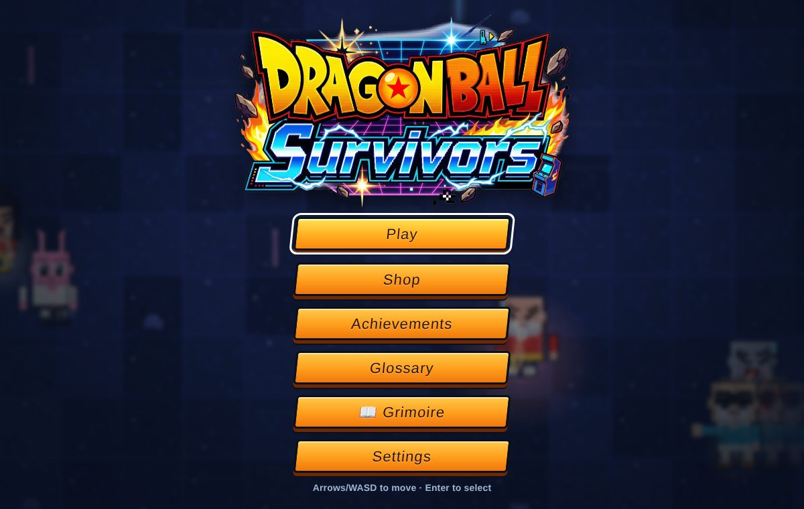

### 📖 Grimoire and recipe-based evolutions
- A weapon evolves when it is **at max level** *and* you own the **right upgrade** (e.g. **Zenkai + Kamehameha**); the evolution is granted by a **chest**. Every weapon has two recipes (one per evolution).
- Level-up cards show a **tooltip with icons**: "The «Zenkai» upgrade evolves your «Kamehameha» weapon". On the HUD a maxed weapon shows the icon of the upgrade it still needs (or a **!** when ready). A maxed weapon makes its missing upgrade show up more often.
- The **second evolution** unlocks by **clearing every stage (Normal or Hard) with that weapon in your build**.
- **Grimoire**: lists every weapon, evolution and recipe; anything you have not unlocked is **censored**. Open it with **Esc** in-game (*Grimoire* tab), from **character select** and from the **main menu**. It also tracks your cleared stages.

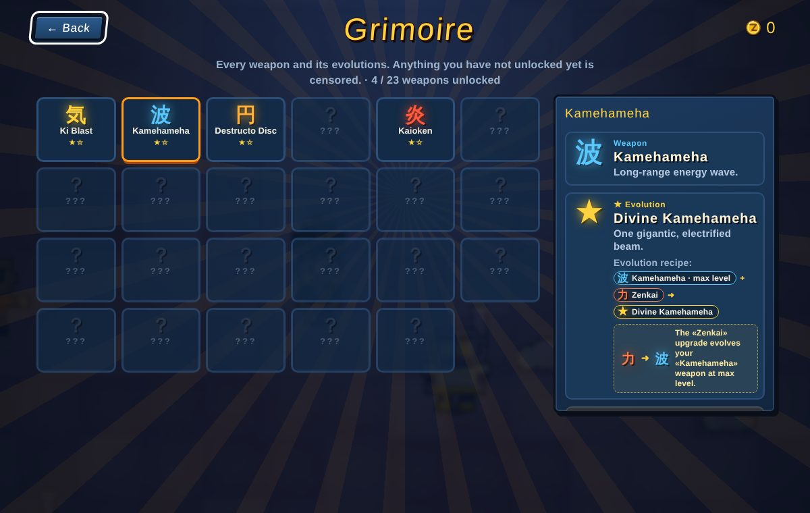
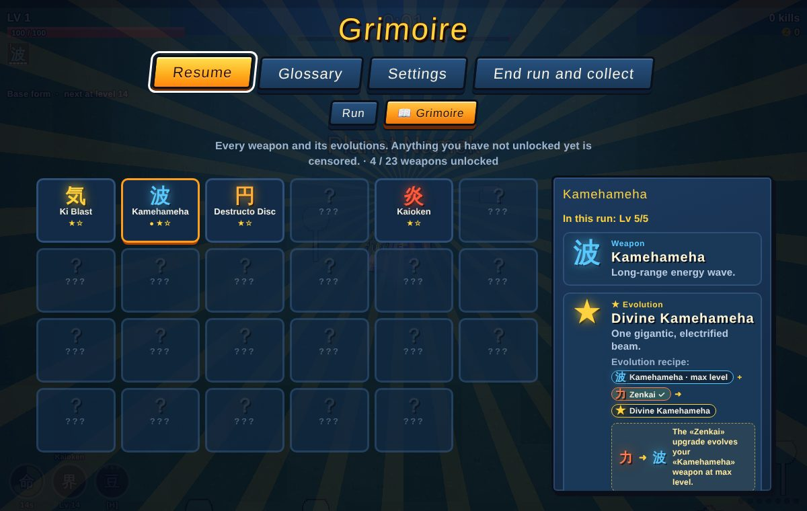
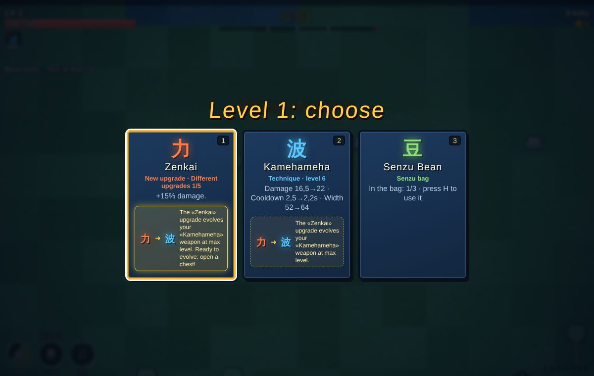

### 🔴 Red gem (XP accumulator)
When too many experience gems crowd the map (over 90), the **farthest ones merge into a single red gem** that stores their XP and cuts lag. The gem **always stays just off-screen** (if you walk away it follows along the same side) (there is no indicator: finding it is up to you). Walk into it (or use the Magnet) to collect everything at once.

### 🫘 Senzu bag
- A **Senzu Bean** card can show up in the level-up menu (only there, **rarely**, about 1 level-up in 10): the bean goes into the **bag** (up to **3**). With a full bag the card heals 50% right away and raises a random stat.
- Eat one in-game with **H** (or the **on-screen button** next to the pet and ability buttons) to recover **40%** HP; it is never wasted at full health.

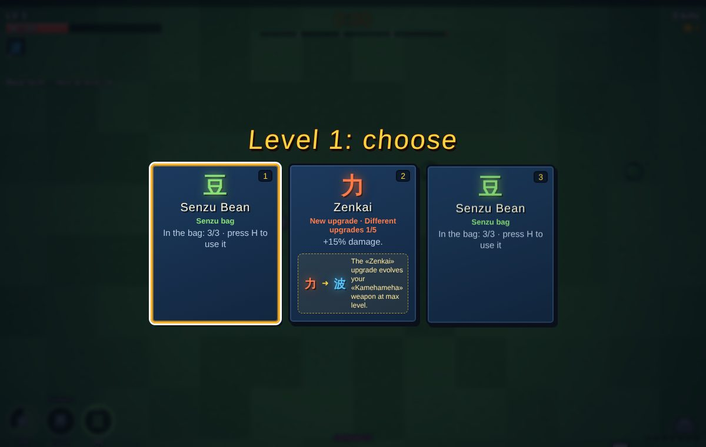

### 🎵 Namek music
**Planet Namek** has its own track, **looping** for the whole stage (during bosses the synthesised boss music takes over, then it resumes where it left off). The tracks (menu and Namek) were generated with **Suno** and are included in `assets/` (see `assets/README.md`).

### ⚡ Transformations and Kaioken
- **Spectacular transformations**: time slows during the charge, the character is invulnerable and the aura expands; on release a **shockwave sweeps the whole stage** (knocks back, stuns and damages enemies, clears enemy bullets) with light, lightning and a dedicated sound.
- **Higher requirements**: every form needs at least **+10 levels** over the previous one (levels 14, 24, 36, 50, 66, 84, 104, 128).
- **No going back to previous forms.**
- **Kaioken x10 / x20**: after the Kaioken form, the Saiyan line can press `R` to cycle off → x10 → x20 → off:

  | Mode | Stats | HP cost |
  |---|---|---|
  | x10 | damage ×2, speed ×1.4, cooldown ÷2 | −4 HP/s |
  | x20 | damage ×4, speed ×2.2, cooldown ÷4 | −8 HP/s |

  Can be switched off at will, turns off by itself below 10% HP, and can't be started below 20% HP.

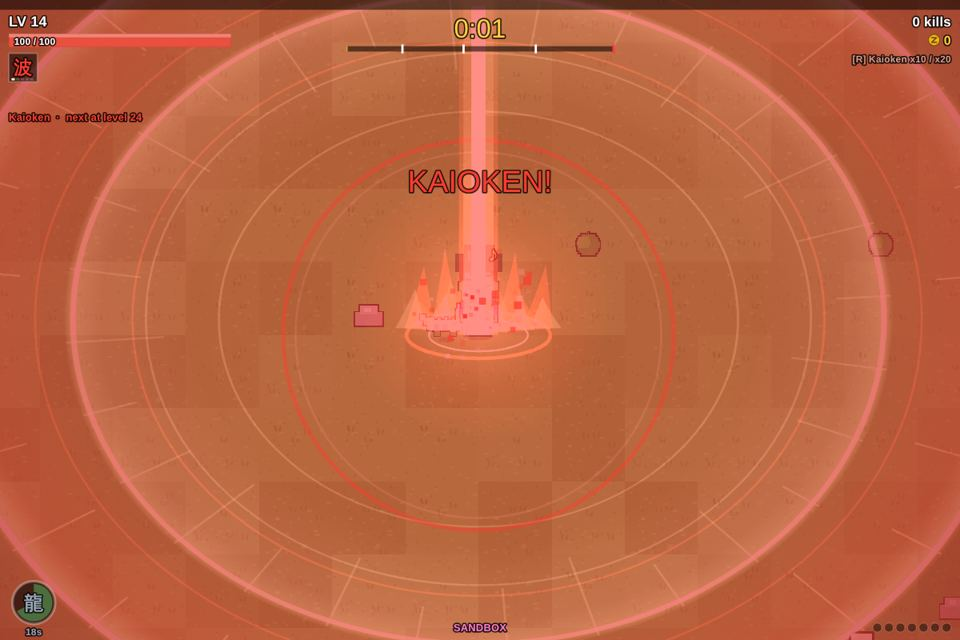
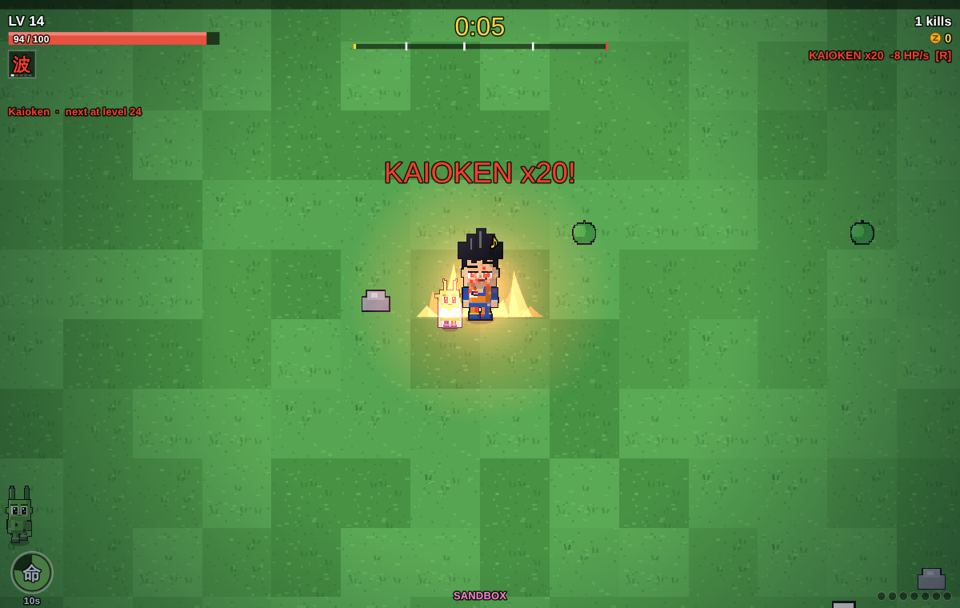

### 😡 Broly's Berserk
Broly has an exclusive ability on the same key (`R`): he **loses control for 10 seconds**.
- Lashes out at random nearby enemies with repeated dashes and explosions.
- **Controls are inverted** and it **cannot be cancelled**.
- Bonuses: damage ×1.8, armor +3, damage taken −30%.
- Perpetual green aura with flames, expanding rings, lightning and **Broly's scream**.
- 45-second cooldown.

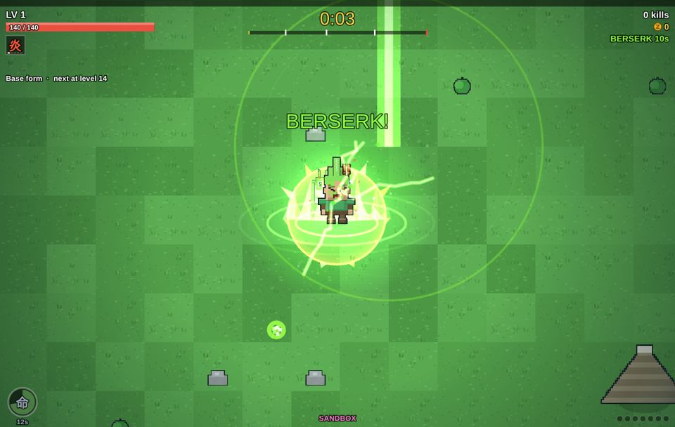

**🖼️ HD playable sprites + custom sprite sheets.** Playable characters now use the same HD pipeline as enemies and bosses (finer pixels, coloured outline, rim light and core shadow). You can also **replace the art with your own PNG sprite sheets** (base form and transformations, with walk and attack frames): put the files in `assets/sprites/` and rebuild. Guide and blank template in [`docs/SPRITES.md`](docs/SPRITES.md) (Italian).

### 🆕 Third wave of updates: arcade sounds, HD sprites and 16 new characters

**🕹️ Arcade menu sounds.** Every button now has an **arcade-style, loud and clearly audible** sound (square-wave "chip" tones): a *tick* when you hover or move with keyboard/pad, a *coin-blip* on click, a descending run of notes for **Back**, a **fanfare** for **Start**, a *ding* for purchases and a *buzz* when you press a disabled button. It applies to every HTML button (menus, pause, level-up, modals) and follows the SFX volume.

**🎨 High-definition enemy and boss sprites.** All enemies, bosses and companions are now painted on a **finer pixel grid** (6 to 10 pixels per unit, chosen from their on-screen size) with a new finishing pass: a **coloured outline** (no more flat black), a **rim light** at the top-left, a **core shadow** at the bottom-right and soft gradients. The creatures were **redrawn from scratch** with far more detail: Saibamen (teeth, ears, bomb gem), Cell Jr., a drone with thrusters, glossy jellies, the void orb with its eye, a hooded wraith, plated **Golem/Colossus** with a glowing core, **wolves** (the mecha wolf too), distinct **Raptor** and **Dinosaur** (tyrannosaur), **pterodactyls** with membranous wings and a muscular **Great Ape**. Humanoid enemies get **rounded heads**, eyes with eyelids and glints, rivets on armour, buckles and hair strands.

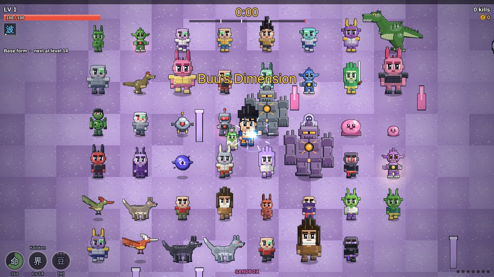
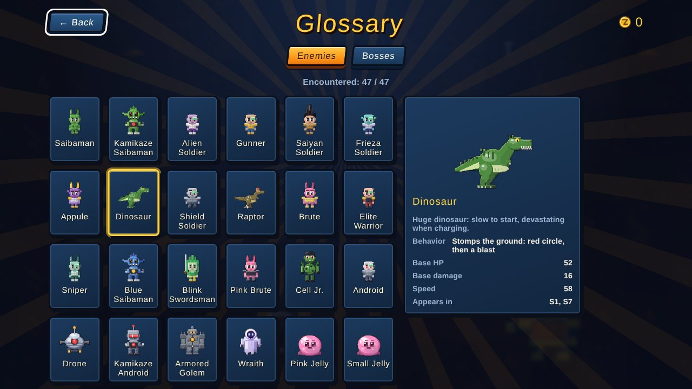

**👥 16 new playable characters (57 total)**, each with its own starting weapon(s), ability, transformation line, price and unlock condition:

| Character | Starts with | Ability | Unlock |
|---|---|---|---|
| **Videl** | Dynamite Kick + Ki | Flying Kick (dash) | Level 18 in a run |
| **Bulma** | Ki Blast | Genius Invention (more coins than Lucky Strike) | Evolve a weapon in a run |
| **Yajirobe** | Sword | Senzu Stash (heal) · **starts with 1 Senzu in the bag** | 5,000 enemies in total |
| **Great Saiyaman** | Ki Blast | Heroic Pose (crits) | Clear Stage 3 |
| **Chiaotzu** | Piercing Beam | Psychic Paralysis (stun) | Stage 6 on Hard |
| **Recoome** | Break Cannon | Recoome Kick (dash) · giant | Clear Stage 2 |
| **Guldo** | Time Skip | Time Freeze | 15 bosses in total |
| **Turles** | Meteor + Ki | Fruit of the Tree (absorb) | Clear Stage 7 |
| **Nail** | Rebel Javelin | Warrior Spirit (power-up) | 2,500 enemies in one run |
| **King Kai** | Kaioken | King Kai Training (power-up) | 4 transformations in a run |
| **Pan** | Homing Orbs + Elegant Dance | Saiyan Blood (power-up) | 5 transformations in a run |
| **Dabura** | Sword + Hellzone Grenade | Demon Wave (nova) | 60 bosses in total |
| **Mr. Popo** | Angelic Bolt | Genie's Shield (barrier) | 80,000 enemies in total |
| **Uub** | Kamehameha + Orbs | Pure Beam | Stage 4 on Hard |
| **Frost** | Piercing Beam + Bolt | Death Beam (nova) | Clear a stage with the x2 modifier |
| **King Piccolo** | Sphere of Destruction | Demon Regeneration · giant | 250 bosses in total |

New form lines: Chiaotzu, Turles, Demons (Dabura, King Piccolo), Special Force (Recoome, Guldo), King Kai, Frost and Uub; Videl, Pan, Bulma, Yajirobe and Mr. Popo use the Human line, Nail the Namekian one, Great Saiyaman the Saiyan one. New hair styles: pigtails, bob and mohawk.

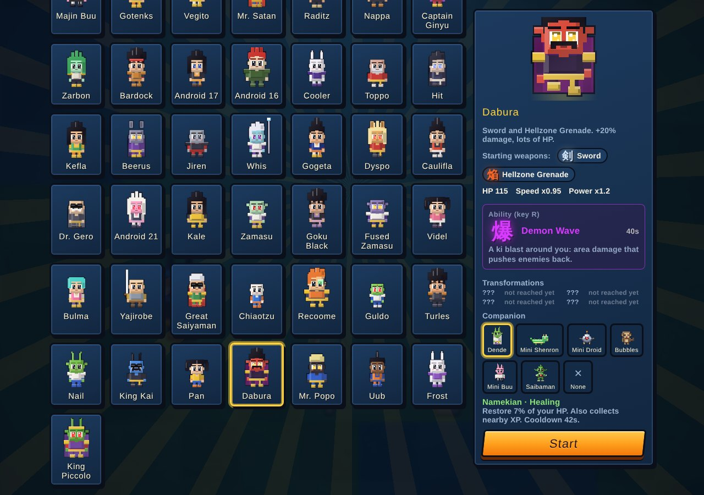

**🎨 Clearer level-up cards.** Every upgrade card now has a **colour that tells what it does** (🔴 damage, 🔵 speed, 🟢 health/healing, 🟡 cooldown, 🟣 pickup, 🩵 experience, 🟠 area, ⚪ armor) with a **large faint background icon** (sword = damage, heart = health, bolt = speed, clock = cooldown, shield = armor, magnet = pickup, star = experience) and a plain-language effect chip (e.g. “+15% damage”). Techniques list one line per changed stat (Damage 10.5→13…).

**🌐 Hosting.** New guide [`docs/HOSTING.md`](docs/HOSTING.md) (Italian) and a GitHub Actions workflow to publish the game on your own domain on every push.

**☁️ Accounts and cloud saves (optional).** With a free [Supabase](https://supabase.com) project the game offers **log in / sign up** (email + password, optional Google, password reset) and **per-account cloud saves** synced across devices. You can always play **as a guest**; if both the device and the cloud already hold progress at first login, the game asks which one to keep. Full guide (Italian): [`docs/SUPABASE.md`](docs/SUPABASE.md); SQL schema in [`supabase/schema.sql`](supabase/schema.sql).

### 👥 New characters (first wave)
Sparking! ZERO-style roster additions: **Broly** (all forms), **Zamasu**, **Fused Zamasu**, **Goku Black**, **Caulifla**, **Kale**, **Dyspo**, **Dr. Gero**, **Android 21**. More **canonical** forms:
- **Frieza**: Second → Third → Final → 100% → **Golden Frieza** → **Black Frieza**.
- **Cell**: Semi-Perfect → **Perfect** → Super Perfect → **Golden Cell** → **Black Cell**.
- **Broly**: Super Saiyan → Legendary → Full Power → Wrathful → SSJ Broly → SSJ Full Power.
- Zamasu, Goku Black, Fused Zamasu, Caulifla and Kale each have their own form line.

**Unlock prices are much higher** (8,000 to 300,000 zenny).

### 🐾 Companions (pets)
Pick a helper by **race** before each run. It follows you, **collects nearby XP gems** and has an **active ability** (`Q`) on a cooldown:

| Companion | Race | Ability (heavily nerfed) | Cooldown |
|---|---|---|---|
| Dende | Namekian | **Healing**: restores 30% HP | 30 s |
| Mini Shenron | Dragon | **Magic gather**: pulls gems within 400 px and gives an XP bonus of 5% of a level | 40 s |
| Mini Droid | Android | **Energy shield**: invulnerable for 1.5 s | 40 s |
| Bubbles | Earth animal | **Lucky banana**: 3 coins on the ground and +5% luck for 50 s | 36 s |
| Mini Buu | Majin | **Candy beam**: stuns enemies within 210 px for 1 s (0.4 s on bosses) | 28 s |
| Saibaman | Saiyan (plant) | **Self-destruct**: area explosion (160 px radius, 12 damage + 0.8 per level) | 22 s |

Pet abilities were **cut by at least three quarters**: they help, but no longer decide the run.

### 🌀 Spirit Bomb upgrade
- The sphere **grows larger with every weapon level** and larger still in the **two evolutions** (the impact area grows too).
- On the evolutions, when the sphere lands: **the ground shakes** (repeated screen tremors and shockwaves), **glowing cracks** open and the area **burns for 5-7 seconds**, dealing **modest** damage over time (about 11-13% of the sphere's damage every half second).

### 🍀 Luck, totems and trinkets
- The **Totem** appears **only once per run** (press `E`) and offers **3 random powers out of 8**:

| Totem | Effect |
|---|---|
| Luck | +1% luck on every level-up for the rest of the run |
| Risk | XP ×2 but +50% damage taken for 180 s |
| Vitality | +15% max HP, +0.4 HP/s and an instant 30% heal |
| Fury | +12% damage but cooldowns 8% slower |
| Wealth | +35% zenny and +25% pickup range |
| Guardian | a barrier blocks one hit, recharges every 25 s |
| Storm | every 20 s (−20% per transformation) lightning hits up to 4 nearby enemies |
| Spirit | every 20 s (−20% per transformation) a pulse heals 6% up to 12% and stuns nearby enemies |

- **Trinket rarities** (Common, Rare, Epic, Legendary): luck shifts odds toward higher rarities.
- **Every boss drops a chest with 4 trinkets, pick 1**; with luck the choices grow **up to 10**.

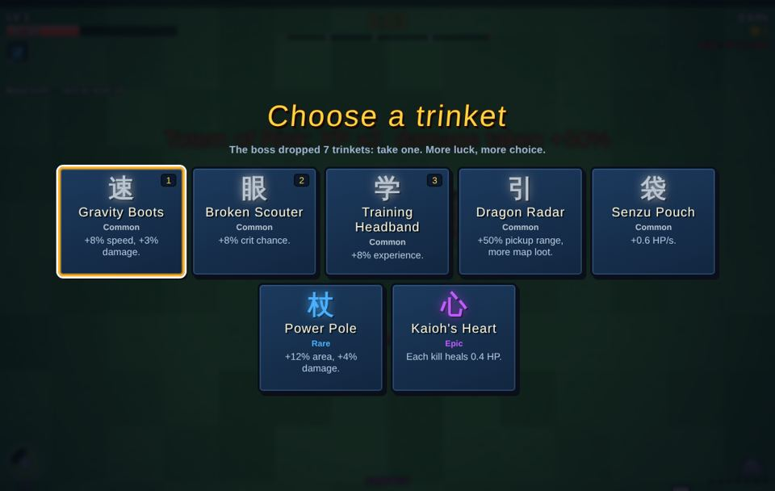
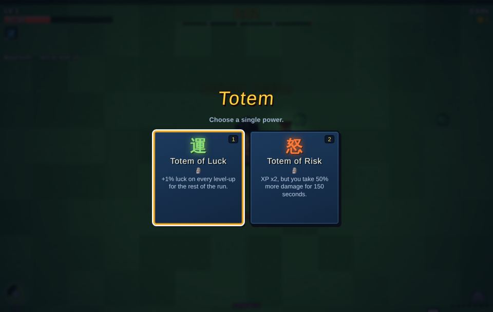

### 🎯 Unique abilities for every character
Each character has an **active ability** (key `R` or the **on-screen button** next to the pet button, showing name, cooldown and state). The Kaioken (Goku) and Berserk (Broly) buttons live there. There are **16 different mechanics**, tuned not to be too strong:

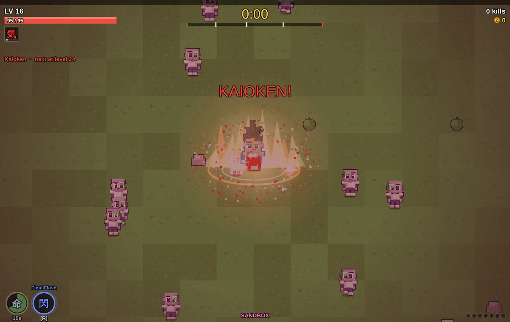

Kaioken ×10/×20 · Berserk · Power beam · Ki nova · Regeneration · Blind · Invulnerable dash · Clones (3, they shoot) · Critical eye (+35% crit) · Barrier · Absorb · Time stop (1.8 s) · Erase · Rewind (recover 6 s of lost HP) · Jackpot · Temporary power-up.

Abilities are described in the character panel.

### 🌍 Environment: traps and healing zones
Levels now contain (not too often) **passive healing zones** (3% max HP/s) and **spike traps** that cycle on and off and hurt **both you and enemies**.

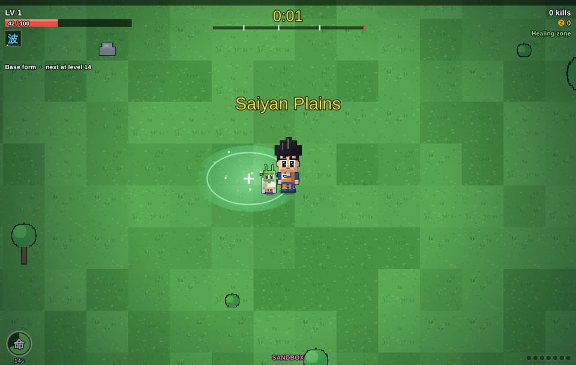
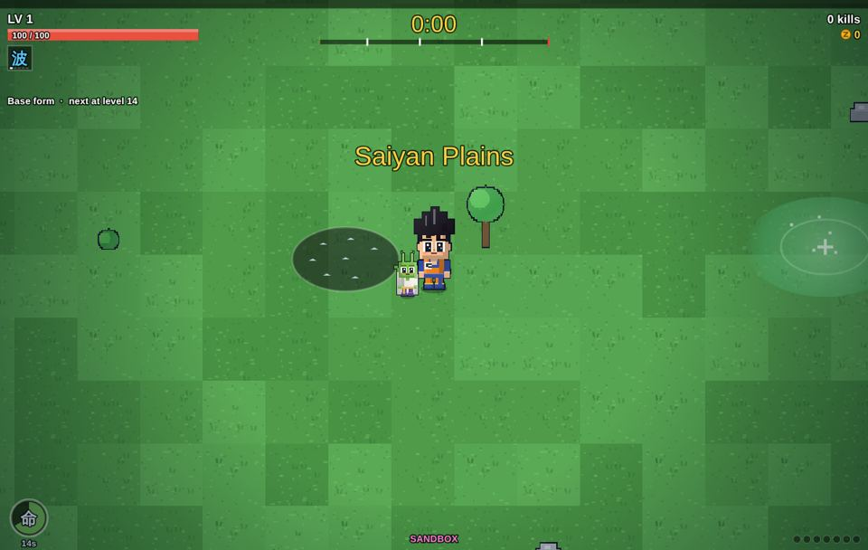

### 🕰️ Expanded Room of Spirit and Time
Now **1 minute** long, with a **larger arena**, **obstacles** (pillars) and **3 buttons** that trigger **traps hurting the boss** (and you, if you stay in range).
- The boss has a **health bar** and **substantial area attacks** (red warning zones: slam, nova, meteors, bursts, waves).
- Afterwards you can spend coins in a shop: **upgrades already bought or free disappear** from the list and, **if you have taken them all, the shop closes** and you leave the rift.

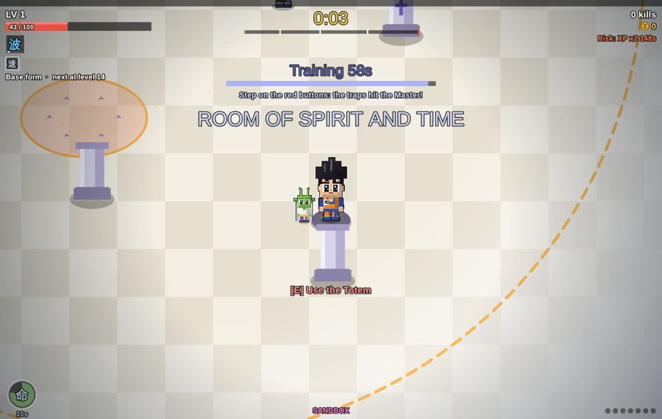

### ⚔️ Weapons: 5 levels → evolution → 5 levels → second evolution
- Every weapon has **5 levels**; at max, the chest **evolves** it and it restarts at 1 for **another 5 levels** (then the second evolution, after clearing every stage with that weapon).
- Each evolution level adds little: **+5% damage, −1.5% cooldown, +2% area** (no runaway numbers).
- **Ki Blast**: far fewer shots (1 to 3 before evolving, 4 at most) and **+1 pierce only on the second evolution**.
- **Spirit Bomb**, **Kamehameha** and the other beams have new sound effects (see below).

### 👹 Tougher enemies, shooter waves and new moves
- More **HP** for all enemies and bosses, and **much higher damage** (at the start of a run without shop upgrades they no longer hit for 8–9).
- Ranged enemies are **no longer scattered through the whole run**: they come in **1-minute waves** every 2–3 minutes, with a warning, then retreat.
- New **moves**:
  - **Leap** (wolves, raptors): crouch, jump in an arc and land with a shockwave.
  - **Slam** (brutes, dinosaurs, colossi…): they stop, a **red circle** warns you, then an area blast.
  - **Zig-zag** (cells, ghosts, pterodactyls…): a weaving approach.
- After a transformation there is now **time to see the animation** (about 4 s) before the level-up.

### 🔥 Bosses power up
If you take **too long** (about 85 s, then 70 s) to beat a boss, it **transforms**: it charges with an aura and flames, releases a **shockwave**, **heals 30%** (22% the second time), gets stronger and faster and **learns new attacks** (slam, nova, lance, storm, meteors, bursts). Up to twice per boss; it is invulnerable while charging.

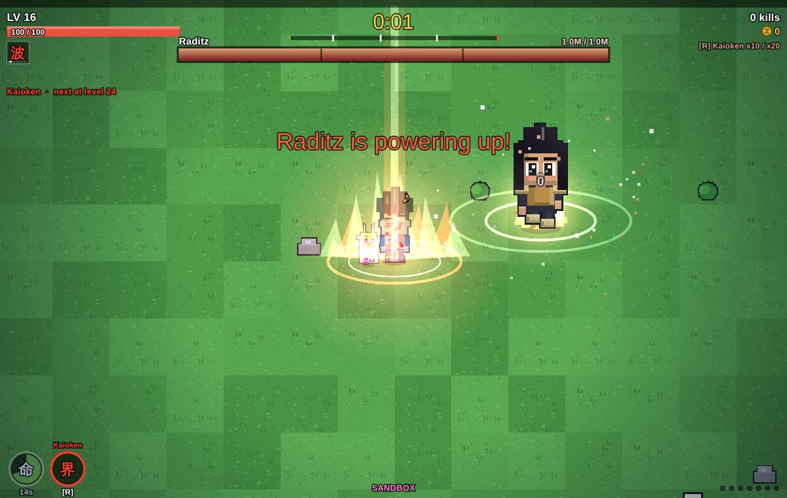
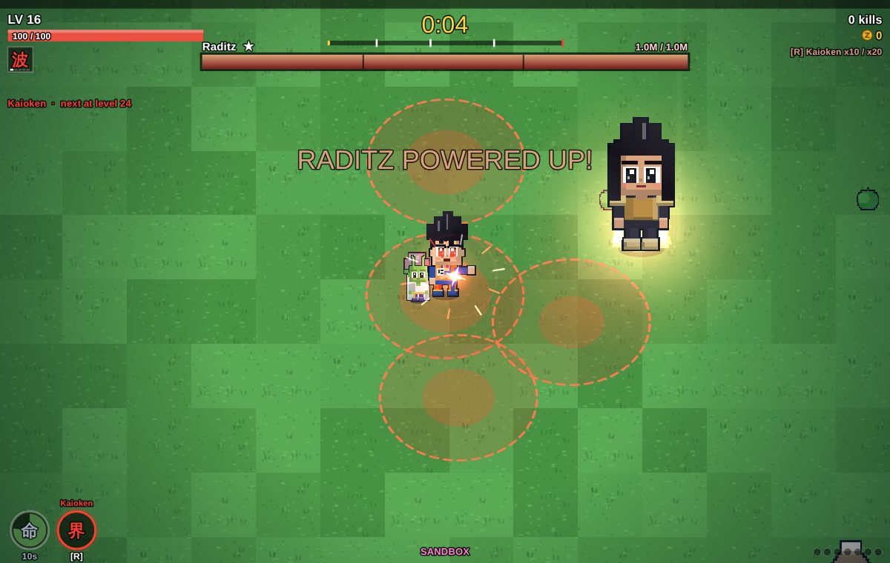

**Signature boss attacks.** Every boss now has 3 extra special attacks (the final boss has all 6) chosen from: **Ki wall** (a wall of shots with a gap), **Cross beams** (four lines of telegraphed blasts), **Flash step** (teleports next to you and fires a fan), **Seeker orbs** (homing orbs), **Vortex** (pulls you in before exploding) and **Death circle** (eight blasts closing in around you). Attacks are always telegraphed by red circles or visible projectiles.

**During boss fights:** normal enemies spawn a bit less (−30% rate, −20% cap). In the **final boss** fight the crowd **grows** instead (+50% rate, +30% cap) and enemies have **more HP and armor** but hit a bit softer (−15%); the final boss has **+30% HP**, **more armor** and deals **−10% damage**.

### 🔊 Reworked audio
New **electric Kamehameha** (crackling charge, distorted release), tougher "anime-style" sounds for Ki and every weapon, dedicated **evolution** effects, an **aura wind** during transformations, and sounds for every ability and enemy move.

### ⚖️ Balance
- **All damage power-ups are time-limited** (e.g. pickups +15% for 12 s, shrines 30 s).
- **Experience nerfed further**, slower level curve: high forms are reached only in long, hard stages.
- Enemies no longer one-shot you: damage per hit is capped to a fraction of max HP (lower for traps and boss bullets).
- Easy stages less trivial, hard stages without excessive forms.

### 🎨 Animation, UI and audio
- **Animated characters** in the select screen (breathing, blinking, expressions, poses) and **in game** (emotes on level up, pain/surprise expressions, smug after a boss).
- Zenny is no longer shown on the main menu; elsewhere it uses a **gold coin icon** instead of a "Z".
- **Menu music** from a file (also plays on character select); other tracks are synthesised.
- UI in **6 languages**: Italian, English, Spanish, French, German, Portuguese (game-content names are translated only in Italian and English; other languages fall back to English).

---

## Game mechanics

### Combat and weapons
- **Auto-attack**: each weapon has its own behaviour (projectiles, beams, orbits, fire zones, chain lightning, meteors…).
- Carry **up to 5 weapons** and **5 different passives**, each **up to level 5** (weapons then evolve and get another 5 levels per evolution).
- **22 weapons**: Ki Blast, Kamehameha, Destructo Disc, Spirit Bomb, Kaioken (aura), Solar Flare, Sword, Homing Orbs, Piercing Beam, Rebel Javelin, Double Sunday, Break Cannon, Elegant Dance, Ginyu Boomerang, Hellzone Grenade, Time Skip, Power Impact, Sphere of Destruction, Angelic Bolt, Fusion Meteor, Big Bang Kamehameha, Dynamite Kick.
- **Evolutions**: a maxed weapon can evolve (via chest). Each evolution needs **a maxed weapon + a specific upgrade** (see the Grimoire). A **second evolution** per weapon unlocks by **clearing every stage (Normal+) with that weapon in your build**.
- Weapons **unlock** into the level-up pool simply by **winning a stage** with a character that starts with that weapon (a second character with the same weapon unlocks nothing new). With the shop upgrade «Weapon Blacklist» (up to 10) you can **ban** weapons: they no longer show up as new weapons among the upgrades.
- **Passives**: Zenkai (+10% damage), Vigor (+20 HP), Swift Flight (+6% speed), Scouter (pickup), Gravity Chamber (−5% cooldown), Battle Armor, Senzu Beans (regen), Meditation (+8% XP).

### Experience, levels and transformations
- Each level offers cards (weapon, upgrade, etc.).
- Every character has a **transformation line** (Saiyan, Namekian, Human, Android, Frieza, Cell, Broly, Zamasu, Goku Black, Fused Zamasu, Caulifla, Kale, Pride Troopers, Gods, Majin, plus the third-wave lines): up to **8 forms** (Ultra Instinct at the end of some lines).
- Forms trigger at levels **14, 24, 36, 50, 66, 84, 104, 128** and grant damage, speed, cooldown, armor, regen and damage-reduction bonuses, plus a new look and aura colour.
- In the Room of Spirit and Time you can **buy the next form early**, but only once you reach at least 70% of its required level.

### Items, run structure and map
- **Chests** (one per boss, plus a supply chest every 5 minutes) with rewards and trinkets.
- **Ground pickups**: coins (4-32 zenny depending on the moment), zenny bag, heart, magnet, temporary damage/speed buffs, XP, luck.
- **Dragon Balls**: collect 7 to make a wish (second life, power, fortune).
- **Map events**: Altar of Power (temporary buff), Healing Spring, Sacrifice Altar (weapon +1 for half your HP), Experience Font, Coin Cache, Totem, Room of Spirit and Time.
- **20 trinkets** across 4 rarities: Broken Scouter, Senzu Pouch, Training Headband, Gravity Boots, Dragon Radar, Potara Earring, Namekian Cape, Power Pole, Speedy Cloud, Hoi-Poi Capsule, Kaioh's Heart, Angel Halo, Spirit Room Clock, Four-Star Ball, Divine Crystal, Royal Saiyan Armor, Ring of Time, Kaioh Mirror, Dragon Heart, Saiyan Fury.

### Stages, difficulty and modes
| # | Stage | Unlock |
|---|---|---|
| 1 | Roshi's Island | — |
| 2 | Snake Way | clear Stage 1 |
| 3 | Saiyan Plains | clear Stage 2 |
| 4 | Planet Vegeta | clear Stage 3 |
| 5 | Planet Namek | clear Stage 4 |
| 6 | Android Ruins | clear Stage 5 |
| 7 | Cell Games Arena | clear Stage 6 |
| 8 | Hell | clear Stage 7 |
| 9 | Buu's Dimension | clear Stage 8 |
| 10 | Realm of the Gods | clear Stage 9 |
| 11 | **Tournament of Power** (finale) | clear Stage 10 |

Stages follow the **canonical Dragon Ball order** (Dragon Ball → Z → Super) and difficulty rises stage by stage. Existing saves lose nothing: a stage you already cleared stays open.

Each stage has **dedicated enemies** (130+ variants in total, with different AI: chasers, shooters, kamikazes, shielded, blinkers…) and **bosses** at fixed times (e.g. Raditz, Nappa and Vegeta on the Saiyan Plains; Frieza on Namek; Cell at the Cell Games; Janemba on Snake Way; evolved Frieza and Cell + Omega Shenron in Hell; Jiren in the Tournament of Power). A **Glossary** in the menu describes every enemy and boss.

| Difficulty | Enemy HP | Enemy damage | Spawn rate | Zenny | Length |
|---|---|---|---|---|---|
| Easy | ×0.9 | ×0.7 | ×0.8 | ×0.7 | 5 min |
| Normal | ×1 | ×1 | ×1 | ×1 | 10 min |
| Hard | ×2 | ×1.5 | ×1.4 | ×1.35 | 15 min |
| Extreme | ×4 | ×1.8 | ×1.5 | ×2.4 | 30 min |

**x2 mode** (unlocked by reaching a stage's final boss): double time and zenny, reduced XP, tougher enemies.
**Sandbox mode** (Settings): freely try weapons, forms and evolutions.

### Permanent progression
- **Shop** (12 upgrades, increasing cost, up to level 6 each; Second Life up to 2): Greed, Study, Vitality, Regeneration, Power, Agility, Magnetism, Armor, Tempo, Luck, Keen Eye, **Second Life** (revive).
- **Achievements**: 90 achievements with zenny rewards.
- **Characters**: 4 available from the start (Goku, Vegeta, Piccolo, Krillin); the rest unlock through a **condition** (clear stages, also on Hard, reach a level, defeat N enemies/bosses) **or by buying** them with zenny.
- Auto-saves in the browser (localStorage); reset from Settings.

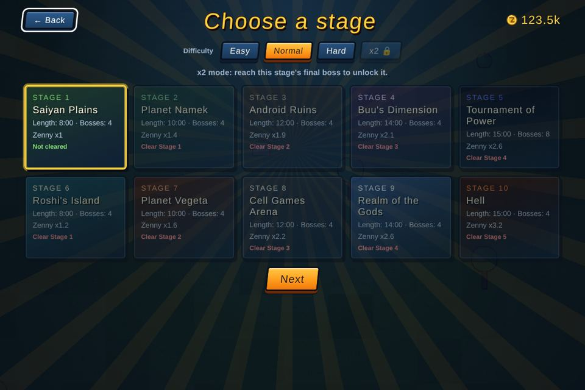
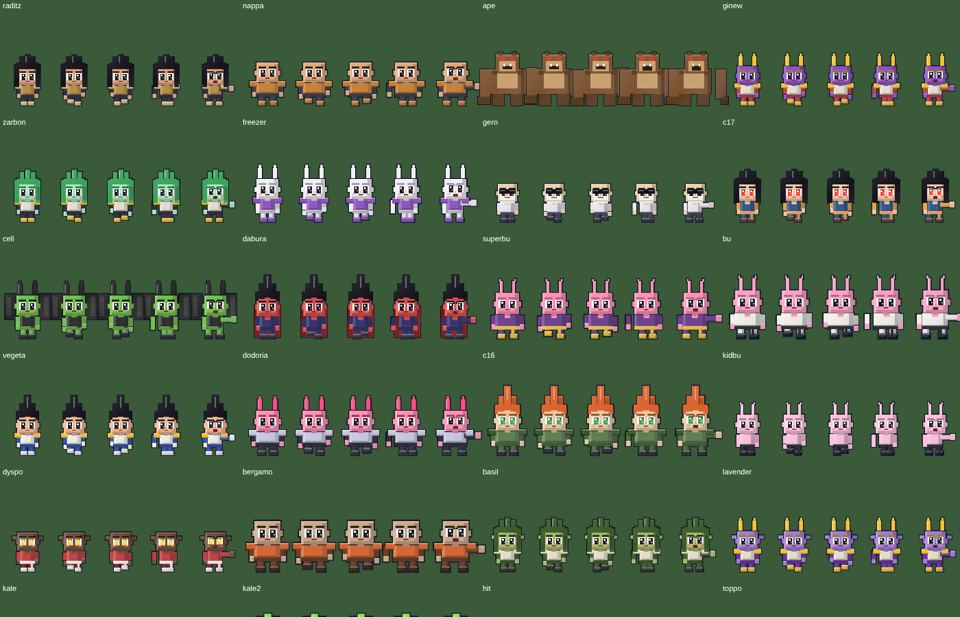

### Playable characters

| Form line | Characters |
|---|---|
| Saiyan | Goku, Vegeta, Trunks, Gohan, Goten, Gotenks, Vegito, Gogeta, Kefla, Raditz, Nappa, Bardock, Great Saiyaman |
| Namekian | Piccolo, Nail |
| Human | Krillin, Yamcha, Tien, Master Roshi, Mr. Satan, Videl, Bulma, Yajirobe, Pan, Mr. Popo |
| Android | Android 18, 17, 16, Dr. Gero, Android 21 |
| Frieza | Frieza, Cooler, Captain Ginyu, Zarbon |
| Cell · Majin | Cell · Majin Buu |
| Pride Troopers | Toppo, Hit, Jiren, Dyspo |
| Gods | Beerus, Whis |
| Dedicated lines | Broly, Zamasu, Fused Zamasu, Goku Black, Caulifla, Kale, Chiaotzu, Turles, Dabura and King Piccolo (Demons), Recoome and Guldo (Special Force), King Kai, Frost, Uub |

---

## Build and development

You only need **Python 3** (bundler) and, optionally, **Node.js** (syntax check and tests).

```bash
python3 build.py --check      # builds dist/dragon-ball-survivors.html and syntax-checks it with node
```

Open `dist/dragon-ball-survivors.html` in a modern browser. It is **self-contained** and works offline (Google Fonts are optional, there is a fallback).

For the **menu music** it is already included at `assets/menu.mp3` (see [assets/README.md](assets/README.md)); replace the file to change it; if it is missing a synthesised track is used.

**Hosting on GitHub Pages**: after `python3 build.py`, copy `dist/dragon-ball-survivors.html` to `docs/index.html` and enable Pages on `main` / `docs`.

## Project layout

```
build.py              bundler: merges src/ into a single HTML
src/index.html        page
src/css/style.css     styles
src/js/               data, i18n, weapons, world, save, game logic, sprites (+ sprites_hd: HD pipeline for enemies/bosses), audio, input, renderer, UI, app
                      (pose = per-weapon arms with inverse kinematics, events + events_draw = map events, xpbar / hpbar = the artwork bars)
                      (map look & life: mapart = themed props and ground decor, sea = animated lakes/sea/lava, objlife = critters on props, snake_art = Snake Way islands)
tests/                simulations and puppeteer tests
docs/screens/         screenshots used in this README
```

## Tests

```bash
node tests/check_i18n.js      # translations in all languages
node tests/map_random.js      # random maps: seeds, clear start area, Snake Way over 25 seeds (puppeteer)
node tests/snake_isles.js     # Snake Way islands, enemy fire budget, cut bullets (puppeteer)
node tests/endless.js         # Endless mode: coins, 50 levels, Lv 100 weapons, Zeno, payout, scaling, berserk, Magnet (puppeteer)
node tests/events.js          # map events: the 11 stages, announcements, transformations, clean end (puppeteer)
node tests/pose.js            # weapon animations: armless frames, IK, Kamehameha / Ki Blast, poses, sprite frames 10-15 (puppeteer)
node tests/hpbar.js           # Health bar with the live portrait (puppeteer); screenshots: shot_pose.js, shot_hp.js
node tests/shot_map.js beach out.png 1024 576 water 0   # screenshot of a map (also shot_props, shot_life, shot_loot, shot_patch)
node tests/v53.js             # v53 gameplay: balance, TAB, weapons per run, zenny bags, Senzu, totems, Tamagami, water and lava (puppeteer)
node tests/v56.js             # v56 spiders, bird shadows, arcade damage numbers and red criticals (puppeteer)
node tests/v54.js             # v54 trinkets and companions: Perfection, 4-trinket chest, skip-lower, companion (XP + shockwave), gacha, swap window, aura (puppeteer)
node tests/eco52.js           # v52 economy: Reroll/Skip/Ban, Zeno, tickets, coin streak, Achievements, Objectives, quests (puppeteer)
node tests/ui52.js            # v52 interface: gear, character search/sort, Quick Start, notifications (puppeteer)
node tests/gacha.js           # Gacha: odds, tickets, Bag, slot, in-run sale, Super Balls (puppeteer)
node tests/kai.js             # Kaioken x10/x20
node tests/bers.js            # Broly's Berserk
node tests/totem.js           # one-time totem + 8 powers
node tests/abil.js            # every ability of the 58 characters
node tests/newchars.js        # the 16 new characters: data, unlocks, Yajirobe's Senzu, full runs
node tests/ui_sfx.js          # arcade button sounds (hover, click, back) - needs puppeteer
node tests/sheet_hd.js en out.png   # preview every enemy sprite (also: boss, or comma-separated keys)
node tests/shot_enemies.js out.png  # in-game screenshot with every enemy
node tests/boss.js            # boss power-ups, slams
node tests/boss2.js           # boss signature attacks, spawn rules
node tests/spirit.js          # Room of Spirit and Time
node tests/senzu.js           # Senzu bag
node tests/gems.js            # red XP gem
node tests/sim.js             # simulation with all characters
node tests/death.js 0 normal 6 goku     # balance: stage, difficulty, runs, character
# e2e/smoke (need puppeteer + a browser): e2e*.js, smoke5.js, smoke6.js, smoke7.js
```

> Balance was checked with a deliberately weak bot; real human play may be easier. Feedback is welcome in the issues.

## License

The **code** is released under the [MIT](LICENSE) license. Dragon Ball names, characters and marks are **not covered** by this license and belong to their respective owners ([DISCLAIMER.md](DISCLAIMER.md)).
