<p align="center"></p>

# Dragon Ball: Survivors

> 🇬🇧 English version: [README.en.md](README.en.md)

Un survivor-like in stile *Vampire Survivors* ispirato a Dragon Ball: ti muovi, le armi sparano da sole, raccogli esperienza, sali di livello, ti trasformi e sopravvivi fino al boss finale. Si gioca nel browser, da PC e da telefono, in **un solo file HTML** (Canvas 2D e JavaScript puro, nessuna dipendenza).

> ⚠️ Progetto amatoriale, non ufficiale e senza scopo di lucro. Non è affiliato a Toei Animation, Shueisha, Bandai Namco né agli eredi di Akira Toriyama. Vedi [DISCLAIMER.md](DISCLAIMER.md).

<p align="center">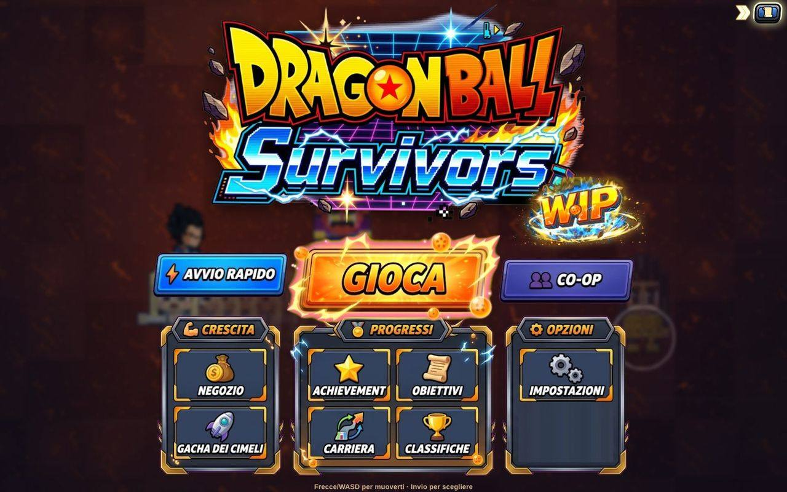<br><sub>Menu</sub></p>

## Indice

1. [Come si gioca](#come-si-gioca)
2. [Controlli](#controlli)
3. [Modalità di gioco](#modalità-di-gioco)
4. [Dentro la partita](#dentro-la-partita)
5. [Personaggi, armi e trasformazioni](#personaggi-armi-e-trasformazioni)
6. [Cimeli e Gacha](#cimeli-e-gacha)
7. [Stage, nemici e boss](#stage-nemici-e-boss)
8. [Progressione permanente](#progressione-permanente)
9. [Online e co-op](#online-e-co-op)
10. [Schermate e opzioni](#schermate-e-opzioni)
11. [Grafica e sprite dei personaggi](#grafica-e-sprite-dei-personaggi)
12. [Build e sviluppo](#build-e-sviluppo)
13. [Struttura del progetto](#struttura-del-progetto)
14. [Licenza e crediti](#licenza-e-crediti)

---

## Come si gioca

1. Dal menu scegli **Gioca** (o **Avvio rapido**), poi lo stage, il personaggio, il **compagno** e quante armi portare (da 1 a 5).
2. Ti muovi tu: **le armi attaccano da sole**. Con `Tab` scegli chi colpire (il più vicino, quello con più o meno Salute, il boss).
3. I nemici lasciano **gemme di esperienza**: raccoglile per salire di livello e scegliere una carta (arma, potenziamento, ecc.).
4. Ai livelli giusti ti **trasformi** (Super Saiyan, Ultra Istinto…): ogni forma dà bonus per tutta la partita.
5. Sopravvivi **30 minuti**, poi sconfiggi il **boss finale** dello stage. Hai 30 secondi per raccogliere il bottino prima della schermata di vittoria.
6. Se muori tieni comunque gli zenny guadagnati. Con gli **zenny** compri potenziamenti permanenti nel Negozio, personaggi e ticket del Gacha.

<table><tr><td width="50%">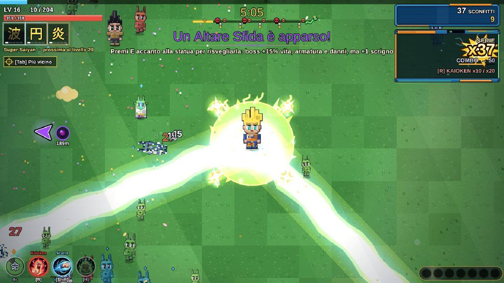<br><sub>Una partita: armi automatiche, combo e Serie di uccisioni</sub></td><td width="50%">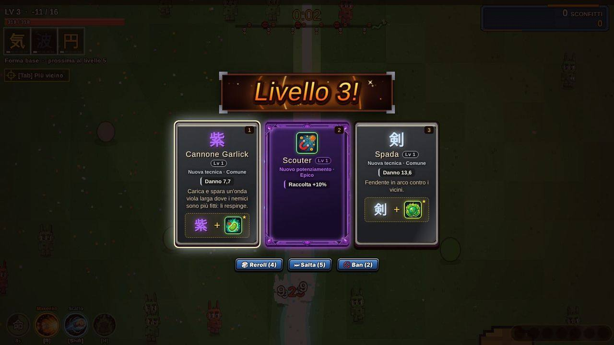<br><sub>Level-up: tre carte, con Reroll, Skip e Ban</sub></td></tr></table>

## Controlli

### Tastiera e mouse

| Azione | Tasti |
|---|---|
| Muoversi | `W` `A` `S` `D` / frecce |
| Abilità del personaggio (Kaioken, Berserk, raggi, cloni, ferma tempo…) | `R` o `X` |
| Scatto (danni sul percorso e invulnerabilità breve) | `Shift` |
| Fagiolo Senzu (cura 50% e un bonus alle statistiche, dalla borsa) | `H` |
| Abilità del compagno | `Q` |
| Interagire (altari, totem, forzieri, Macchina dello Scambio, Stanza dello Spirito e del Tempo…) | `E` o `F` |
| Cambiare bersaglio delle armi | `Tab` |
| Pausa (mappa, statistiche, cronologia eventi, impostazioni) | `Esc` o `P` |
| Scegliere una carta nelle finestre di scelta | `1`–`9` (`0` = la decima) |
| Premere il pulsante evidenziato / uscire dalla Stanza dello Spirito e del Tempo | `Spazio` |
| Conferma / indietro nei menu | `Invio` o `Spazio` / `Esc` o `⌫` |
| Zoom della telecamera | rotella del mouse (50–150%, a passi del 10%) |
| Contatore FPS e diagnostica | `F2` o `` ` `` |

Il **Kamehameha** si carica tenendo premuto il tasto dell'abilità. Tutti i tasti si riassegnano da **Impostazioni → Comandi**.

### Gamepad

| Azione | Pulsante |
|---|---|
| Muoversi / menu | D-pad |
| Conferma / interagire | A |
| Indietro | B |
| Abilità del compagno | X |
| Abilità del personaggio | Y |
| Fagiolo Senzu | LB |
| Scatto | RB |
| Cambiare bersaglio | pressione dello stick sinistro |
| Pausa | Start |
| Diagnostica | Select |

### Telefono e tablet

Joystick virtuale a schermo e pulsanti grandi con le icone di **abilità**, **Scatto**, **Fagiolo Senzu**, **compagno** e **Interagisci** (`E`). L'interfaccia si rimpicciolisce per lasciare più campo visibile, la mappa in pausa si trascina con il dito.


<p align="center">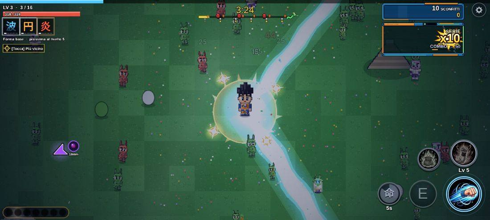<br><sub>Su telefono: pulsanti touch</sub></p>

---

## Modalità di gioco

| Modalità | Come funziona |
|---|---|
| **Classica** | Una partita da 30 minuti per stage che finisce con il boss finale. Una sola difficoltà: la sfida cresce col tempo (nemici più numerosi dal minuto 3, più forti ogni 5 minuti, miniboss e élite). |
| **x2** | Si sblocca raggiungendo il boss finale di uno stage: la partita dura la metà, l'esperienza è ridotta, i nemici sono più duri. Nessun moltiplicatore di zenny. |
| **Infinita** | Si sblocca vincendo lo stage («Continua»): le armi salgono fino al Lv 100, la ricarica può scendere a 0,2 s, il negozio di Zeno-sama compare ogni 5 minuti e ogni 50 livelli ricevi 100 monete mentre i nemici diventano più forti. Dal menu di pausa imposti priorità e scelta automatica dei potenziamenti. |
| **Avvio rapido** | Parte subito con l'ultimo personaggio e stage usati. |
| **Sfida settimanale** | Stesso stage, personaggio e seme per tutti per una settimana: il primo in classifica ti torna contro come fantasma. |
| **Co-op** | Fino a 4 giocatori nello stesso mondo (BETA). Vedi [Online e co-op](#online-e-co-op). |

---

## Dentro la partita

### Combattimento
- **Attacco automatico**: ogni arma ha il suo comportamento (proiettili, raggi, orbite, zone di fuoco, fulmini a catena, meteore…). I colpi pesano: numeri di danno arcade (rossi per i critici), combo, **Serie** di uccisioni con barra e fasce (50, 100, 200, 500).
- **Debolezze**: ogni boss ne ha una. Alcuni attacchi nemici si possono distruggere.
- **Ki Clash**, **Ultimo respiro**, alleati che arrivano in aiuto, cinematiche dei boss e delle trasformazioni (la telecamera si stringe e tutto si ferma finché l'aura esplode).
- **Level-up**: oltre alle carte puoi usare **Reroll**, **Skip** e **Ban** (strumenti del Negozio) e il level-up automatico con le tue priorità (Impostazioni).

<table><tr><td width="50%">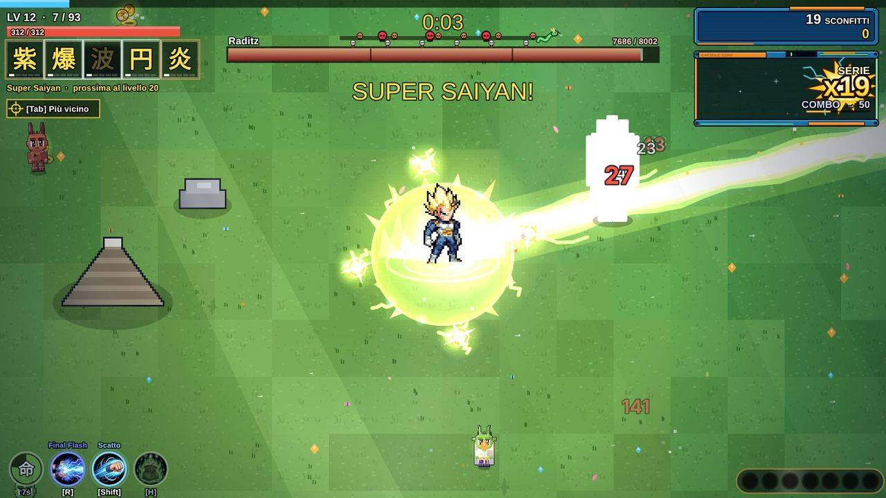<br><sub>Un boss con la sua barra e la debolezza</sub></td><td width="50%">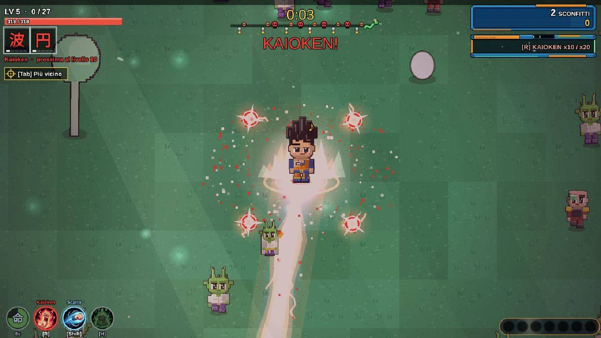<br><sub>Trasformazione: la telecamera si stringe mentre l'aura esplode</sub></td></tr></table>

### Che cosa trovi sulla mappa
Ogni partita ha una mappa diversa e viva (meteo, giorno/notte, mare e lava animati, creature, oggetti da rompere).

| Elemento | Cosa fa |
|---|---|
| **Forzieri** | Uno per boss e uno di rifornimento ogni 5 minuti, in cinque rarità, con potenziamenti e cimeli. |
| **Zenny e oggetti** | Monete, borse di zenny, cuori, magnete, potenziamenti temporanei, esperienza, Fortuna. I punti di bottino compaiono più spesso con il loot extra. |
| **Sfere del Drago** | Raccogline 7 per evocare **Shenron** (4 desideri proposti tra seconda vita, potere, fortuna, ticket, immortalità, trasformazione, leggenda). Le 3 **Super Sfere** custodite dai Tamagami chiamano **Porunga**. |
| **Altari e sorgenti** | Altare del Potere, Sorgente curativa, Altare del Sacrificio, Fonte dell'esperienza, Deposito di monete, Altari Sfida (boss più forti in cambio di più scrigni). Si usano con `E`. |
| **Totem** | 8 poteri: Fortuna, Rischio, Vitalità, Furia, Ricchezza, Guardiano, Tempesta, Spirito. |
| **Stanza dello Spirito e del Tempo** | Compri in anticipo la forma successiva (con almeno il 70% del livello richiesto) e affronti un Maestro che imita le tue armi. |
| **Macchina dello Scambio** | Compare in circa il 12% delle partite: ci metti fino a 3 cimeli, lavora ~10 secondi **mentre giochi** (barra di avanzamento sopra di lei) e ti restituisce cimeli diversi della stessa rarità, con perfezione uguale o migliore. |
| **Tunnel** | Ne compare uno ogni 15 minuti: tunnel a senso unico con un boss in fondo e 3 casse. |
| **Portale di Zeno** | Il negozio di Zeno-sama. |
| **Visite a sorpresa** | Un personaggio arriva con una missione da 60 secondi; Cerchio di allenamento, Capsule Corp, Saibaman d'oro che scappa col bottino. |
| **Trappole e zone di cura** | Rare ma pericolose o preziose. |
| **Eventi a tema** | Ogni stage ha un evento in cui i nemici si trasformano (annunci in 6 lingue). |
| **Orde, élite, miniboss** | Orde a tema (la prima a 2 minuti, poi una ogni 5) guidate da un élite, un miniboss ogni 5 minuti, nemici che salgono di grado. |

La mappa in pausa (grande, con zoom) mostra dove sono i pickup; frecce ai bordi dello schermo indicano gli oggetti importanti.

<table><tr><td width="50%">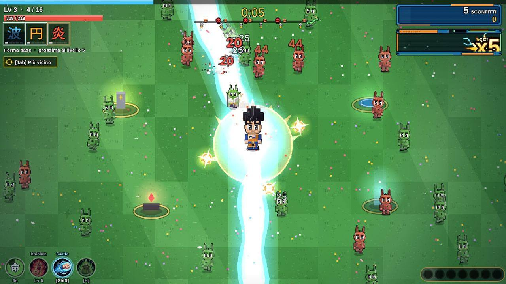<br><sub>Altari e sorgenti sulla mappa</sub></td><td width="50%">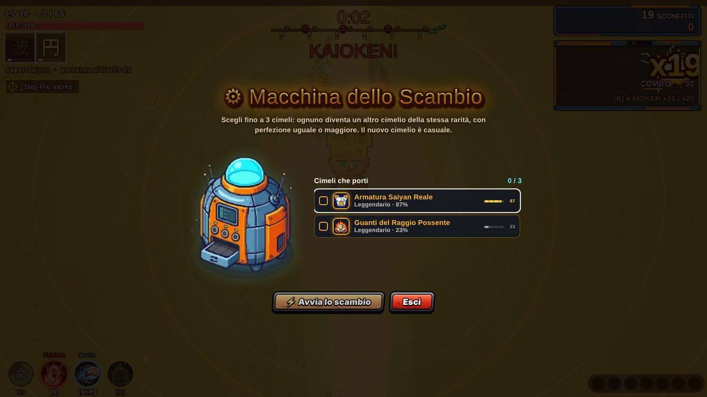<br><sub>Macchina dello Scambio</sub></td></tr></table>

<table><tr><td width="50%">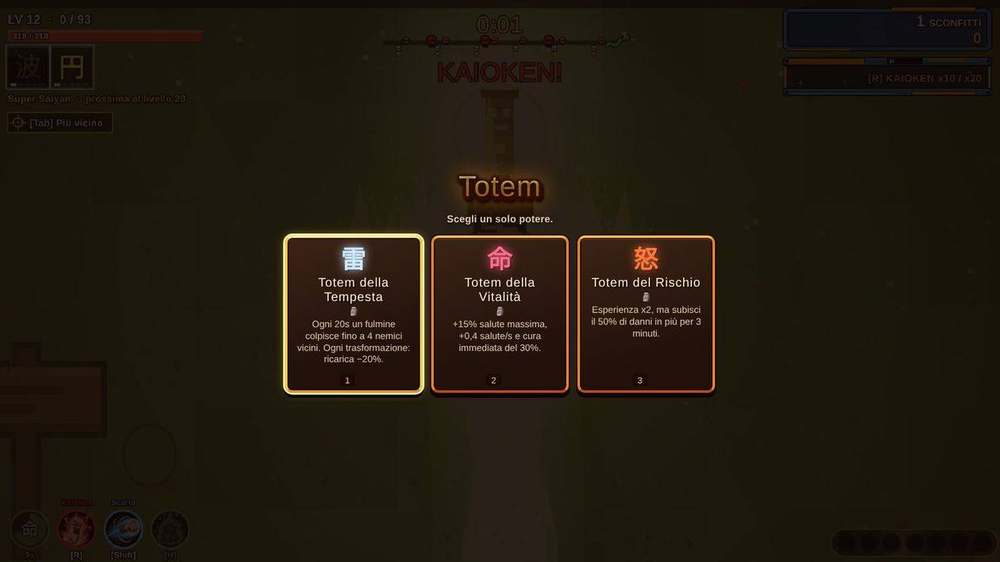<br><sub>Totem: scegli un solo potere</sub></td><td width="50%">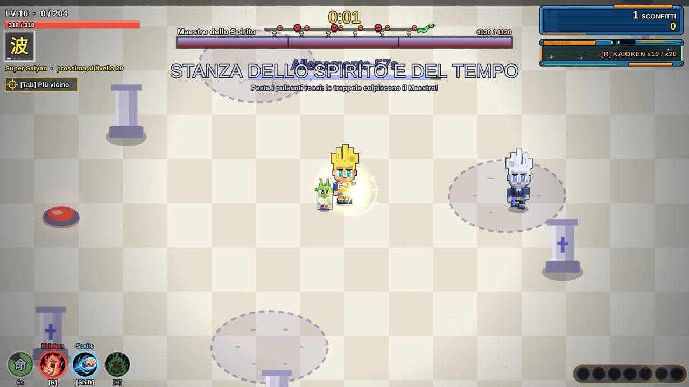<br><sub>Stanza dello Spirito e del Tempo</sub></td></tr></table>

<table><tr><td width="50%">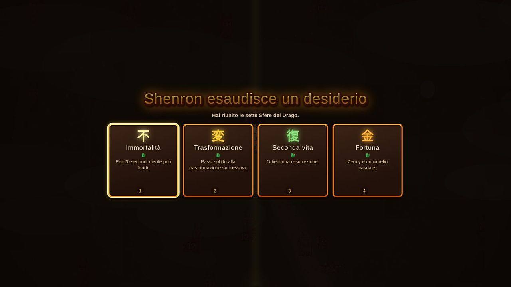<br><sub>Shenron esaudisce un desiderio</sub></td><td width="50%">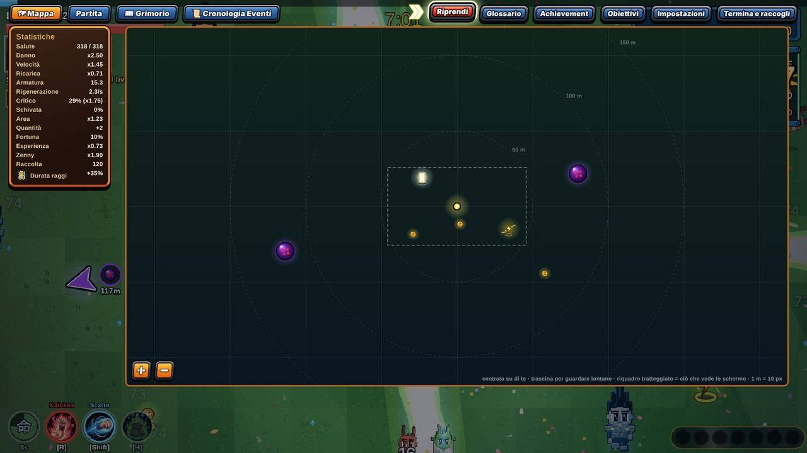<br><sub>Pausa: mappa, statistiche e impostazioni</sub></td></tr></table>

### Compagni
Raccolgono l'esperienza lontana, hanno un'abilità (`Q`) e liberano un'onda d'urto quando sei circondato.

| Compagno | Razza | Abilità | ricarica |
|---|---|---|---|
| **Dende** | Namecciano | **Guarigione** — Recuperi il 30% della salute. | 30 s |
| **Mini Shenron** | Drago | **Raccolta Magica** — Attira le gemme di esperienza entro 400 px e dà un bonus di XP pari al 5% del livello. | 40 s |
| **Mini Droide** | Androide | **Scudo Energetico** — Sei invulnerabile per 1,5 secondi. | 40 s |
| **Bubbles** | Animale della Terra | **Banana Fortunata** — Tre monete di zenny a terra e +2,5% fortuna per 50 secondi. | 36 s |
| **Mini Bu** | Majin | **Raggio Caramella** — Stordisce i nemici entro 210 px per 1 secondo (0,4 sui boss). | 28 s |
| **Saibaman** | Saiyan (pianta) | **Autodistruzione** — Esplode infliggendo danni ad area (raggio 160 px). | 22 s |

**Totem** (8 poteri, se ne sceglie uno):

| Totem | Effetto |
|---|---|
| **Totem della Fortuna** | +0,5% fortuna a ogni livello, per tutta la partita. |
| **Totem del Rischio** | Esperienza x2, ma subisci il 50% di danni in più per 3 minuti. |
| **Totem della Vitalità** | +15% salute massima, +0,4 salute/s e cura immediata del 30%. |
| **Totem della Furia** | +12% danno, ma ricarica +8% più lenta. |
| **Totem della Ricchezza** | +35% zenny e +25% raccolta per 150 secondi. |
| **Totem Guardiano** | Una barriera blocca un colpo, poi si ricarica ogni 25s. |
| **Totem della Tempesta** | Ogni 20s un fulmine colpisce fino a 4 nemici vicini. Ogni trasformazione: ricarica −20%. |
| **Totem dello Spirito** | Ogni 20s un impulso cura il 6% (fino al 12% con le trasformazioni) e stordisce i nemici vicini. Ogni trasformazione: ricarica −20%. |

---

## Personaggi, armi e trasformazioni

### 58 personaggi giocabili
Ognuno ha armi di partenza, statistiche, una **linea di trasformazioni** (fino a 8 forme, ai livelli 5, 10, 20, 30, 50, 70, 90 e 120, con aura dipinta) e un'**abilità unica** con una versione potenziata nella forma finale.

<p align="center">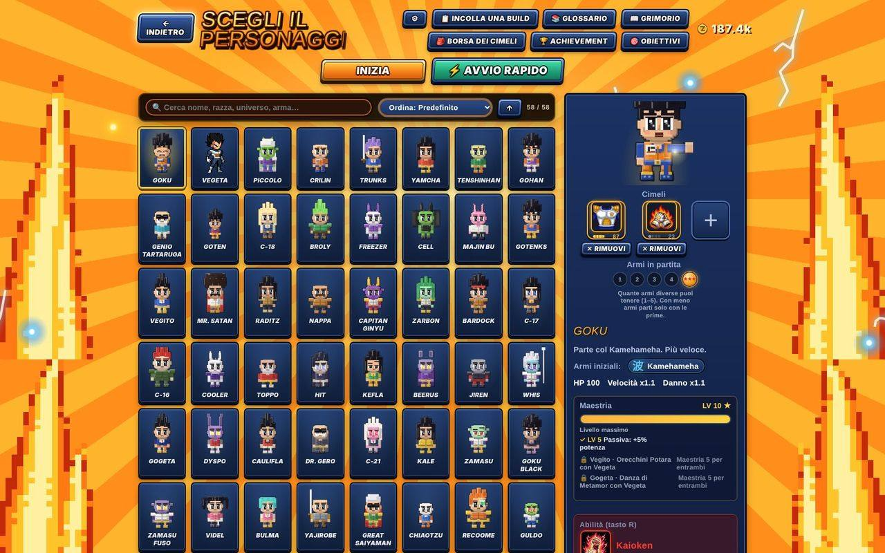<br><sub>Selezione del personaggio</sub></p>

<details>
<summary><b>Tutti i 58 personaggi</b></summary>

| | Nome | Parte con | Abilità | Salute · Velocità · Danno |
|---|---|---|---|---|
|  | **Goku** | Kamehameha | 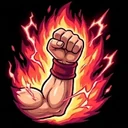 **Kaioken** — Kaioken x10 / x20: danno ×1,5 / ×2, ma perdi 8 / 16 salute al secondo, +1,5 per ogni trasformazione raggiunta. Premi di nuovo per cambiare o spegnere. | 100 · ×1.1 · ×1.1 |
|  | **Vegeta** | Cannone Garlick, Attacco Big Bang | 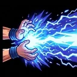 **Final Flash** — Raggio potente nella direzione del nemico più vicino: colpisce tutto in linea. | 95 · ×1 · ×1.2 |
|  | **Piccolo** | Granata Infernale | 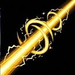 **Cannone Speciale** — Carica per circa 1 secondo, poi spara un raggio a spirale sottilissimo che trafigge tutti i nemici in linea: danno altissimo e stordimento. | 125 · ×0.95 · ×1.1 |
|  | **Crilin** | Disco Distruttore | 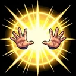 **Taiyoken** — Acceca e stordisce i nemici vicini per 1,7 secondi. | 105 · ×1 · ×1.3 |
|  | **Trunks** | Spada | 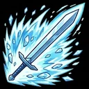 **Fendente Furioso** — Esplosione di ki attorno a te: danni ad area e respinge i nemici. | 100 · ×1.05 · ×1.1 |
|  | **Yamcha** | Colpi Eccentrici | 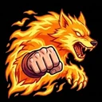 **Pugno Zanna di Lupo** — Scatto in avanti, invulnerabile, che colpisce chi attraversi. | 95 · ×1.05 · ×1 |
|  | **Tenshinhan** | Taiyoken, Colpo di Ki | 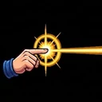 **Raggio Dodon** — Raggio potente nella direzione del nemico più vicino: colpisce tutto in linea. | 100 · ×1 · ×0.97 |
|  | **Gohan** | Colpo di Ki | 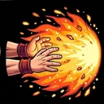 **Masenko** — Raggio potente nella direzione del nemico più vicino: colpisce tutto in linea. | 100 · ×1 · ×1 |
|  | **Genio Tartaruga** | Kamehameha | 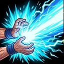 **Kamehameha del Maestro** — Raggio potente nella direzione del nemico più vicino: colpisce tutto in linea. | 90 · ×0.95 · ×1 |
|  | **Goten** | Colpi Eccentrici | 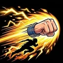 **Scatto Fulmineo** — Scatto in avanti, invulnerabile, che colpisce chi attraversi. | 95 · ×1.15 · ×1 |
|  | **C-18** | Colpo di Ki | 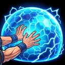 **Barriera Energetica** — Barriera: invulnerabile per 1,5 secondi. | 105 · ×1 · ×1 |
|  | **Broly** | Aura | 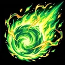 **Meteora Gigante** — Scaglia una meteora di ki verde sul nemico più vicino: avanza lentamente crescendo e poi esplode con danni enormi. | 140 · ×0.9 · ×1.25 |
|  | **Freezer** | Raggio Perforante | 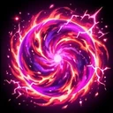 **Supernova Mortale** — Esplosione di ki attorno a te: danni ad area e respinge i nemici. | 88 · ×1 · ×1.2 |
|  | **Cell** | Colpo di Ki | 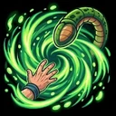 **Assorbimento** — Assorbi energia dai nemici vicini: danni e cura fino al 12% della salute. | 105 · ×1 · ×1.05 |
|  | **Majin Bu** | Aura, Genkidama | 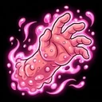 **Rigenerazione Elastica** — Rigenera il 15% della salute in 6 secondi. | 165 · ×0.85 · ×0.95 |
|  | **Gotenks** | Colpi Eccentrici, Colpo di Ki | 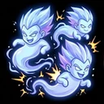 **Fantasmi Kamikaze** — Evoca 3 fantasmi che volano contro il nemico più vicino e copiano le tue armi attive: attaccano ogni 10 secondi (fino a ogni 4 secondi salendo di livello) e a fine durata esplodono. | 80 · ×1.15 · ×1.05 |
|  | **Vegito** | Colpo di Ki, Kamehameha | 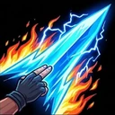 **Lama Spirituale** — Raggio potente nella direzione del nemico più vicino: colpisce tutto in linea. | 95 · ×1.05 · ×1 |
|  | **Mr. Satan** | Calcio Dinamite | 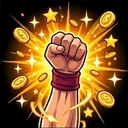 **Colpo di Fortuna** — Monete, una piccola cura e un po' di fortuna per 30 secondi. | 90 · ×0.95 · ×0.95 |
|  | **Raditz** | Doppio Sunday | 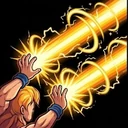 **Doppio Sunday** — Raggio potente nella direzione del nemico più vicino: colpisce tutto in linea. | 100 · ×1 · ×1.1 |
|  | **Nappa** | Cannone Distruttore | 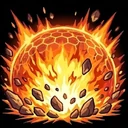 **Esplosione Saiyan** — Esplosione di ki attorno a te: danni ad area e respinge i nemici. | 130 · ×0.9 · ×1.15 |
|  | **Capitan Ginyu** | Boomerang Ginyu | 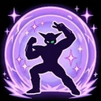 **Posa Ginyu** — Barriera: invulnerabile per 1,5 secondi. | 105 · ×1 · ×1.05 |
|  | **Zarbon** | Danza Elegante | 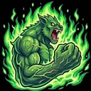 **Mostro Zarbon** — Potenziamento per 8 secondi: danno +25%, velocità +15%. | 95 · ×1.1 · ×1.05 |
|  | **Bardock** | Lancia Ribelle | 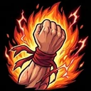 **Rivolta Saiyan** — Potenziamento per 8 secondi: danno +30%. | 100 · ×1.05 · ×1.15 |
|  | **C-17** | Disco Distruttore | 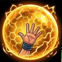 **Barriera Perfetta** — Barriera: invulnerabile per 1,5 secondi. | 105 · ×1.05 · ×1 |
|  | **C-16** | Granata Infernale | 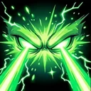 **Cannone Oculare** — Raggio potente nella direzione del nemico più vicino: colpisce tutto in linea. | 150 · ×0.85 · ×1.15 |
|  | **Cooler** | Raggio Perforante | 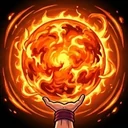 **Supernova Cooler** — Esplosione di ki attorno a te: danni ad area e respinge i nemici. | 92 · ×1 · ×1.2 |
|  | **Toppo** | Sfera della Distruzione | 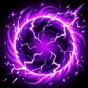 **Sfera della Giustizia** — Lancia una sfera oscura sul nemico più vicino: cresce, attira i nemici vicini e poi esplode con danni enormi. | 135 · ×0.95 · ×1.25 |
|  | **Hit** | Salto Temporale | 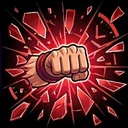 **Salto Temporale** — Ferma il tempo: i nemici sullo schermo restano bloccati per 1,8 secondi. | 90 · ×1.15 · ×1.1 |
|  | **Kefla** | Meteora di Fusione | 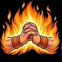 **Fusione Furiosa** — Potenziamento per 8 secondi: danno +30%, velocità +10%. | 100 · ×1.1 · ×1.15 |
|  | **Beerus** | Aura, Sfera della Distruzione | 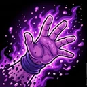 **Hakai** — Cancella una parte della vita dei nemici vicini (poco sui boss). | 100 · ×1 · ×1.1 |
|  | **Jiren** | Impatto Potente, Aura | 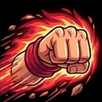 **Pugno Inarrestabile** — Scatto in avanti, invulnerabile, che colpisce chi attraversi. | 125 · ×1 · ×1.3 |
|  | **Whis** | Fulmine Angelico | 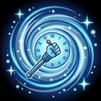 **Riavvolgimento** — Riavvolge il tempo: recuperi la salute persa negli ultimi 6 secondi. | 85 · ×1.2 · ×1 |
|  | **Gogeta** | Big Bang Kamehameha, Colpo di Ki | 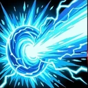 **Big Bang Kamehameha** — Raggio potente nella direzione del nemico più vicino: colpisce tutto in linea. | 100 · ×1.05 · ×1.2 |
|  | **Dyspo** | Calcio Dinamite | 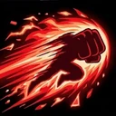 **Velocità Suprema** — Scatto in avanti, invulnerabile, che colpisce chi attraversi. | 80 · ×1.28 · ×1 |
|  | **Caulifla** | Colpo di Ki | 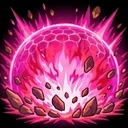 **Onda Saiyan** — Esplosione di ki attorno a te: danni ad area e respinge i nemici. | 95 · ×1.1 · ×1.15 |
|  | **Dr. Gero** | Doppio Sunday | 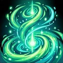 **Energia Infinita** — Rigenera il 13% della salute in 6 secondi. | 100 · ×0.88 · ×1.1 |
|  | **C-21** | Colpo di Ki, Boomerang Ginyu |  **Appetito Insaziabile** — Assorbi energia dai nemici vicini: danni e cura fino al 12% della salute. | 105 · ×1.05 · ×1.05 |
|  | **Kale** | Big Bang Kamehameha | 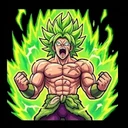 **Furia Incontrollata** — Potenziamento per 8 secondi: danno +50% (subisci +30% di danni). | 125 · ×0.95 · ×1.25 |
|  | **Zamasu** | Spada, Fulmine Angelico |  **Lama di Giudizio** — Raggio potente nella direzione del nemico più vicino: colpisce tutto in linea. | 100 · ×1 · ×1.05 |
|  | **Goku Black** | Spada, Colpo di Ki |  **Lama di Ki** — Scatto in avanti, invulnerabile, che colpisce chi attraversi. | 95 · ×1.1 · ×1.2 |
|  | **Zamasu Fuso** | Fulmine Angelico, Meteora di Fusione |  **Giudizio Divino** — Cancella una parte della vita dei nemici vicini (poco sui boss). | 130 · ×1 · ×1.25 |
|  | **Videl** | Calcio Dinamite, Colpo di Ki |  **Calcio Volante** — Scatto in avanti, invulnerabile, che colpisce chi attraversi. | 95 · ×1.1 · ×1.05 |
|  | **Bulma** | Colpo di Ki |  **Invenzione Geniale** — Monete, una piccola cura e un po' di fortuna per 30 secondi. | 80 · ×1 · ×0.9 |
|  | **Yajirobe** | Spada |  **Scorta di Senzu** — Rigenera il 20% della salute in 6 secondi. | 130 · ×0.9 · ×1.15 |
|  | **Great Saiyaman** | Colpo di Ki |  **Posa Eroica** — +35% probabilità di critico per 8 secondi. | 100 · ×1.05 · ×1.15 |
|  | **Chiaotzu** | Raggio Perforante |  **Raggio Dodon** — Raggio potente nella direzione del nemico più vicino: colpisce tutto in linea. | 85 · ×1.08 · ×0.95 |
|  | **Recoome** | Cannone Distruttore |  **Calcio Recoome** — Scatto in avanti, invulnerabile, che colpisce chi attraversi. | 125 · ×0.9 · ×1.3 |
|  | **Guldo** | Salto Temporale |  **Fermatempo** — Ferma il tempo: i nemici sullo schermo restano bloccati per 1,8 secondi. | 80 · ×0.95 · ×0.95 |
|  | **Turles** | Meteora di Fusione, Colpo di Ki |  **Frutto dell'Albero** — Assorbi energia dai nemici vicini: danni e cura fino al 12% della salute. | 100 · ×1.05 · ×1.2 |
|  | **Nail** | Lancia Ribelle |  **Spirito Guerriero** — Potenziamento per 8 secondi: danno +40% (subisci +20% di danni). | 110 · ×1.05 · ×1.15 |
|  | **Re Kaioh** | Aura |  **Allenamento di Re Kaioh** — Potenziamento per 8 secondi: danno +30%, velocità +12%. | 115 · ×0.9 · ×1 |
|  | **Pan** | Colpi Eccentrici, Danza Elegante |  **Sangue Saiyan** — Potenziamento per 8 secondi: danno +20%, velocità +20%. | 85 · ×1.15 · ×0.95 |
|  | **Dabura** | Spada, Granata Infernale |  **Onda Demoniaca** — Esplosione di ki attorno a te: danni ad area e respinge i nemici. | 115 · ×0.95 · ×1.2 |
|  | **Mr. Popo** | Fulmine Angelico |  **Scudo del Genio** — Barriera: invulnerabile per 1,5 secondi. | 120 · ×0.9 · ×1 |
|  | **Uub** | Kamehameha, Colpi Eccentrici |  **Raggio Puro** — Raggio potente nella direzione del nemico più vicino: colpisce tutto in linea. | 100 · ×1.1 · ×1.2 |
|  | **Frost** | Raggio Perforante, Fulmine Angelico |  **Raggio Mortale** — Esplosione di ki attorno a te: danni ad area e respinge i nemici. | 105 · ×1.05 · ×1.15 |
|  | **Re Piccolo** | Sfera della Distruzione |  **Rigenerazione Demoniaca** — Rigenera il 18% della salute in 6 secondi. | 140 · ×0.85 · ×1.3 |
|  | **Zeno-sama** | Sfera della Distruzione, Genkidama |  **Cancellazione** — Cancella una parte della vita dei nemici vicini (poco sui boss). | 360 · ×1.4 · ×1.65 |

</details>

Ne hai **4 subito** (Goku, Vegeta, Piccolo, Crilin); gli altri si sbloccano con una condizione (vincere stage, raggiungere un livello, sconfiggere tot nemici o boss) **oppure comprandoli** con zenny. La schermata **Achievement** dice cosa fare per ogni sblocco.

**Fusioni di personaggi**: Vegito e Gogeta (Potara / Metamoran), Gotenks, Kefla e Zamasu Fuso si giocano per una partita con entrambi i genitori a **Maestria 5**.

<table><tr><td width="50%"><br><sub>Abilità del personaggio: Kaioken</sub></td><td width="50%"><br><sub>Forziere Leggendario</sub></td></tr></table>

### Abilità
Kaioken (x10/x20), Berserk, Final Flash, Cannone Speciale, Taiyoken, Fendente Furioso, Raggio Dodon, Pugno Zanna di Lupo, cloni, Sfera della Giustizia, Super Ghost Kamikaze, barriere, assorbimento, ferma tempo, cancellazione, riavvolgimento, jackpot e altre. Quando usi un'abilità l'icona sale sopra l'eroe; se dura nel tempo vedi un anello che si svuota. Ogni abilità ha **icone dedicate** su pulsanti, schede e tooltip.

### 24 armi
<details>
<summary><b>Le 24 armi e le loro evoluzioni</b></summary>

| | Arma | Evoluzione | Seconda evoluzione |
|---|---|---|---|
|  | **Colpo di Ki**<br>Spara al nemico più vicino. | **Supernova di Ki**<br>Sei colpi perforanti. | **Ki Cataclisma**<br>Otto colpi perforanti e velocissimi. |
|  | **Kamehameha**<br>Onda di energia a lunga gittata. | **Kamehameha Divino**<br>Un raggio gigantesco e carico di scariche. | **Kamehameha Ultra**<br>Raggio ancora più largo, con scarica anche dietro. |
|  | **Disco Distruttore**<br>Dischi che orbitano attorno a te. | **Kienzan Supremo**<br>Sei dischi enormi. | **Kienzan Cataclisma**<br>Otto dischi giganti. |
|  | **Genkidama**<br>Una sfera enorme cade sui nemici. | **Genkidama Suprema**<br>Tre sfere devastanti. | **Genkidama Divina**<br>Cinque sfere elettriche. |
|  | **Aura**<br>Un'aura brucia chi si avvicina. | **Aura Divina**<br>Aura enorme che rallenta i nemici. | **Aura del Dio**<br>Aura immensa che brucia tutto. |
|  | **Taiyoken**<br>Acceca i nemici vicini. | **Taiyoken Supremo**<br>Accecamento lungo e molto danno. | **Taiyoken Assoluto**<br>Accecamento totale e danno enorme. |
|  | **Spada**<br>Fendente in arco contro i vicini. | **Lama Suprema**<br>Fendente a 360 gradi. | **Lama del Dio**<br>Fendente a 360 gradi, ancora più rapido. |
|  | **Colpi Eccentrici**<br>Sfere che inseguono i nemici. | **Sfere Divine**<br>Sei sfere veloci e potenti. | **Sfere del Destino**<br>Otto sfere inseguitrici. |
|  | **Raggio Perforante**<br>Trafigge il nemico più resistente. | **Raggio Mortale**<br>Tre raggi mortali. | **Raggio dell'Imperatore**<br>Cinque raggi mortali. |
|  | **Lancia Ribelle**<br>Lance di ki perforanti. | **Lancia dell'Ultimo Saiyan**<br>Più lance, perforano di più. | **Lancia della Rivolta**<br>Una lancia in più, più danno. |
|  | **Doppio Sunday**<br>Colpi esplosivi su più bersagli. | **Doppio Sunday Supremo**<br>Più colpi, esplosioni più grandi. | **Sunday Cataclisma**<br>Un colpo in più, area maggiore. |
|  | **Cannone Distruttore**<br>Proiettile che esplode a contatto. | **Cannone Distruttore Max**<br>Esplosioni molto più ampie. | **Cannone Apocalisse**<br>Doppia granata, area enorme. |
|  | **Danza Elegante**<br>Spirale di colpi attorno a te. | **Danza Elegante Suprema**<br>Più bracci, perforano. | **Danza del Principe**<br>Un braccio in più, più veloce. |
|  | **Boomerang Ginyu**<br>Va e torna colpendo due volte. | **Boomerang Speciale**<br>Più boomerang, gittata lunga. | **Forza Ginyu**<br>Un boomerang in più, area maggiore. |
|  | **Granata Infernale**<br>Decine di sfere di ki circondano un nemico e colpiscono tutte insieme: attacco lentissimo, esplosione devastante. | **Granata Infernale Suprema**<br>Circonda 2 nemici alla volta, più sfere e più danno. | **Granata Infernale Divina**<br>Circonda 3 nemici, sfere ancora più numerose ed esplosione più ampia. |
|  | **Salto Temporale**<br>Ferma i nemici e li colpisce. | **Salto Temporale Perfetto**<br>Più colpi, stop più lungo. | **Tempo Spezzato**<br>Due colpi in più, area maggiore. |
|  | **Impatto Potente**<br>Onda d'urto che respinge. | **Impatto Supremo**<br>Raggio maggiore, doppia onda. | **Impatto Assoluto**<br>Onde più ampie e forti. |
|  | **Sfera della Distruzione**<br>Sfera che segue e brucia i nemici. | **Hakai Supremo**<br>Attira i nemici verso di sé. | **Hakai Divino**<br>Una sfera in più, più grande. |
|  | **Fulmine Angelico**<br>Fulmine che salta tra i nemici. | **Fulmine del Cielo**<br>Più salti, più danno. | **Tempesta Angelica**<br>Due salti in più, raggio maggiore. |
|  | **Meteora di Fusione**<br>Piovono meteore sui nemici. | **Pioggia di Meteore**<br>Più meteore, esplosioni maggiori. | **Cataclisma Cometa**<br>Una meteora in più, area maggiore. |
|  | **Big Bang Kamehameha**<br>Un raggio ruota tutto intorno a te. | **Big Bang Doppio**<br>Due raggi opposti. | **Big Bang Trinità**<br>Tre raggi che ruotano. |
|  | **Cannone Garlick**<br>Carica e spara un'onda viola larga dove i nemici sono più fitti: li respinge. | **Cannone Garlick Supremo**<br>Onda più larga e più lunga, spinta più forte. | **Cannone Garlick Finale**<br>L'onda esplode in fondo alla sua corsa. |
|  | **Attacco Big Bang**<br>Carica una sfera di ki e la scaglia: esplode al contatto. | **Big Bang Finale**<br>Due sfere, esplosioni più ampie. | **Big Bang Galattico**<br>Una sfera in più, esplosioni enormi. |
|  | **Calcio Dinamite**<br>Esplosione ravvicinata che spinge via. | **Calcio Dinamite Super**<br>Doppia esplosione. | **Calcio Campione**<br>Esplosioni più ampie e potenti. |

</details>

<details>
<summary><b>Le 12 evoluzioni doppie</b></summary>

| | Evoluzione | Fusione di |
|---|---|---|
|  | **Tempesta di Ki** | Colpo di Ki + Colpi Eccentrici |
|  | **Kamehameha Finale** | Kamehameha + Cannone Distruttore |
|  | **Lama Kienzan** | Disco Distruttore + Spada |
|  | **Genkidama Universale** | Genkidama + Meteora di Fusione |
|  | **Aura Esplosiva** | Aura + Impatto Potente |
|  | **Giudizio Divino** | Sfera della Distruzione + Fulmine Angelico |
|  | **Lance Infernali** | Granata Infernale + Lancia Ribelle |
|  | **Calcio Big Bang** | Big Bang Kamehameha + Calcio Dinamite |
|  | **Lampo del Tempo** | Taiyoken + Salto Temporale |
|  | **Domenica Ginyu** | Doppio Sunday + Boomerang Ginyu |
|  | **Danza dell'Imperatore** | Danza Elegante + Raggio Perforante |
|  | **Esplosione Finale** | Attacco Big Bang + Cannone Garlick |

</details>

- Ogni arma sale fino al **Lv 5**, si **evolve** (forziere o condizione del Grimorio) e ha altri 5 livelli.
- Le armi si sbloccano nella pool vincendo uno stage con un personaggio che parte con quell'arma. Con la **Lista Nera Armi** del Negozio puoi bandirne.
- Gli effetti sono **animazioni dipinte** (anche per le evoluzioni) con suoni 8-bit.

### 11 potenziamenti passivi
<details>
<summary><b>I 11 potenziamenti passivi</b></summary>

| Nome | Effetto |
|---|---|
| **Zenkai** | +10% danno. |
| **Vigore** | +20 salute massima. |
| **Volo veloce** | +6% velocità. |
| **Scouter** | +10% raggio di raccolta; serve anche per evolvere alcune armi. |
| **Camera Gravitazionale** | -5% ricarica. |
| **Armatura da Battaglia** | Armatura +1: riduce ogni colpo subito. |
| **Fagioli Senzu** | +0,5 salute/s. |
| **Meditazione** | +8% esperienza. |
| **Quantità** | +1 quantità: ogni arma lancia un proiettile in più (i raggi si caricano il 15% più a lungo). |
| **Fortuna** | +2% fortuna: ricompense, loot e carte migliori. |
| **Area** | +6% area: la portata di tutte le armi è più grande. |

</details>

Alcuni servono anche per le evoluzioni.

### Fagioli Senzu e Scatto
La **borsa Senzu** (fino a 3) cura il 50% della Salute e alza una statistica per la partita. Lo **Scatto** fa danno sul percorso e dà invulnerabilità; ha una ricarica di pochi secondi.

---

## Cimeli e Gacha

**173 cimeli** in 5 rarità (Comune, Raro, Epico, Leggendario, Mitico), ognuno con statistiche e un effetto speciale. Ogni esemplare ha una **Perfezione da 0 a 100** (a 100 l'aura è quella dell'Ultra Istinto) e può avere statistiche extra.

- **Gacha**: ticket da 1 o da 10 estrazioni con animazione (apertura automatica, velocità regolabile), Super Sfere.
- **Borsa**: raccoglie i tuoi cimeli, con ordinamento, filtri per rarità e statistica (anche per quelle che contano), vendita e slot extra del Negozio.
- **Reroll**: rilancia la Perfezione (200 zenny a tiro, −2% ogni 10 tiri fino a −50%), con blocco delle statistiche e **auto reroll** fino a un obiettivo.
- **Fusione**: tre cimeli dello stesso tipo danno quello di rarità più alta con la migliore perfezione di ogni statistica; tre della stessa rarità la fanno salire di un grado.
- **In partita**: i cimeli si trovano nei forzieri; dopo il boss finale ne scegli 2 da portare nella Borsa. La **Macchina dello Scambio** li rigenera.


<table><tr><td width="50%"><br><sub>Borsa dei cimeli</sub></td><td width="50%"><br><sub>Reroll dei cimeli</sub></td></tr></table>

<details>
<summary><b>Tutti i 173 cimeli</b></summary>

<details>
<summary><b>Comune (7)</b></summary>

| | Nome | Effetto |
|---|---|---|
|  | **Scouter Rotto** | +5% probabilità di critico. |
|  | **Sacchetto di Senzu** | +0,6 salute al secondo. |
|  | **Bandana d'Allenamento** | +8% esperienza. |
|  | **Stivali Gravitazionali** | +8% velocità, +3% danno. |
|  | **Radar del Drago** | +49% raccolta, +25% loot extra. |
|  | **Guscio di Muten Roshi** | +0,7 armatura, +0,3 salute al secondo. |
|  | **Gi da Allenamento Pesante** | +8% salute. |

</details>

<details>
<summary><b>Raro (9)</b></summary>

| | Nome | Effetto |
|---|---|---|
|  | **Stivali del Vento** | Scatto più rapido: -35% ricarica e +30% danno. |
|  | **Orecchino Potara** | +7% danno, +12% salute. |
|  | **Mantello Namecciano** | +12% schivata. |
|  | **Nyoibo** | +12% area, +4% danno. |
|  | **Nuvola Speedy** | +15% velocità, -8% ricarica. |
|  | **Capsula Hoi-Poi** | 1,2% di loot extra dai nemici. |
|  | **Pesi da Allenamento** | +6% danno, +8% salute. |
|  | **Tessera Capsule Corp.** | +10% esperienza, +30% loot extra. |
|  | **Medaglia del Torneo** | +15% zenny, +25% raccolta. |

</details>

<details>
<summary><b>Epico (7)</b></summary>

| | Nome | Effetto |
|---|---|---|
|  | **Cuore di Kaioh** | Ogni uccisione cura 0,4 salute. |
|  | **Aureola dell'Angelo** | Rinasci una volta con il 50% di salute. |
|  | **Orologio dello Spirito** | -10% ricarica, +4% danno. |
|  | **Sfera a 4 Stelle** | Ogni 4s un'onda d'urto colpisce i vicini. |
|  | **Cristallo Divino** | +6% probabilità di critico. I critici esplodono per il 40% del danno. |
|  | **Maschera di Jackie Chun** | +6% probabilità di critico, +10% schivata. |
|  | **Pergamena della Tartaruga** | +14% area, +4% probabilità di critico. |

</details>

<details>
<summary><b>Leggendario (150)</b></summary>

| | Nome | Effetto |
|---|---|---|
|  | **Armatura Saiyan Reale** | +3 armatura, +30% salute. |
|  | **Anello del Tempo** | Ogni 10s i nemici rallentano per 4s. |
|  | **Cuore del Drago** | +12% danno, +8% esperienza, +25% zenny. |
|  | **Specchio dei Kaioh** | Una barriera blocca un colpo ogni 7,5s. |
|  | **Furia Saiyan** | +4% danno. +20% danno sotto il 35% di salute. |
|  | **Cintura del Campione** | +8% danno, +2 armatura. |
|  | **Anello del Guerriero** | +11% danno, +15% velocità. |
|  | **Stivali del Saggio** | +8% danno, +21% esperienza. |
|  | **Distintivo della Furia** | +11% danno, +30% zenny. |
|  | **Cristallo del Cecchino** | +8% danno, +10% probabilità di critico. |
|  | **Pendente del Pugno Ferreo** | +11% danno, +13% schivata. |
|  | **Tunica dell'Onda** | +8% danno, +21% area. |
|  | **Collana del Gigante** | +11% danno, +70% raccolta. |
|  | **Bracciale della Vita** | +8% danno, +32% salute. |
|  | **Cristallo del Campione** | +11% danno, +50% loot extra. |
|  | **Orecchino del Guardiano** | +8% danno, +2,8 armatura. |
|  | **Sandali dell'Orgoglio Saiyan** | +11% danno, +0,8 salute al secondo. |
|  | **Spilla del Tempo** | +8% danno, -14% ricarica. |
|  | **Diadema del Vento** | +21% velocità, +15% esperienza. |
|  | **Sandali del Mercante** | +15% velocità, +42% zenny. |
|  | **Amuleto del Lampo** | +21% velocità, +7% probabilità di critico. |
|  | **Medaglione dell'Ombra** | +15% velocità, +18% schivata. |
|  | **Bandana della Corsa** | +21% velocità, +15% area. |
|  | **Capsula della Calamita** | +15% velocità, +98% raccolta. |
|  | **Tunica della Nuvola** | +21% velocità, +23% salute. |
|  | **Scudo del Predatore** | +15% velocità, +70% loot extra. |
|  | **Medaglione del Falco** | +21% velocità, +2 armatura. |
|  | **Fiala della Rinascita** | +15% velocità, +1,1 salute al secondo. |
|  | **Emblema del Tuono** | +21% velocità, -10% ricarica. |
|  | **Elmo della Fortuna** | +15% esperienza, +42% zenny. |
|  | **Bandana dello Studio** | +21% esperienza, +7% probabilità di critico. |
|  | **Bastone della Nebbia** | +15% esperienza, +18% schivata. |
|  | **Tunica della Meditazione** | +21% esperienza, +15% area. |
|  | **Corona del Raccoglitore** | +15% esperienza, +98% raccolta. |
|  | **Medaglione del Maestro** | +21% esperienza, +23% salute. |
|  | **Anello del Bottino** | +15% esperienza, +70% loot extra. |
|  | **Emblema dell'Allenamento** | +21% esperienza, +2 armatura. |
|  | **Pergamena del Senzu** | +15% esperienza, +1,1 salute al secondo. |
|  | **Corona della Sapienza** | +21% esperienza, -10% ricarica. |
|  | **Gemma dell'Occhio Acuto** | +30% zenny, +10% probabilità di critico. |
|  | **Sandali del Tesoro** | +42% zenny, +13% schivata. |
|  | **Corno della Tempesta** | +30% zenny, +21% area. |
|  | **Guanti dello Zenny** | +42% zenny, +70% raccolta. |
|  | **Fascia del Vigore** | +30% zenny, +32% salute. |
|  | **Bastone del Banchiere** | +42% zenny, +50% loot extra. |
|  | **Distintivo della Roccia** | +30% zenny, +2,8 armatura. |
|  | **Corno della Capsule Corp.** | +42% zenny, +0,8 salute al secondo. |
|  | **Diadema dello Spirito** | +30% zenny, -14% ricarica. |
|  | **Fiala della Precisione** | +10% probabilità di critico, +13% schivata. |
|  | **Amuleto dell'Esplosione** | +7% probabilità di critico, +21% area. |
|  | **Elmo del Cacciatore** | +10% probabilità di critico, +70% raccolta. |
|  | **Talismano della Tartaruga** | +7% probabilità di critico, +32% salute. |
|  | **Gemma dell'Assassino** | +10% probabilità di critico, +50% loot extra. |
|  | **Sigillo dell'Acciaio** | +7% probabilità di critico, +2,8 armatura. |
|  | **Orologio del Colpo Mortale** | +10% probabilità di critico, +0,8 salute al secondo. |
|  | **Spallina dell'Orologio** | +7% probabilità di critico, -14% ricarica. |
|  | **Cintura del Fantasma** | +18% schivata, +15% area. |
|  | **Collana del Radar** | +13% schivata, +98% raccolta. |
|  | **Pergamena della Danza** | +18% schivata, +23% salute. |
|  | **Bandana del Saccheggio** | +13% schivata, +70% loot extra. |
|  | **Diadema del Ninja** | +18% schivata, +2 armatura. |
|  | **Maschera del Fiore** | +13% schivata, +1,1 salute al secondo. |
|  | **Amuleto dell'Illusione** | +18% schivata, -10% ricarica. |
|  | **Bracciale dell'Attrazione** | +15% area, +98% raccolta. |
|  | **Fascia del Vortice** | +21% area, +23% salute. |
|  | **Orecchino del Corsaro** | +15% area, +70% loot extra. |
|  | **Sfera del Cataclisma** | +21% area, +2 armatura. |
|  | **Spilla della Guarigione** | +15% area, +1,1 salute al secondo. |
|  | **Spallina della Cupola** | +21% area, -10% ricarica. |
|  | **Sandali dell'Eroe** | +70% raccolta, +32% salute. |
|  | **Amuleto del Richiamo** | +98% raccolta, +50% loot extra. |
|  | **Medaglione della Fortezza** | +70% raccolta, +2,8 armatura. |
|  | **Bandana dell'Esploratore** | +98% raccolta, +0,8 salute al secondo. |
|  | **Capsula del Ritmo** | +70% raccolta, -14% ricarica. |
|  | **Sigillo della Resistenza** | +32% salute, +50% loot extra. |
|  | **Polsiera del Muro** | +23% salute, +2,8 armatura. |
|  | **Tessera del Colosso** | +32% salute, +0,8 salute al secondo. |
|  | **Cintura della Concentrazione** | +23% salute, -14% ricarica. |
|  | **Collana della Caccia** | +70% loot extra, +2 armatura. |
|  | **Elmo della Fenice** | +50% loot extra, +1,1 salute al secondo. |
|  | **Cristallo del Ladro** | +70% loot extra, -10% ricarica. |
|  | **Gemma della Sorgente** | +2 armatura, +1,1 salute al secondo. |
|  | **Tunica della Corazza** | +2,8 armatura, -10% ricarica. |
|  | **Corno del Kata** | +0,8 salute al secondo, -14% ricarica. |
|  | **Medaglione del Torneo** | +8% danno, +14% velocità, +12% esperienza. |
|  | **Mantello dello Scatto** | +8% danno, +14% velocità, +40% loot extra. |
|  | **Capsula dell'Eco** | +8% danno, +14% esperienza, +12% area. |
|  | **Sigillo del Guerriero** | +8% danno, +27% zenny, +6% probabilità di critico. |
|  | **Scudo dell'Oro** | +8% danno, +27% zenny, +0,6 salute al secondo. |
|  | **Pendente del Bastione** | +8% danno, +6% probabilità di critico, +1,6 armatura. |
|  | **Anello della Furia** | +8% danno, +11% schivata, +1,6 armatura. |
|  | **Collana dell'Onda** | +8% danno, +14% area, +0,6 salute al secondo. |
|  | **Guanti dell'Abbondanza** | +8% danno, +20% salute, +40% loot extra. |
|  | **Spilla del Pugno Ferreo** | +8% danno, +1,8 armatura, +0,6 salute al secondo. |
|  | **Emblema del Dojo** | +15% velocità, +14% esperienza, +56% raccolta. |
|  | **Sigillo del Miraggio** | +15% velocità, +27% zenny, +10% schivata. |
|  | **Corona del Vento** | +15% velocità, +27% zenny, -8% ricarica. |
|  | **Spallina dello Sguardo** | +15% velocità, +6% probabilità di critico, +0,6 salute al secondo. |
|  | **Cintura del Respiro** | +15% velocità, +11% schivata, +0,6 salute al secondo. |
|  | **Orecchino del Lampo** | +15% velocità, +14% area, -8% ricarica. |
|  | **Elmo della Salute** | +15% velocità, +20% salute, +1,6 armatura. |
|  | **Bandana della Calma** | +15% velocità, +1,8 armatura, -8% ricarica. |
|  | **Gemma del Saggio** | +15% esperienza, +27% zenny, +40% loot extra. |
|  | **Tunica del Cecchino** | +15% esperienza, +6% probabilità di critico, +18% salute. |
|  | **Corno della Vita** | +15% esperienza, +11% schivata, +18% salute. |
|  | **Medaglione dello Studio** | +15% esperienza, +14% area, +40% loot extra. |
|  | **Anello del Drago** | +15% esperienza, +63% raccolta, +0,6 salute al secondo. |
|  | **Orecchino della Rinascita** | +15% esperienza, +45% loot extra, +0,6 salute al secondo. |
|  | **Distintivo del Mercante** | +30% zenny, +6% probabilità di critico, +56% raccolta. |
|  | **Spilla dell'Ombra** | +30% zenny, +11% schivata, +56% raccolta. |
|  | **Pendente del Vigore** | +30% zenny, +14% area, +18% salute. |
|  | **Fiala della Fortuna** | +30% zenny, +63% raccolta, +1,6 armatura. |
|  | **Orologio del Predatore** | +30% zenny, +45% loot extra, +1,6 armatura. |
|  | **Medaglione della Calamita** | +7% probabilità di critico, +11% schivata, +56% raccolta. |
|  | **Talismano dell'Occhio Acuto** | +7% probabilità di critico, +14% area, +18% salute. |
|  | **Emblema del Raccoglitore** | +7% probabilità di critico, +63% raccolta, +1,6 armatura. |
|  | **Sfera del Guardiano** | +7% probabilità di critico, +45% loot extra, +1,6 armatura. |
|  | **Polsiera della Nebbia** | +13% schivata, +14% area, +18% salute. |
|  | **Tessera del Radar** | +13% schivata, +63% raccolta, +1,6 armatura. |
|  | **Cintura della Roccia** | +13% schivata, +45% loot extra, +1,6 armatura. |
|  | **Collana della Tempesta** | +15% area, +63% raccolta, +40% loot extra. |
|  | **Capsula della Tartaruga** | +15% area, +20% salute, -8% ricarica. |
|  | **Bandana del Bottino** | +70% raccolta, +20% salute, +40% loot extra. |
|  | **Diadema dell'Attrazione** | +70% raccolta, +1,8 armatura, +0,6 salute al secondo. |
|  | **Bracciale della Pioggia di Ki** | +2 quantità, +8% danno. |
|  | **Mantello dei Mille Colpi** | +2 quantità, +7% probabilità di critico. |
|  | **Emblema della Raffica** | +2 quantità, -10% ricarica. |
|  | **Maschera dello Sciame** | +2 quantità, +15% area. |
|  | **Corno della Tempesta di Ki** | +2 quantità, +15% velocità. |
|  | **Medaglione dei Cento Pugni** | +2 quantità, +23% salute. |
|  | **Talismano della Moltitudine** | +2 quantità, +15% esperienza. |
|  | **Bastone della Pioggia di Ki** | +2 quantità, +2 armatura. |
|  | **Tunica dei Mille Colpi** | +2 quantità, +6% danno, -8% ricarica. |
|  | **Orologio della Raffica** | +2 quantità, +12% area, +6% probabilità di critico. |
|  | **Distintivo del Red Ribbon** | +34% comparsa élite. |
|  | **Scouter dell'Esercito di Freezer** | +24% comparsa élite, +7% probabilità di critico. |
|  | **Emblema della Squadra Ginyu** | +24% comparsa élite, +8% danno. |
|  | **Sangue Saiyan** | +24% comparsa élite, +15% esperienza. |
|  | **Taglia del Cacciatore** | +17% comparsa élite, +30% zenny, +40% loot extra. |
|  | **Gemma del Raggio Eterno** | +30% durata raggi. |
|  | **Guanti del Raggio Possente** | +21% durata raggi, +11% danno. |
|  | **Stivali del Raggio Veloce** | +21% durata raggi, +21% velocità. |
|  | **Lente del Raggio Largo** | +21% durata raggi, +21% area. |
|  | **Cristallo del Flusso Continuo** | +21% durata raggi, -14% ricarica. |
|  | **Occhio del Raggio Mortale** | +21% durata raggi, +10% probabilità di critico. |
|  | **Pergamena del Maestro dei Raggi** | +21% durata raggi, +21% esperienza. |
|  | **Medaglione del Raggio Vitale** | +21% durata raggi, +32% salute. |
|  | **Bracciale del Raggio Saldo** | +21% durata raggi, +2,8 armatura. |
|  | **Fiala del Raggio Curativo** | +21% durata raggi, +1,1 salute al secondo. |
|  | **Corona del Raggio Moltiplicato** | +2 quantità, +15% durata raggi. |

</details>

<details>
<summary><b>Mitico (0)</b></summary>

| | Nome | Effetto |
|---|---|---|

</details>

</details>

---

## Stage, nemici e boss

<p align="center"><br><sub>Selezione dello stage</sub></p>

| | Stage | Sblocco | Boss |
|---|---|---|---|
|  | **1. Isola di Muten** | — | Mercenario Tao, Tenshinhan, Jackie Chun, Re Piccolo |
|  | **2. Via del Serpente** | vincere lo stage 1 | Janemba (Forma Grassa) |
|  | **3. Pianura Saiyan** | vincere lo stage 2 | Raditz, Nappa, Vegeta, Scimmione Gigante |
|  | **4. Pianeta Vegeta** | vincere lo stage 3 | Nappa, Bardock, Turles, Scimmione Gigante |
|  | **5. Pianeta Namek** | vincere lo stage 4 | Ginew, Dodoria, Zarbon, Cooler, Freezer |
|  | **6. Rovine degli Androidi** | vincere lo stage 5 | Dr. Gero, C-13, C-14, C-15, C-16, C-17, C-18 |
|  | **7. Arena dei Cell Game** | vincere lo stage 6 | C-16, Cell Max, Cell |
|  | **8. Inferno** | vincere lo stage 7 | Dabura, Freezer (Prima Forma), Cell (Forma Imperfetta), Omega Shenron |
|  | **9. Dimensione di Bu** | vincere lo stage 8 | Dabura, Super Bu, Bu Puro, Majin Bu |
|  | **10. Regno degli Dei** | vincere lo stage 9 | Kaioshin, Dai Kaioshin, Champa, Beerus |
|  | **11. Torneo del Potere** | vincere lo stage 10 | Dyspo, Bergamo, Basil, Lavender, Ribrianne, Cabba, Caulifla, Kale, Frost, Hit, Toppo, Jiren |

Gli stage seguono l'ordine canonico di Dragon Ball (Dragon Ball → Z → Super). Ogni mappa ha la sua musica, i suoi ostacoli dipinti, il suo meteo e un evento a tema; la **Via del Serpente** è fatta di isole raggiungibili, il **Torneo del Potere** si combatte in un'arena circolare chiusa.

- **Nemici**: oltre 140 varianti con IA diverse (inseguimento, tiratori, kamikaze, schermati, schivatori…), con **gradi** che li rendono più forti e colorati col passare dei minuti.
- **Boss**: un centinaio tra boss e miniboss (Raditz, Nappa e Vegeta, Freezer e Cooler, Cell, Janemba, Omega Shenron, Jiren…). Si trasformano, hanno mosse firmate, una debolezza e un potenziamento in corso di partita. La **Guida/Glossario** descrive ogni nemico e boss.
- **Album dei nemici**: scoprirne 10, 25 e 50 dà premi.

---

## Progressione permanente

- **Negozio**: potenziamenti permanenti con costo crescente (Avidità, Studio, Vitalità, Rigenerazione, Danno, Agilità, Magnetismo, Armatura Saiyan, Ritmo, Fortuna, Area, Occhio Critico, Durata Raggi, Seconda Vita, Urlo di Broly!, Scanner Sfere del Drago, Quantità, Cimelio Extra, Lista Nera Armi, Reroll, Skip, Ban).
- **Achievement e Obiettivi**: centinaia di traguardi con premi in zenny e ticket (uccisioni, boss, collezione di cimeli, perfezione, fusioni, estrazioni…), più le **missioni giornaliere**.
- **Maestria**: ogni personaggio sale fino al Lv 10 giocandolo; al **Lv 5** ottieni una passiva e le fusioni di personaggi si sbloccano con i genitori a Maestria 5.
- **Patti**: 7 maledizioni volontarie (ferro, furia, orda, vento, cristallo, digiuno, oblio) per partite più dure e paga più alta.
- **Grimorio**: ricette di tutte le evoluzioni, requisiti e progressi per arma, con diario delle uccisioni.
- **Carriera**: tempo di gioco, partite, vittorie, nemici e boss sconfitti, arma e personaggio preferiti, nemici per saga.
- **Codici delle build**: copia il codice della tua build a fine partita e incolla quello di un amico per vederla.
- **Scheda di fine partita** da condividere, note di versione nel gioco (📜).


<table><tr><td width="50%"><br><sub>Negozio</sub></td><td width="50%"><br><sub>Obiettivi e missioni giornaliere</sub></td></tr></table>

<table><tr><td width="50%"><br><sub>Achievement e sblocchi</sub></td><td width="50%"><br><sub>Grimorio</sub></td></tr></table>

<table><tr><td width="50%"><br><sub>Glossario dei nemici</sub></td><td width="50%"><br><sub>Patti e maledizioni</sub></td></tr></table>

<details>
<summary><b>Tutti i potenziamenti del Negozio</b></summary>

| | Nome | Effetto | Livelli max |
|---|---|---|---|
|  | **Avidità** | +15% zenny per livello. | 6 |
|  | **Studio** | +10% esperienza per livello. | 6 |
|  | **Vitalità** | +20 salute massima per livello. | 6 |
|  | **Rigenerazione** | +0,5 salute/s per livello. | 6 |
|  | **Danno** | +6% danno per livello. | 6 |
|  | **Agilità** | +4% velocità per livello. | 6 |
|  | **Magnetismo** | +5% raccolta per livello. | 6 |
|  | **Armatura Saiyan** | +2 armatura per livello. | 6 |
|  | **Ritmo** | -5% ricarica per livello. | 6 |
|  | **Fortuna** | +2,5% fortuna per livello: più ricompense dai forzieri, loot e cimeli migliori. | 6 |
|  | **Area** | +4% area per livello: la portata di tutte le armi è più grande. | 6 |
|  | **Occhio Critico** | +4% probabilità di critico per livello. | 6 |
|  | **Durata Raggi** | +5% durata dei raggi per livello: Kamehameha, Big Bang e Cannone Garlick restano più a lungo alla massima estensione. | 6 |
|  | **Seconda Vita** | +1 resurrezione (50% salute) per partita. | 2 |
|  | **Urlo di Broly!** | +5% frequenza dei nemici per livello: più nemici, più esperienza e bottino, ma anche più pericolo. | 5 |
|  | **Scanner Sfere del Drago** | +5% frequenza delle Sfere del Drago per livello, anche Super e quelle dei nemici. | 2 |
|  | **Quantità** | +1 quantità: ogni arma lancia un proiettile in più (i raggi si caricano il 15% più a lungo). | 2 |
|  | **Cimelio Extra** | +1 slot cimelio: porti fino a 3 cimeli insieme. | 2 |
|  | **Lista Nera Armi** | +1 arma bandita: le armi bandite non compaiono più tra i potenziamenti, così le altre escono più spesso. Scegli quali bandire dalla scheda. | 10 |
|  | **Reroll** | +1 reroll a partita: al level-up ritira tutte e 3 le carte potenziamento. | 5 |
|  | **Skip** | +1 skip a partita: al level-up salti la scelta senza prendere nulla. | 5 |
|  | **Ban** | +1 ban a partita: al level-up bandisci un'arma o un potenziamento (a tua scelta) per il resto della partita. | 5 |

</details>

---

## Online e co-op

- **Account e cloud** (facoltativi): registrazione con email e password (con recupero tramite codice) o con Google; il salvataggio si sincronizza tra dispositivi, con gestione dei conflitti.
- **Classifiche** per stage e metrica, **Sfida settimanale** con il fantasma del primo, **eventi della comunità** settimanali.
- **Co-op (BETA)**: stanze con codice, amici, inviti, ricerca di compagni, chat e classifica. Fino a **4 giocatori** nella stessa partita; la scelta delle carte di uno non ferma gli altri.
- Controlli sul server e protezioni anti-cheat per le classifiche.

Senza account il gioco funziona benissimo anche **offline**: il salvataggio è nel browser (codificato).

---

## Schermate e opzioni

**Menu principale**: Gioca · Avvio rapido · Co-op · Crescita (Negozio, Gacha, Borsa) · Progressi (Sblocchi, Achievement, Carriera, Classifiche) · Opzioni · Grimorio · Guida/Glossario · Note di versione · Account.

**Opzioni**: lingua (**italiano, inglese, spagnolo, francese, tedesco, portoghese**), grafica (risoluzione dinamica, opacità e riduzione degli effetti, animazioni di morte, schermo intero, zoom), audio (musica, effetti, armi evolute più silenziose), gameplay (level-up automatico, priorità, Kamehameha, ticket), comandi riassegnabili per tastiera e gamepad.

**Tecnologia**: tutta la grafica è in pixel art, in parte generata dal codice e in parte dipinta (personaggi, aure, armi, mappe, icone); gli effetti sonori sono sintetizzati in stile 8-bit, la musica è in MP3 (una per mappa, più i temi dei boss). Il gioco regola da solo la risoluzione per restare fluido nelle fasi più affollate.

---

## Grafica e sprite dei personaggi

> **Avviso sugli sprite.** I personaggi di questo gioco **non** usano sprite ufficiali di Dragon Ball e non sono una riproduzione fedele dei disegni originali. È una scelta obbligata, non un vezzo.

**Come sono fatti.**
- **Quasi tutti i personaggi sono generati dal codice** (`src/js/sprites.js`): una piccola pixel art "a blocchi" costruita da parametri (colore della pelle, tuta, armatura, stivali, stile dei capelli, accessori). Le **linee di trasformazione** cambiano capelli, colori e **aura**; le pose delle armi (Kamehameha, Genkidama…) sono disegnate dal codice (`src/js/pose.js`). Per questo sono *ispirati* ai personaggi, ma semplificati e riconoscibili solo nei tratti principali.
- **Goku è l'eccezione**: le sue forme (base, Kaioken, Super Saiyan, God, Blue, Ultra Istinto) usano sprite pixel art **fan-made** di artisti terzi, elencati in [CREDITS.md](CREDITS.md). Le sue camminate sono state ricavate da video e immagini generati con un'AI (Gemini) a partire dagli sprite fermi e ricolorate con la stessa tavolozza.
- **Aure, effetti delle armi, terreni e ostacoli** sono illustrazioni generate con strumenti AI e poi pulite, ritagliate e animate da script (`tools/`).

**Perché è difficile ricreare gli originali.**
- **Diritti**: i design appartengono a Toei Animation, Shueisha e Bandai Namco. Gli sprite ufficiali dei giochi non si possono usare, e rifarli fedelmente significherebbe riprodurre opere protette: il gioco resta un omaggio *amatoriale e non commerciale*.
- **Mole di lavoro**: 58 personaggi, fino a 8 forme ciascuno, ognuno con camminata, attacco, pose delle armi e aura, rivolto in più direzioni. Disegnarli a mano, in modo coerente, è un lavoro da un intero team di artisti.
- **Limiti dell'AI**: i generatori di immagini non mantengono lo stesso personaggio da un frame all'altro, non rispettano una griglia di pixel né una tavolozza ristretta, e sbagliano proporzioni e mani. Per questo vanno bene per aure ed effetti, ma non per animare un personaggio fotogramma per fotogramma.
- **Coerenza dello stile**: sprite presi da fonti diverse hanno dimensioni, tavolozze e livelli di dettaglio incompatibili; il gioco li uniforma, ma un set completo e omogeneo dello stesso autore non esiste.

Se sei un titolare dei diritti o l'autore di uno sprite e vuoi chiedere una modifica o una rimozione, apri una issue: verrà gestita subito. Vedi anche [DISCLAIMER.md](DISCLAIMER.md) e [CREDITS.md](CREDITS.md).

---

## Build e sviluppo

Servono **Python 3** (per il bundler) e, opzionalmente, **Node.js** (controlli di sintassi e test).

```bash
python3 build.py --check    # crea dist/dragon-ball-survivors.html e controlla la sintassi con node
```

Apri `dist/dragon-ball-survivors.html` in un browser moderno: è autosufficiente e funziona anche offline. Se `esbuild` è installato la pagina viene minificata.

- **Musica ed effetti**: file in `assets/audio/` (vedi [assets/README.md](assets/README.md)); se mancano si usa audio sintetizzato.
- **Pubblicazione**: il workflow `.github/workflows/deploy.yml` costruisce il gioco e lo pubblica su GitHub Pages a ogni push su `main`.
- Il gioco si accorge da solo delle nuove versioni (`dist/version.json`) e propone di ricaricare.

## Struttura del progetto

```
build.py              bundler: unisce src/ e gli asset in un unico HTML
src/index.html        pagina
src/css/              stili (style, skin, gacha, mobile, loader)
src/js/
  util.js data.js     utilità e dati (armi, personaggi, stage, nemici, boss, cimeli, compagni, negozio…)
  i18n*.js            traduzioni (it, en, es, fr, de, pt)
  game.js             logica di gioco (senza DOM) e MapDirector (eventi, totem, stanze, Macchina dello Scambio)
  weapons*.js wfx.js  comportamento e animazioni dipinte delle armi
  world.js mapx.js …  mappe, terreno, ostacoli, isole, mare, lava, eventi a tema
  sprites*.js pose.js sprite procedurali e dipinti, pose delle armi
  renderer.js         disegno (canvas, HUD, effetti)
  ui*.js app.js       schermate, input, ciclo principale
  gacha.js ui_gacha.js ui_trin.js   Gacha, Borsa, Reroll, Fusione, Macchina dello Scambio
  save.js cloud.js    salvataggio, sincronizzazione e classifiche
  audio.js            effetti 8-bit sintetizzati e musica
assets/
  ui/                 logo, atlanti delle barre, menu, cornici delle carte
  icons/              icone: negozio, armi, cimeli, abilità, HUD
  sprites/            fogli sprite e sorgenti (vedi assets/sprites/README.md)
  audio/              musica (music/menu, stages, bosses) ed effetti sonori (sfx/)
tools/                script che generano atlanti e fogli sprite dalle sorgenti
tests/                simulazioni e test con Puppeteer (python3 tools/run_tests.py)
docs/                 logo e screenshot
```

```bash
python3 tools/run_tests.py   # esegue la batteria di test
node tests/check_i18n.js     # verifica le traduzioni in tutte le lingue
```

> Il bilanciamento è stato verificato anche con un bot volutamente debole: l'esperienza di una persona può essere più facile. Segnalazioni e proposte sono benvenute nelle issue.

## Licenza e crediti

Il **codice** è sotto licenza [MIT](LICENSE). Nomi, personaggi e marchi di Dragon Ball **non sono coperti** da questa licenza e appartengono ai rispettivi proprietari ([DISCLAIMER.md](DISCLAIMER.md)). Crediti di grafica e musica in [CREDITS.md](CREDITS.md).
