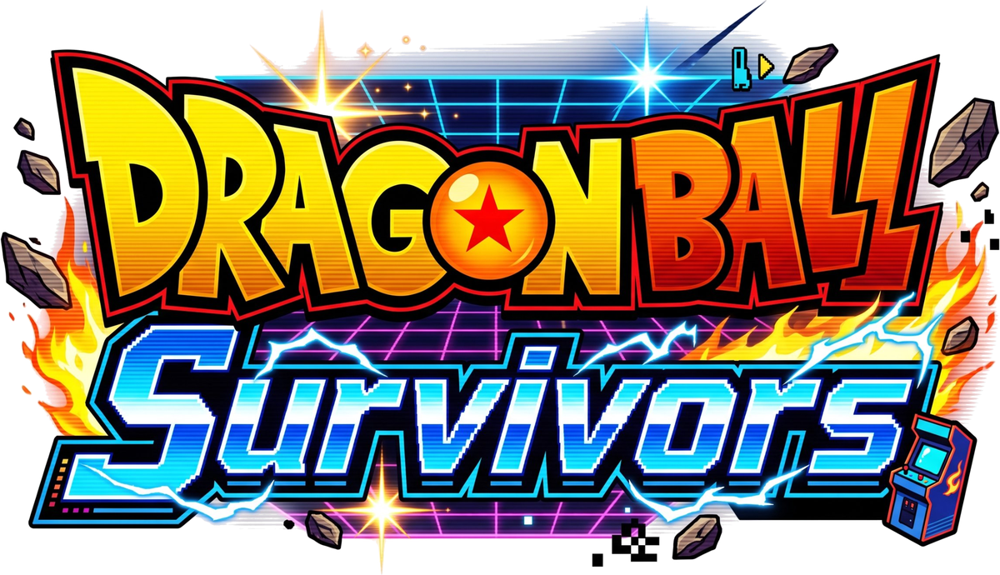
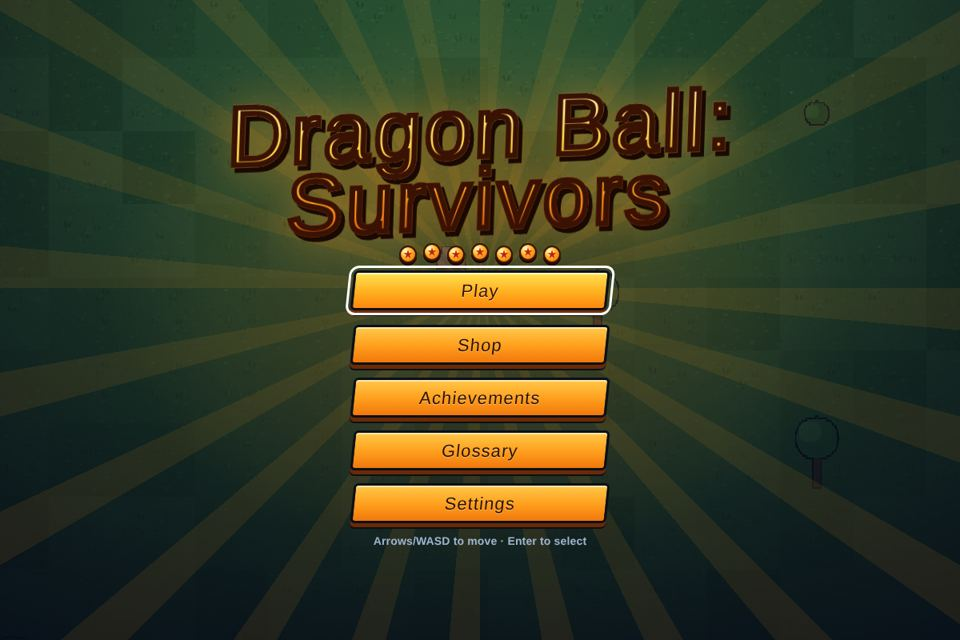
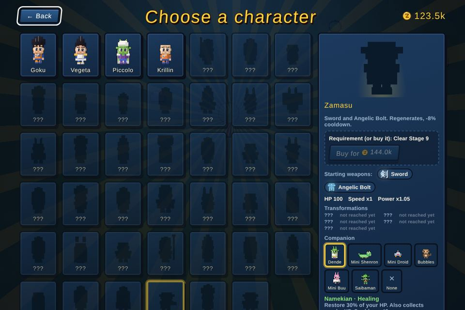

<p align="center"></p>

# Dragon Ball: Survivors

> 🇬🇧 English version: [README.en.md](README.en.md)

Un survivor-like in stile *Vampire Survivors* ispirato a Dragon Ball: ti muovi, le armi sparano da sole, raccogli esperienza, sali di livello, ti trasformi e sopravvivi fino al boss finale. Si gioca nel browser, da PC e da telefono, in **un solo file HTML** (Canvas 2D e JavaScript puro, nessuna dipendenza).

> ⚠️ Progetto amatoriale, non ufficiale e senza scopo di lucro. Non è affiliato a Toei Animation, Shueisha, Bandai Namco né agli eredi di Akira Toriyama. Vedi [DISCLAIMER.md](DISCLAIMER.md).



## Indice

1. [Come si gioca](#come-si-gioca)
2. [Controlli](#controlli)
3. [Modalità di gioco](#modalità-di-gioco)
4. [Dentro la partita](#dentro-la-partita)
5. [Personaggi, armi e trasformazioni](#personaggi-armi-e-trasformazioni)
6. [Cimeli e Gacha](#cimeli-e-gacha)
7. [Stage, nemici e boss](#stage-nemici-e-boss)
8. [Progressione permanente](#progressione-permanente)
9. [Online e co-op](#online-e-co-op)
10. [Schermate e opzioni](#schermate-e-opzioni)
11. [Build e sviluppo](#build-e-sviluppo)
12. [Struttura del progetto](#struttura-del-progetto)
13. [Licenza e crediti](#licenza-e-crediti)

---

## Come si gioca

1. Dal menu scegli **Gioca** (o **Avvio rapido**), poi lo stage, il personaggio, il **compagno** e quante armi portare (da 1 a 5).
2. Ti muovi tu: **le armi attaccano da sole**. Con `Tab` scegli chi colpire (il più vicino, quello con più o meno Salute, il boss).
3. I nemici lasciano **gemme di esperienza**: raccoglile per salire di livello e scegliere una carta (arma, potenziamento, ecc.).
4. Ai livelli giusti ti **trasformi** (Super Saiyan, Ultra Istinto…): ogni forma dà bonus per tutta la partita.
5. Sopravvivi **30 minuti**, poi sconfiggi il **boss finale** dello stage. Hai 30 secondi per raccogliere il bottino prima della schermata di vittoria.
6. Se muori tieni comunque gli zenny guadagnati. Con gli **zenny** compri potenziamenti permanenti nel Negozio, personaggi e ticket del Gacha.



## Controlli

### Tastiera e mouse

| Azione | Tasti |
|---|---|
| Muoversi | `W` `A` `S` `D` / frecce |
| Abilità del personaggio (Kaioken, Berserk, raggi, cloni, ferma tempo…) | `R` o `X` |
| Scatto (danni sul percorso e invulnerabilità breve) | `Shift` |
| Fagiolo Senzu (cura 50% e un bonus alle statistiche, dalla borsa) | `H` |
| Abilità del compagno | `Q` |
| Interagire (altari, totem, forzieri, Macchina dello Scambio, Stanza dello Spirito e del Tempo…) | `E` o `F` |
| Cambiare bersaglio delle armi | `Tab` |
| Pausa (mappa, statistiche, cronologia eventi, impostazioni) | `Esc` o `P` |
| Scegliere una carta nelle finestre di scelta | `1`–`9` (`0` = la decima) |
| Premere il pulsante evidenziato / uscire dalla Stanza dello Spirito e del Tempo | `Spazio` |
| Conferma / indietro nei menu | `Invio` o `Spazio` / `Esc` o `⌫` |
| Zoom della telecamera | rotella del mouse (50–150%, a passi del 10%) |
| Contatore FPS e diagnostica | `F2` o `` ` `` |

Il **Kamehameha** si carica tenendo premuto il tasto dell'abilità. Tutti i tasti si riassegnano da **Impostazioni → Comandi**.

### Gamepad

| Azione | Pulsante |
|---|---|
| Muoversi / menu | D-pad |
| Conferma / interagire | A |
| Indietro | B |
| Abilità del compagno | X |
| Abilità del personaggio | Y |
| Fagiolo Senzu | LB |
| Scatto | RB |
| Cambiare bersaglio | pressione dello stick sinistro |
| Pausa | Start |
| Diagnostica | Select |

### Telefono e tablet

Joystick virtuale a schermo e pulsanti grandi con le icone di **abilità**, **Scatto**, **Fagiolo Senzu**, **compagno** e **Interagisci** (`E`). L'interfaccia si rimpicciolisce per lasciare più campo visibile, la mappa in pausa si trascina con il dito.

---

## Modalità di gioco

| Modalità | Come funziona |
|---|---|
| **Classica** | Una partita da 30 minuti per stage che finisce con il boss finale. Una sola difficoltà: la sfida cresce col tempo (nemici più numerosi dal minuto 3, più forti ogni 5 minuti, miniboss e élite). |
| **x2** | Si sblocca raggiungendo il boss finale di uno stage: la partita dura la metà, l'esperienza è ridotta, i nemici sono più duri. Nessun moltiplicatore di zenny. |
| **Infinita** | Si sblocca vincendo lo stage («Continua»): le armi salgono fino al Lv 100, la ricarica può scendere a 0,2 s, il negozio di Zeno-sama compare ogni 5 minuti e ogni 50 livelli ricevi 100 monete mentre i nemici diventano più forti. Dal menu di pausa imposti priorità e scelta automatica dei potenziamenti. |
| **Avvio rapido** | Parte subito con l'ultimo personaggio e stage usati. |
| **Sfida settimanale** | Stesso stage, personaggio e seme per tutti per una settimana: il primo in classifica ti torna contro come fantasma. |
| **Co-op** | Fino a 4 giocatori nello stesso mondo (BETA). Vedi [Online e co-op](#online-e-co-op). |

---

## Dentro la partita

### Combattimento
- **Attacco automatico**: ogni arma ha il suo comportamento (proiettili, raggi, orbite, zone di fuoco, fulmini a catena, meteore…). I colpi pesano: numeri di danno arcade (rossi per i critici), combo, **Serie** di uccisioni con barra e fasce (50, 100, 200, 500).
- **Debolezze**: ogni boss ne ha una. Alcuni attacchi nemici si possono distruggere.
- **Ki Clash**, **Ultimo respiro**, alleati che arrivano in aiuto, cinematiche dei boss e delle trasformazioni (la telecamera si stringe e tutto si ferma finché l'aura esplode).
- **Level-up**: oltre alle carte puoi usare **Reroll**, **Skip** e **Ban** (strumenti del Negozio) e il level-up automatico con le tue priorità (Impostazioni).

### Che cosa trovi sulla mappa
Ogni partita ha una mappa diversa e viva (meteo, giorno/notte, mare e lava animati, creature, oggetti da rompere).

| Elemento | Cosa fa |
|---|---|
| **Forzieri** | Uno per boss e uno di rifornimento ogni 5 minuti, in cinque rarità, con potenziamenti e cimeli. |
| **Zenny e oggetti** | Monete, borse di zenny, cuori, magnete, potenziamenti temporanei, esperienza, Fortuna. I punti di bottino compaiono più spesso con il loot extra. |
| **Sfere del Drago** | Raccogline 7 per evocare **Shenron** (4 desideri proposti tra seconda vita, potere, fortuna, ticket, immortalità, trasformazione, leggenda). Le 3 **Super Sfere** custodite dai Tamagami chiamano **Porunga**. |
| **Altari e sorgenti** | Altare del Potere, Sorgente curativa, Altare del Sacrificio, Fonte dell'esperienza, Deposito di monete, Altari Sfida (boss più forti in cambio di più scrigni). Si usano con `E`. |
| **Totem** | 8 poteri: Fortuna, Rischio, Vitalità, Furia, Ricchezza, Guardiano, Tempesta, Spirito. |
| **Stanza dello Spirito e del Tempo** | Compri in anticipo la forma successiva (con almeno il 70% del livello richiesto) e affronti un Maestro che imita le tue armi. |
| **Macchina dello Scambio** | Compare in circa il 12% delle partite: ci metti fino a 3 cimeli, lavora ~10 secondi **mentre giochi** (barra di avanzamento sopra di lei) e ti restituisce cimeli diversi della stessa rarità, con perfezione uguale o migliore. |
| **Tunnel** | Ne compare uno ogni 15 minuti: tunnel a senso unico con un boss in fondo e 3 casse. |
| **Portale di Zeno** | Il negozio di Zeno-sama. |
| **Visite a sorpresa** | Un personaggio arriva con una missione da 60 secondi; Cerchio di allenamento, Capsule Corp, Saibaman d'oro che scappa col bottino. |
| **Trappole e zone di cura** | Rare ma pericolose o preziose. |
| **Eventi a tema** | Ogni stage ha un evento in cui i nemici si trasformano (annunci in 6 lingue). |
| **Orde, élite, miniboss** | Orde a tema (la prima a 2 minuti, poi una ogni 5) guidate da un élite, un miniboss ogni 5 minuti, nemici che salgono di grado. |

La mappa in pausa (grande, con zoom) mostra dove sono i pickup; frecce ai bordi dello schermo indicano gli oggetti importanti.

### Compagni
Dende, Mini Shenron, Mini Droide, Bubbles, Mini Bu e Saibaman: raccolgono l'esperienza lontana, hanno un'abilità (`Q`) e liberano un'onda d'urto quando sei circondato.

---

## Personaggi, armi e trasformazioni

### 58 personaggi giocabili
Ognuno ha armi di partenza, statistiche, una **linea di trasformazioni** (fino a 8 forme, con aura dipinta) e un'**abilità unica** con una versione potenziata nella forma finale.

| Linea | Personaggi |
|---|---|
| Saiyan | Goku, Vegeta, Trunks, Gohan, Goten, Gotenks, Vegito, Gogeta, Kefla, Raditz, Nappa, Bardock, Turles, Great Saiyaman, Caulifla, Kale, Broly |
| Namecciano | Piccolo, Nail, Re Piccolo |
| Umani | Crilin, Yamcha, Tenshinhan, Chiaotzu, Genio Tartaruga, Mr. Satan, Videl, Bulma, Yajirobe, Pan, Mr. Popo, Uub |
| Androidi | C-16, C-17, C-18, C-21, Dr. Gero |
| Freezer e truppe | Freezer, Cooler, Frost, Capitan Ginyu, Zarbon, Recoome, Guldo, Dabura |
| Cell · Majin | Cell · Majin Bu |
| Pride Troopers | Toppo, Hit, Jiren, Dyspo |
| Dei e Zamasu | Beerus, Whis, Re Kaioh, Zamasu, Goku Black, Zamasu Fuso, Zeno-sama |

Ne hai **4 subito** (Goku, Vegeta, Piccolo, Crilin); gli altri si sbloccano con una condizione (vincere stage, raggiungere un livello, sconfiggere tot nemici o boss) **oppure comprandoli** con zenny. La schermata **Achievement** dice cosa fare per ogni sblocco.

**Fusioni di personaggi**: Vegito e Gogeta (Potara / Metamoran), Gotenks, Kefla e Zamasu Fuso si giocano per una partita con entrambi i genitori a **Maestria 5**.

### Abilità
Kaioken (x10/x20), Berserk, Final Flash, Cannone Speciale, Taiyoken, Fendente Furioso, Raggio Dodon, Pugno Zanna di Lupo, cloni, Sfera della Giustizia, Super Ghost Kamikaze, barriere, assorbimento, ferma tempo, cancellazione, riavvolgimento, jackpot e altre. Quando usi un'abilità l'icona sale sopra l'eroe; se dura nel tempo vedi un anello che si svuota. Ogni abilità ha **icone dedicate** su pulsanti, schede e tooltip.

### 24 armi
Colpo di Ki, Kamehameha, Disco Distruttore, Genkidama, Aura, Taiyoken, Spada, Colpi Eccentrici, Raggio Perforante, Lancia Ribelle, Doppio Sunday, Cannone Distruttore, Danza Elegante, Boomerang Ginyu, Granata Infernale, Salto Temporale, Impatto Potente, Sfera della Distruzione, Fulmine Angelico, Meteora di Fusione, Big Bang Kamehameha, Cannone Garlick, Attacco Big Bang, Calcio Dinamite.

- Ogni arma sale fino al **Lv 5**, si **evolve** (forziere o condizione del Grimorio) e ha altri 5 livelli.
- **12 evoluzioni doppie** (fusioni di due armi, anche dal Grimorio): Tempesta di Ki, Kamehameha Finale, Lama Kienzan, Genkidama Universale, Aura Esplosiva, Giudizio Divino, Lance Infernali, Calcio Big Bang, Lampo del Tempo, Domenica Ginyu, Danza dell'Imperatore, Esplosione Finale.
- Le armi si sbloccano nella pool vincendo uno stage con un personaggio che parte con quell'arma. Con la **Lista Nera Armi** del Negozio puoi bandirne.
- Gli effetti sono **animazioni dipinte** (anche per le evoluzioni) con suoni 8-bit.

### 11 potenziamenti passivi
Zenkai (danno), Vigore (Salute), Volo veloce (velocità), Scouter (raccolta), Camera Gravitazionale (ricarica), Armatura da Battaglia, Fagioli Senzu (rigenerazione), Meditazione (esperienza), Quantità, Fortuna, Area. Alcuni servono anche per le evoluzioni.

### Fagioli Senzu e Scatto
La **borsa Senzu** (fino a 3) cura il 50% della Salute e alza una statistica per la partita. Lo **Scatto** fa danno sul percorso e dà invulnerabilità; ha una ricarica di pochi secondi.

---

## Cimeli e Gacha

**173 cimeli** in 5 rarità (Comune, Raro, Epico, Leggendario, Mitico), ognuno con statistiche e un effetto speciale. Ogni esemplare ha una **Perfezione da 0 a 100** (a 100 l'aura è quella dell'Ultra Istinto) e può avere statistiche extra.

- **Gacha**: ticket da 1 o da 10 estrazioni con animazione (apertura automatica, velocità regolabile), Super Sfere.
- **Borsa**: raccoglie i tuoi cimeli, con ordinamento, filtri per rarità e statistica (anche per quelle che contano), vendita e slot extra del Negozio.
- **Reroll**: rilancia la Perfezione (200 zenny a tiro, −2% ogni 10 tiri fino a −50%), con blocco delle statistiche e **auto reroll** fino a un obiettivo.
- **Fusione**: tre cimeli dello stesso tipo danno quello di rarità più alta con la migliore perfezione di ogni statistica; tre della stessa rarità la fanno salire di un grado.
- **In partita**: i cimeli si trovano nei forzieri; dopo il boss finale ne scegli 2 da portare nella Borsa. La **Macchina dello Scambio** li rigenera.

---

## Stage, nemici e boss

| # | Stage | Sblocco |
|---|---|---|
| 1 | Isola di Muten | — |
| 2 | Via del Serpente | vincere lo stage 1 |
| 3 | Pianura Saiyan | vincere lo stage 2 |
| 4 | Pianeta Vegeta | vincere lo stage 3 |
| 5 | Pianeta Namek | vincere lo stage 4 |
| 6 | Rovine degli Androidi | vincere lo stage 5 |
| 7 | Arena dei Cell Game | vincere lo stage 6 |
| 8 | Inferno | vincere lo stage 7 |
| 9 | Dimensione di Bu | vincere lo stage 8 |
| 10 | Regno degli Dei | vincere lo stage 9 |
| 11 | **Torneo del Potere** | vincere lo stage 10 |

Gli stage seguono l'ordine canonico di Dragon Ball (Dragon Ball → Z → Super). Ogni mappa ha la sua musica, i suoi ostacoli dipinti, il suo meteo e un evento a tema; la **Via del Serpente** è fatta di isole raggiungibili, il **Torneo del Potere** si combatte in un'arena circolare chiusa.

- **Nemici**: oltre 140 varianti con IA diverse (inseguimento, tiratori, kamikaze, schermati, schivatori…), con **gradi** che li rendono più forti e colorati col passare dei minuti.
- **Boss**: un centinaio tra boss e miniboss (Raditz, Nappa e Vegeta, Freezer e Cooler, Cell, Janemba, Omega Shenron, Jiren…). Si trasformano, hanno mosse firmate, una debolezza e un potenziamento in corso di partita. La **Guida/Glossario** descrive ogni nemico e boss.
- **Album dei nemici**: scoprirne 10, 25 e 50 dà premi.

---

## Progressione permanente

- **Negozio**: potenziamenti permanenti con costo crescente (Avidità, Studio, Vitalità, Rigenerazione, Danno, Agilità, Magnetismo, Armatura Saiyan, Ritmo, Fortuna, Area, Occhio Critico, Durata Raggi, Seconda Vita, Urlo di Broly!, Scanner Sfere del Drago, Quantità, Cimelio Extra, Lista Nera Armi, Reroll, Skip, Ban).
- **Achievement e Obiettivi**: centinaia di traguardi con premi in zenny e ticket (uccisioni, boss, collezione di cimeli, perfezione, fusioni, estrazioni…), più le **missioni giornaliere**.
- **Maestria**: ogni personaggio sale fino al Lv 10 giocandolo; al **Lv 5** ottieni una passiva e le fusioni di personaggi si sbloccano con i genitori a Maestria 5.
- **Patti**: 7 maledizioni volontarie (ferro, furia, orda, vento, cristallo, digiuno, oblio) per partite più dure e paga più alta.
- **Grimorio**: ricette di tutte le evoluzioni, requisiti e progressi per arma, con diario delle uccisioni.
- **Carriera**: tempo di gioco, partite, vittorie, nemici e boss sconfitti, arma e personaggio preferiti, nemici per saga.
- **Codici delle build**: copia il codice della tua build a fine partita e incolla quello di un amico per vederla.
- **Scheda di fine partita** da condividere, note di versione nel gioco (📜).

---

## Online e co-op

- **Account e cloud** (facoltativi): registrazione con email e password (con recupero tramite codice) o con Google; il salvataggio si sincronizza tra dispositivi, con gestione dei conflitti.
- **Classifiche** per stage e metrica, **Sfida settimanale** con il fantasma del primo, **eventi della comunità** settimanali.
- **Co-op (BETA)**: stanze con codice, amici, inviti, ricerca di compagni, chat e classifica. Fino a **4 giocatori** nella stessa partita; la scelta delle carte di uno non ferma gli altri.
- Controlli sul server e protezioni anti-cheat per le classifiche.

Senza account il gioco funziona benissimo anche **offline**: il salvataggio è nel browser (codificato).

---

## Schermate e opzioni

**Menu principale**: Gioca · Avvio rapido · Co-op · Crescita (Negozio, Gacha, Borsa) · Progressi (Sblocchi, Achievement, Carriera, Classifiche) · Opzioni · Grimorio · Guida/Glossario · Note di versione · Account.

**Opzioni**: lingua (**italiano, inglese, spagnolo, francese, tedesco, portoghese**), grafica (risoluzione dinamica, opacità e riduzione degli effetti, animazioni di morte, schermo intero, zoom), audio (musica, effetti, armi evolute più silenziose), gameplay (level-up automatico, priorità, Kamehameha, ticket), comandi riassegnabili per tastiera e gamepad.

**Tecnologia**: tutta la grafica è in pixel art, in parte generata dal codice e in parte dipinta (personaggi, aure, armi, mappe, icone); gli effetti sonori sono sintetizzati in stile 8-bit, la musica è in MP3 (una per mappa, più i temi dei boss). Il gioco regola da solo la risoluzione per restare fluido nelle fasi più affollate.

---

## Build e sviluppo

Servono **Python 3** (per il bundler) e, opzionalmente, **Node.js** (controlli di sintassi e test).

```bash
python3 build.py --check    # crea dist/dragon-ball-survivors.html e controlla la sintassi con node
```

Apri `dist/dragon-ball-survivors.html` in un browser moderno: è autosufficiente e funziona anche offline. Se `esbuild` è installato la pagina viene minificata.

- **Musica ed effetti**: file `assets/*.mp3` (vedi [assets/README.md](assets/README.md)); se mancano si usa audio sintetizzato.
- **Pubblicazione**: il workflow `.github/workflows/deploy.yml` costruisce il gioco e lo pubblica su GitHub Pages a ogni push su `main`.
- Il gioco si accorge da solo delle nuove versioni (`dist/version.json`) e propone di ricaricare.

## Struttura del progetto

```
build.py              bundler: unisce src/ e gli asset in un unico HTML
src/index.html        pagina
src/css/              stili (style, skin, gacha, mobile, loader)
src/js/
  util.js data.js     utilità e dati (armi, personaggi, stage, nemici, boss, cimeli, compagni, negozio…)
  i18n*.js            traduzioni (it, en, es, fr, de, pt)
  game.js             logica di gioco (senza DOM) e MapDirector (eventi, totem, stanze, Macchina dello Scambio)
  weapons*.js wfx.js  comportamento e animazioni dipinte delle armi
  world.js mapx.js …  mappe, terreno, ostacoli, isole, mare, lava, eventi a tema
  sprites*.js pose.js sprite procedurali e dipinti, pose delle armi
  renderer.js         disegno (canvas, HUD, effetti)
  ui*.js app.js       schermate, input, ciclo principale
  gacha.js ui_gacha.js ui_trin.js   Gacha, Borsa, Reroll, Fusione, Macchina dello Scambio
  save.js cloud.js    salvataggio, sincronizzazione e classifiche
  audio.js            effetti 8-bit sintetizzati e musica
assets/
  ui/                 logo, atlanti delle barre, menu, cornici delle carte
  icons/              icone: negozio, armi, cimeli, abilità, HUD
  sprites/            fogli sprite e sorgenti (vedi assets/sprites/README.md)
  *.mp3               musica ed effetti
tools/                script che generano atlanti e fogli sprite dalle sorgenti
tests/                simulazioni e test con Puppeteer (python3 tools/run_tests.py)
docs/                 logo e screenshot
```

```bash
python3 tools/run_tests.py   # esegue la batteria di test
node tests/check_i18n.js     # verifica le traduzioni in tutte le lingue
```

> Il bilanciamento è stato verificato anche con un bot volutamente debole: l'esperienza di una persona può essere più facile. Segnalazioni e proposte sono benvenute nelle issue.

## Licenza e crediti

Il **codice** è sotto licenza [MIT](LICENSE). Nomi, personaggi e marchi di Dragon Ball **non sono coperti** da questa licenza e appartengono ai rispettivi proprietari ([DISCLAIMER.md](DISCLAIMER.md)). Crediti di grafica e musica in [CREDITS.md](CREDITS.md).
